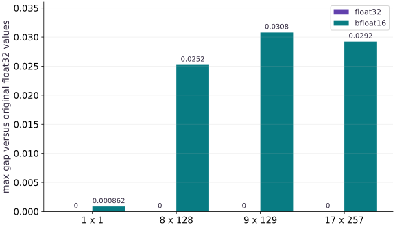

# Iterate with correctness and performance evidence

Phase 13: Pallas kernels · about 120 minutes · CPU

This worked reference is validated on CPU. Accelerator compatibility requires a separate source review and target execution receipt. Use the execution matrix to review device selection and data ownership before adapting a separate target program.

**Before this lesson:** [Tiling, memory, and pipelining](https://www.tahabouhsine.com/jaxpathways/lesson-kernels-03.html).

## What you will be able to do

- Build a representative shape/dtype correctness matrix for an actual Pallas pipeline.
- Separate kernel implementation error from input/output precision differences.
- Implement a guarded compile/warmup/synchronized target benchmark.
- Connect profiling, partitioning, tiling and numerical evidence to an optimization decision.

## The problem

A custom kernel is useful only if it stays correct when shapes and dtypes change and improves an actual workload. What evidence is enough to keep an optimization, and what should we do when no target hardware is available? We will build a repeatable audit and an executable target-only measurement protocol.

## The idea

A low-precision kernel can differ from a high-precision calculation because inputs changed representation, arithmetic changed, or the implementation is wrong. Separate these causes with references that answer different questions.

## Use two references to locate a precision gap

Two comparisons answer different questions. First compare the kernel with an oracle using the same represented inputs and output-cast rule; this tests the implementation. Then compare that oracle with the original float32 calculation; this reveals representation effects. In the retained audit, implementation error is zero for both dtypes on all four fixtures, while bfloat16 still differs from original float32 data. A correct low-precision contract can have a real precision gap.

$$
e_{\rm impl}=\lVert y_{\rm kernel}-y_{\rm represented\ ref}\rVert_\infty,\qquad e_{\rm total}=\lVert y_{\rm kernel}-y_{\rm original\ FP32\ ref}\rVert_\infty
$$

### Pause and reason

Which comparison should you inspect before blaming quantization for a wrong output?

<details><summary>Compare your reasoning</summary>

Compare against an independent reference on the same represented inputs. A mismatch there may be an implementation error rather than unavoidable representation error.

</details>

## Choose cases that challenge the contract

The fixture list moves from $(1,1)$ to exact tile $(8,128)$, then tails $(9,129)$ and $(17,257)$. The same frozen inputs are checked in float32 and bfloat16. This sequence challenges singleton indexing, aligned coverage, row/column tails and larger padding without changing the logical operation. Predict which shape can expose an off-by-one at the edge: either tail, unlike the aligned tile.

## Use two references for two different questions

The represented-input oracle promotes stored inputs to float32, computes $2X+Y$, then applies the declared output cast. Matching it means the kernel implements that dtype policy. Comparing with original float32 operands answers how much value changed through representation. For example, a represented input may round before computation even if the kernel is exact for that represented value; report these errors separately.

## Make target timing a complete operation

The target protocol compiles separately, warms five times and synchronizes each measured output. Inputs are already on device; the reported wrapper boundary includes padding, Pallas call and crop. That boundary matches what a caller receives. A kernel-only time would answer another question and should not be compared directly. The retained execution refuses to benchmark CPU interpretation.

## Compare a strong baseline with the same contract

Compare against jitted ordinary JAX using the same dtype, represented inputs, padding, output cast and measurement boundary; XLA may already fuse $2X+Y$. Report samples, median, 90th percentile, compile time and actual device so another learner can distinguish setup from steady state. This review's CPU receipt contains no target timing, so it cannot say which implementation is faster.

## Relate local kernels to the distributed workload

A local elementwise kernel cannot remove all-reduce, resharding or input staging. First use the workload profile to determine whether local compute, memory movement or communication dominates. Then measure the candidate in that same partitioned workload while preserving the global objective. A faster isolated operation can have little effect if another cost dominates.

## Accept, revise or decline the optimization

Keep a specialized kernel when representative correctness passes and target measurements improve the declared end-to-end boundary enough to justify its maintenance. If it is slower or unchanged, retain the simpler baseline. Here interpretation checks and precision comparisons are available, but the retained receipt has no target performance data; the honest result is that speed remains unmeasured.

## Derive a conditional end-to-end bound

A local speedup matters only in proportion to its measured share of total time. If the operation accounts for $p=0.3$ and becomes $s=2$ times faster, normalized total time is $0.7+0.3/2=0.85$, so total speedup is about 1.176. If its cost vanished, the limit is $1/0.7\approx1.429$. These are conditional calculations, not kernel or TPU measurements; reprofile if other costs change.

$$
S_{\rm total}=\frac{1}{(1-p)+p/s},\qquad S_{\rm limit}=\frac{1}{1-p}\quad(0\le p<1)
$$

### Pause and reason

Why is a twofold local improvement not necessarily a twofold application improvement?

<details><summary>Compare your reasoning</summary>

Only the fraction p changes in the model; the remaining fraction still takes time. Reprofile if the optimization also changes other work.

</details>

## Keep reference semantics, target mode and benchmark boundary together

Create main.py for the first block, then append each block in order in your course CPU environment.

```python
# Step 1 — Keep reference semantics, target mode and benchmark boundary together: The candidate uses the same checked Pallas pipeline.
import jax
import jax.numpy as jnp
import numpy as np
from jax.experimental import pallas as pl
from jax.experimental.pallas import tpu as pltpu

def validate_pair(x,y,block):
    if x.ndim!=2 or x.shape!=y.shape or min(x.shape)<1:
        raise ValueError("inputs must be nonempty matrices with identical shapes")
    if x.dtype!=y.dtype or x.dtype not in (jnp.float32,jnp.bfloat16):
        raise ValueError("matching float32 or bfloat16 inputs required")
    if len(block)!=2 or any(not isinstance(n,int) or n<1 for n in block):
        raise ValueError("two positive integer block dimensions required")

def pad_pair(x,y,block):
    validate_pair(x,y,block)
    m,n=x.shape
    bm,bn=block
    padded=((m+bm-1)//bm*bm,(n+bn-1)//bn*bn)
    pads=((0,padded[0]-m),(0,padded[1]-n))
    return jnp.pad(x,pads),jnp.pad(y,pads),padded

def axpy_body(x_ref,y_ref,out_ref):
    result=2.0*x_ref[...].astype(jnp.float32)+y_ref[...].astype(jnp.float32)
    out_ref[...]=result.astype(out_ref.dtype)

def blocked_axpy(x,y,block=(2,4)):
    px,py,padded=pad_pair(x,y,block)
    bm,bn=block
    spec=pl.BlockSpec(block,lambda i,j:(i,j))
    out=pl.pallas_call(axpy_body,
        out_shape=jax.ShapeDtypeStruct(padded,x.dtype),
        grid=(padded[0]//bm,padded[1]//bn),
        in_specs=(spec,spec),out_specs=spec,interpret=True)(px,py)
    return out[:x.shape[0],:x.shape[1]]

def pipelined_axpy(x,y,block=(8,128),buffers=2,no_pipelining=False,mode="simulate"):
    px,py,padded=pad_pair(x,y,block)
    bm,bn=block
    if bm%8 or bn%128:
        raise ValueError("pipeline blocks must be multiples of (8,128)")
    if buffers not in (2,3):
        raise ValueError("this lab supports two or three buffers")
    if mode not in ("simulate","tpu"):
        raise ValueError("mode must explicitly be simulate or tpu")
    if mode=="tpu" and (jax.default_backend()!="tpu" or any(not isinstance(a,jax.core.Tracer) and any(d.platform!="tpu" for d in a.devices()) for a in (x,y))):
        raise RuntimeError("Real TPU inputs/backend required; simulation fallback is disabled")
    spec=pl.BlockSpec(block,lambda i,j:(i,j),pipeline_mode=pl.Buffered(buffer_count=buffers))
    output_spec=pl.BlockSpec(block,lambda i,j:(i,j),pipeline_mode=pl.Buffered(buffer_count=2))
    def outer(x_hbm,y_hbm,out_hbm):
        pltpu.emit_pipeline(axpy_body,grid=(padded[0]//bm,padded[1]//bn),
            in_specs=(spec,spec),out_specs=output_spec,
            no_pipelining=no_pipelining)(x_hbm,y_hbm,out_hbm)
    whole=pl.BlockSpec(memory_space=pl.ANY)
    interpretation=pltpu.InterpretParams(detect_races=True) if mode=="simulate" else False
    call=pl.pallas_call(outer,out_shape=jax.ShapeDtypeStruct(padded,x.dtype),
        in_specs=(whole,whole),out_specs=whole,interpret=interpretation)
    if mode=="simulate":
        # This describes a SIMULATED TPU layout, not the machine running the code.
        abstract=jax.sharding.AbstractMesh((1,),("simulated_device",),
            abstract_device=jax.sharding.AbstractDevice(device_kind="TPU v5 lite",num_cores=1))
        with jax.sharding.use_abstract_mesh(abstract):
            output=call(px,py)
    else:
        output=call(px,py)
    return output[:x.shape[0],:x.shape[1]]

def target_benchmark(candidate,baseline,args,repeats=20):
    if jax.default_backend()!="tpu" or any(d.platform!="tpu" for a in args for d in a.devices()):
        raise RuntimeError("TPU benchmark requires real TPU inputs; interpretation timings are not accepted")
    if repeats<5:
        raise ValueError("at least five repeated target measurements required")
    import time
    records={}
    for label,function in (("candidate",candidate),("baseline",baseline)):
        started=time.perf_counter()
        # Wrap with `jax.jit` (`compiled`) so XLA traces and compiles the function.
        compiled=jax.jit(function).lower(*args).compile()
        compile_seconds=time.perf_counter()-started
        # Wait for device work to finish before timing it or comparing its result on the host.
        for _ in range(5):compiled(*args).block_until_ready()
        samples=[]
        for _ in range(repeats):
            started=time.perf_counter()
            # Wait for device work to finish before timing it or comparing its result on the host.
            compiled(*args).block_until_ready()
            samples.append((time.perf_counter()-started)*1000)
        records[label]={"compile_seconds":compile_seconds,"samples_ms":samples,
            "median_ms":float(np.median(samples)),"p90_ms":float(np.percentile(samples,90))}
    # Check which hardware backend (`cpu`, `gpu`, or `tpu`) JAX selected for `records['actual_backend']`.
    records["actual_backend"]=jax.default_backend()
    records["device_kind"]=jax.devices()[0].device_kind
    records["boundary"]="already-placed logical inputs; complete padded/cropped wrapper output; warm synchronized execution"
    return records
```

The candidate uses the same checked Pallas pipeline. The benchmark rejects CPU inputs before compiling or timing. It measures the complete wrapper, including padding/cropping, and records compilation separately.

## Audit a matrix of shapes and precisions

Create main.py for the first block, then append each block in order in your course CPU environment.

```python
# Step 2 — Audit a matrix of shapes and precisions
rng=np.random.default_rng(42)
correctness=[]
precision_gaps=[]
for shape in [(1,1),(8,128),(9,129),(17,257)]:
    original_x=rng.normal(size=shape).astype(np.float32)
    original_y=rng.normal(size=shape).astype(np.float32)
    ideal=2*original_x+original_y
    row=[]
    gaps=[]
    for dtype in (jnp.float32,jnp.bfloat16):
        a=jnp.asarray(original_x,dtype=dtype)
        b=jnp.asarray(original_y,dtype=dtype)
        actual=pipelined_axpy(a,b)
        represented=(2*a.astype(jnp.float32)+b.astype(jnp.float32)).astype(dtype)
        # Transfer the device result to the host for an independent NumPy comparison.
        np.testing.assert_array_equal(np.asarray(actual),np.asarray(represented))
        # Transfer the device result to the host for an independent NumPy comparison.
        error=float(np.max(np.abs(np.asarray(actual,dtype=np.float32)-np.asarray(represented,dtype=np.float32))))
        # Transfer the device result to the host for an independent NumPy comparison.
        gap=float(np.max(np.abs(np.asarray(actual,dtype=np.float32)-ideal)))
        row.append(error)
        gaps.append(gap)
    correctness.append(row)
    precision_gaps.append(gaps)
print("Kernel errors versus represented-input oracle:",correctness)
print("Gaps versus original float32 data:",precision_gaps)
```

A zero kernel error means the implementation honored the declared precision contract. A nonzero gap to the original float32 dataset measures representation and output rounding, which must be reported separately.

## Check the evidence boundary before requesting a speed claim

Create main.py for the first block, then append each block in order in your course CPU environment.

```python
# Step 3 — Check the evidence boundary before requesting a speed claim: The runnable target entry point is the project target_tpu.py script.
if jax.default_backend()=="cpu":
    probe=jnp.ones((8,128),dtype=jnp.float32)
    rejected=False
    try:target_benchmark(lambda a,b:pipelined_axpy(a,b,mode="tpu"),lambda a,b:2*a+b,(probe,probe))
    except RuntimeError as error:
        rejected=True
        print("Expected benchmark refusal:",error)
    assert rejected
print("CPU correctness audit complete; no TPU latency or speedup measured")
```

The runnable target entry point is the project target_tpu.py script. A missing target receipt remains a missing target receipt; the CPU result is not relabeled as performance data.

## Run the example

```python
# Step 1 — Keep reference semantics, target mode and benchmark boundary together: The candidate uses the same checked Pallas pipeline.
import jax
import jax.numpy as jnp
import numpy as np
from jax.experimental import pallas as pl
from jax.experimental.pallas import tpu as pltpu

def validate_pair(x,y,block):
    if x.ndim!=2 or x.shape!=y.shape or min(x.shape)<1:
        raise ValueError("inputs must be nonempty matrices with identical shapes")
    if x.dtype!=y.dtype or x.dtype not in (jnp.float32,jnp.bfloat16):
        raise ValueError("matching float32 or bfloat16 inputs required")
    if len(block)!=2 or any(not isinstance(n,int) or n<1 for n in block):
        raise ValueError("two positive integer block dimensions required")

def pad_pair(x,y,block):
    validate_pair(x,y,block)
    m,n=x.shape
    bm,bn=block
    padded=((m+bm-1)//bm*bm,(n+bn-1)//bn*bn)
    pads=((0,padded[0]-m),(0,padded[1]-n))
    return jnp.pad(x,pads),jnp.pad(y,pads),padded

def axpy_body(x_ref,y_ref,out_ref):
    result=2.0*x_ref[...].astype(jnp.float32)+y_ref[...].astype(jnp.float32)
    out_ref[...]=result.astype(out_ref.dtype)

def blocked_axpy(x,y,block=(2,4)):
    px,py,padded=pad_pair(x,y,block)
    bm,bn=block
    spec=pl.BlockSpec(block,lambda i,j:(i,j))
    out=pl.pallas_call(axpy_body,
        out_shape=jax.ShapeDtypeStruct(padded,x.dtype),
        grid=(padded[0]//bm,padded[1]//bn),
        in_specs=(spec,spec),out_specs=spec,interpret=True)(px,py)
    return out[:x.shape[0],:x.shape[1]]

def pipelined_axpy(x,y,block=(8,128),buffers=2,no_pipelining=False,mode="simulate"):
    px,py,padded=pad_pair(x,y,block)
    bm,bn=block
    if bm%8 or bn%128:
        raise ValueError("pipeline blocks must be multiples of (8,128)")
    if buffers not in (2,3):
        raise ValueError("this lab supports two or three buffers")
    if mode not in ("simulate","tpu"):
        raise ValueError("mode must explicitly be simulate or tpu")
    if mode=="tpu" and (jax.default_backend()!="tpu" or any(not isinstance(a,jax.core.Tracer) and any(d.platform!="tpu" for d in a.devices()) for a in (x,y))):
        raise RuntimeError("Real TPU inputs/backend required; simulation fallback is disabled")
    spec=pl.BlockSpec(block,lambda i,j:(i,j),pipeline_mode=pl.Buffered(buffer_count=buffers))
    output_spec=pl.BlockSpec(block,lambda i,j:(i,j),pipeline_mode=pl.Buffered(buffer_count=2))
    def outer(x_hbm,y_hbm,out_hbm):
        pltpu.emit_pipeline(axpy_body,grid=(padded[0]//bm,padded[1]//bn),
            in_specs=(spec,spec),out_specs=output_spec,
            no_pipelining=no_pipelining)(x_hbm,y_hbm,out_hbm)
    whole=pl.BlockSpec(memory_space=pl.ANY)
    interpretation=pltpu.InterpretParams(detect_races=True) if mode=="simulate" else False
    call=pl.pallas_call(outer,out_shape=jax.ShapeDtypeStruct(padded,x.dtype),
        in_specs=(whole,whole),out_specs=whole,interpret=interpretation)
    if mode=="simulate":
        # This describes a SIMULATED TPU layout, not the machine running the code.
        abstract=jax.sharding.AbstractMesh((1,),("simulated_device",),
            abstract_device=jax.sharding.AbstractDevice(device_kind="TPU v5 lite",num_cores=1))
        with jax.sharding.use_abstract_mesh(abstract):
            output=call(px,py)
    else:
        output=call(px,py)
    return output[:x.shape[0],:x.shape[1]]

def target_benchmark(candidate,baseline,args,repeats=20):
    if jax.default_backend()!="tpu" or any(d.platform!="tpu" for a in args for d in a.devices()):
        raise RuntimeError("TPU benchmark requires real TPU inputs; interpretation timings are not accepted")
    if repeats<5:
        raise ValueError("at least five repeated target measurements required")
    import time
    records={}
    for label,function in (("candidate",candidate),("baseline",baseline)):
        started=time.perf_counter()
        # Wrap with `jax.jit` (`compiled`) so XLA traces and compiles the function.
        compiled=jax.jit(function).lower(*args).compile()
        compile_seconds=time.perf_counter()-started
        # Wait for device work to finish before timing it or comparing its result on the host.
        for _ in range(5):compiled(*args).block_until_ready()
        samples=[]
        for _ in range(repeats):
            started=time.perf_counter()
            # Wait for device work to finish before timing it or comparing its result on the host.
            compiled(*args).block_until_ready()
            samples.append((time.perf_counter()-started)*1000)
        records[label]={"compile_seconds":compile_seconds,"samples_ms":samples,
            "median_ms":float(np.median(samples)),"p90_ms":float(np.percentile(samples,90))}
    # Include the selected backend in the run record so the result has runtime context.
    records["actual_backend"]=jax.default_backend()
    records["device_kind"]=jax.devices()[0].device_kind
    records["boundary"]="already-placed logical inputs; complete padded/cropped wrapper output; warm synchronized execution"
    return records

# Step 2 — Audit a matrix of shapes and precisions
rng=np.random.default_rng(42)
correctness=[]
precision_gaps=[]
for shape in [(1,1),(8,128),(9,129),(17,257)]:
    original_x=rng.normal(size=shape).astype(np.float32)
    original_y=rng.normal(size=shape).astype(np.float32)
    ideal=2*original_x+original_y
    row=[]
    gaps=[]
    for dtype in (jnp.float32,jnp.bfloat16):
        a=jnp.asarray(original_x,dtype=dtype)
        b=jnp.asarray(original_y,dtype=dtype)
        actual=pipelined_axpy(a,b)
        represented=(2*a.astype(jnp.float32)+b.astype(jnp.float32)).astype(dtype)
        # Transfer the device result to the host for an independent NumPy comparison.
        np.testing.assert_array_equal(np.asarray(actual),np.asarray(represented))
        # Transfer the device result to the host for an independent NumPy comparison.
        error=float(np.max(np.abs(np.asarray(actual,dtype=np.float32)-np.asarray(represented,dtype=np.float32))))
        # Transfer the device result to the host for an independent NumPy comparison.
        gap=float(np.max(np.abs(np.asarray(actual,dtype=np.float32)-ideal)))
        row.append(error)
        gaps.append(gap)
    correctness.append(row)
    precision_gaps.append(gaps)
print("Kernel errors versus represented-input oracle:",correctness)
print("Gaps versus original float32 data:",precision_gaps)

# Step 3 — Check the evidence boundary before requesting a speed claim: The runnable target entry point is the project target_tpu.py script.
if jax.default_backend()=="cpu":
    probe=jnp.ones((8,128),dtype=jnp.float32)
    rejected=False
    try:target_benchmark(lambda a,b:pipelined_axpy(a,b,mode="tpu"),lambda a,b:2*a+b,(probe,probe))
    except RuntimeError as error:
        rejected=True
        print("Expected benchmark refusal:",error)
    assert rejected
print("CPU correctness audit complete; no TPU latency or speedup measured")
```

Expected: All eight shape/dtype cases exactly match the represented-input oracle. bfloat16 differs from original float32 values by a separately reported precision gap. The benchmark refuses CPU execution; no target speedup is reported.

## Precision gaps remain after kernel correctness passes

**Predict:** Can a kernel have zero implementation error and still differ from the original higher-precision data?



**Recorded CPU computation**

### Read the figure

The x-axis lists frozen matrix shapes $(1,1)$, $(8,128)$, $(9,129)$, $(17,257)$; the y-axis is maximum absolute gap from the original float32 result. Float32 bars are all zero. Bfloat16 gaps are about 0.000862, 0.02522, 0.03079 and 0.02922 respectively. Compare the two series at each fixture: the largest gap is $(9,129)$, not the largest shape. Predict whether zero implementation error rules out this gap; it does not, because the references use different represented inputs.

### Connect it to the computation

The execution reports zero kernel error against the represented-input oracle for all eight shape/dtype cases, then reports the bfloat16 gaps plotted here against original float32 values. The bars therefore show representation difference, not implementation failure. No bar represents latency, memory use or target execution. Before changing indexing, check which reference fails; before claiming speed, obtain a real target measurement.

```python
labels=['1 x 1','8 x 128','9 x 129','17 x 257']
visual_data={'kind':'bar','labels':labels,'ylabel':'max gap versus original float32 values','series':[{'label':'float32','y':[r[0] for r in precision_gaps]},{'label':'bfloat16','y':[r[1] for r in precision_gaps]}]}
```

## Recorded reference execution

CPU run: 2026-10-27T17:15:07.844054+00:00. JAX 0.9.2.

```text
Kernel errors versus represented-input oracle: [[0.0, 0.0], [0.0, 0.0], [0.0, 0.0], [0.0, 0.0]]
Gaps versus original float32 data: [[0.0, 0.000862419605255127], [0.0, 0.025217056274414062], [0.0, 0.030788421630859375], [0.0, 0.0292205810546875]]
Expected benchmark refusal: TPU benchmark requires real TPU inputs; interpretation timings are not accepted
CPU correctness audit complete; no TPU latency or speedup measured
Kernel errors versus represented-input oracle: [[0.0, 0.0], [0.0, 0.0], [0.0, 0.0], [0.0, 0.0]]
Gaps versus original float32 data: [[0.0, 0.000862419605255127], [0.0, 0.025217056274414062], [0.0, 0.030788421630859375], [0.0, 0.0292205810546875]]
Expected benchmark refusal: TPU benchmark requires real TPU inputs; interpretation timings are not accepted
CPU correctness audit complete; no TPU latency or speedup measured
Joint row permutation preserves output identity
Early/final-only rounding: 1.0 1.0078125
Configuration, padded elements: (8, 128) 2 4096
Configuration, padded elements: (8, 128) 3 4096
Configuration, padded elements: (16, 256) 2 4096
Configuration, padded elements: (16, 256) 3 4096
Mixed and integer dtypes rejected
Modeled twofold-local speedup and zero-cost limit: 1.1764705882352942 1.4285714285714286
PASS: kernels-04

```

## Preserve correctness under a joint row permutation

**Predict before running:** Will permuting both input rows change any value after restoring the order?

```python
# Experiment — Preserve correctness under a joint row permutation: This operation has no coupling between rows.
a=jnp.asarray(rng.normal(size=(9,129)),dtype=jnp.float32)
b=jnp.asarray(rng.normal(size=(9,129)),dtype=jnp.float32)
order=jnp.array([8,0,7,1,6,2,5,3,4])
inverse=jnp.argsort(order)
original=pipelined_axpy(a,b)
permuted=pipelined_axpy(a[order],b[order])[inverse]
# Transfer the device result to the host for an independent NumPy comparison.
np.testing.assert_array_equal(np.asarray(permuted),np.asarray(original))
print("Joint row permutation preserves output identity")
```

**Expected:** The restored output is identical.

This operation has no coupling between rows. A failure suggests ownership or data-pairing errors rather than ordinary floating-point variability.

## Make a precision-policy counterexample

**Predict before running:** Will rounding an intermediate bfloat16 value always equal one final output cast?

```python
# Experiment — Make a precision-policy counterexample
first=jnp.array([1.00390625],dtype=jnp.float32)
second=jnp.array([0.00390625],dtype=jnp.float32)
early=(first.astype(jnp.bfloat16).astype(jnp.float32)+second).astype(jnp.bfloat16)
late=(first+second).astype(jnp.bfloat16)
assert float(early[0])!=float(late[0])
print("Early/final-only rounding:",float(early[0]),float(late[0]))
```

**Expected:** Early rounding yields 1.0 while one final cast yields 1.0078125.

The order of representation changes is part of the numerical algorithm. A reference must reflect the declared contract rather than a superficially similar expression.

## Make it yours

Add a (15,255) fixture, compare two tile choices and two buffer counts, and retain the same frozen inputs for every candidate. Report errors and padded work separately.

### How to write this exercise — Step-by-step recipe & starter scaffold

**Inputs:**
- Two frozen float32 inputs shaped (15,255), generated once for all candidates.
- Two tile choices, (8,128) and (16,256), and two/three input-buffer counts.

**Outputs:**
- Numerical error against the independent NumPy expression for each candidate.
- Padded work calculated from tile geometry and reported separately from numerical error.

**Invariants to check:**
- All candidates receive the same input arrays.
- Logical output shape remains (15,255); error and padded work are distinct measurements.

**Hints:**
- Generate the matrix once, outside the candidate loop.
- Compute padded work from launch geometry rather than wall-clock time.

**Starter code scaffold (fill in the TODOs):**

```python
import numpy as np

def compare_kernel_candidates(run_candidate, first, second, tiles, input_buffer_counts):
    # TODO: keep the fixture fixed while comparing each tile/buffer combination.
    raise NotImplementedError("Compare numerical error and padded work on identical inputs")
```

<details><summary>Reference solution</summary>

```python
# Exercise solution
a=jnp.asarray(np.random.default_rng(8).normal(size=(15,255)),dtype=jnp.float32)
b=jnp.asarray(np.random.default_rng(9).normal(size=(15,255)),dtype=jnp.float32)
# Transfer the device result to the host for an independent NumPy comparison.
expected=2*np.asarray(a)+np.asarray(b)
for block in [(8,128),(16,256)]:
    for buffers in (2,3):
        result=pipelined_axpy(a,b,block,buffers=buffers)
        np.testing.assert_allclose(result,expected,rtol=1e-6,atol=1e-6)
        gm=(15+block[0]-1)//block[0]
        gn=(255+block[1]-1)//block[1]
        print("Configuration, padded elements:",block,buffers,gm*gn*block[0]*block[1])
```

</details>

## Reject unsupported dtype mixing

**Practice**

Pass a float32 matrix and a bfloat16 matrix together, then pass integer arrays. Verify neither is silently coerced into an undocumented kernel contract.

<details><summary>Hint</summary>

The wrapper promises matching float32 or bfloat16 inputs.

</details>

### How to write: Reject unsupported dtype mixing — Step-by-step recipe & starter scaffold

**Inputs:**
- Float32 and bfloat16 matrices plus integer matrix inputs.
- A wrapper with an observable launch callback.

**Outputs:**
- Rejection for mixed floating dtypes and integer inputs before launch.

**Invariants to check:**
- The wrapper does not silently cast unsupported inputs.
- No launch occurs on either invalid case.

**Hints:**
- Compare declared dtype contracts before conversion or dispatch.
- Test each invalid pair independently.

**Starter code scaffold (fill in the TODOs):**

```python
def reject_unsupported_dtypes(wrapper, float_matrix, bf16_matrix, integer_matrix):
    # TODO: assert mixed and integer inputs fail before launch.
    raise NotImplementedError("Enforce the documented same-floating-dtype contract")
```

<details><summary>Reference solution and reasoning</summary>

```python
# Reject unsupported dtype mixing (Practice): Supported dtype boundaries are a correctness decision.
for first,second in [(jnp.ones((8,128),jnp.float32),jnp.ones((8,128),jnp.bfloat16)),(jnp.ones((8,128),jnp.int32),jnp.ones((8,128),jnp.int32))]:
    rejected=False
    try:pipelined_axpy(first,second)
    except ValueError:rejected=True
    assert rejected
print("Mixed and integer dtypes rejected")
```

Supported dtype boundaries are a correctness decision. Adding a new dtype requires a reference, target support and justified tolerances.

</details>

## Bound the end-to-end opportunity

**Challenge**

A profile attributes $30\%$ of time to a local operation. Derive the best end-to-end speedup if that operation becomes twice as fast, then the impossible-to-exceed limit if its cost vanished.

<details><summary>Hint</summary>

Keep the remaining workload time unchanged in the calculation.

</details>

### How to write: Bound the end-to-end opportunity — Step-by-step recipe & starter scaffold

**Inputs:**
- Amdahl fraction 0.30 and local speedup 2.0.

**Outputs:**
- End-to-end speedup for the stated improvement and the zero-cost limit.

**Invariants to check:**
- Unaccelerated fraction remains unchanged.
- The limiting result is finite and bounded by the accelerated fraction.

**Hints:**
- Apply S=1/((1-p)+p/s).
- Set s to infinity for the zero-cost limit.

**Starter code scaffold (fill in the TODOs):**

```python
def amdahl_bounds(fraction, local_speedup):
    # TODO: return achieved and asymptotic end-to-end speedup.
    raise NotImplementedError("Bound system-level gains from a local optimization")
```

<details><summary>Reference solution and reasoning</summary>

```python
# Bound the end-to-end opportunity (Challenge): These are conditional analytic estimates, not measured speedups.
fraction=.3
local_speedup=2.0
end_to_end=1/((1-fraction)+fraction/local_speedup)
limit=1/(1-fraction)
np.testing.assert_allclose(end_to_end,1.1764705882352942)
np.testing.assert_allclose(limit,1.4285714285714286)
print("Modeled twofold-local speedup and zero-cost limit:",end_to_end,limit)
```

These are conditional analytic estimates, not measured speedups. Communication or scheduling changes can alter the fraction, so reprofile the complete workload.

</details>

## Check your understanding

The kernel matches the represented-input oracle exactly but differs from the original float32 dataset in bfloat16. What should the report say?

1. The kernel is necessarily incorrect.
2. The interpretation proves TPU throughput.
3. Implementation correctness passed for the declared precision policy; the separate representation gap must still be reported.

<details><summary>Answer and explanation</summary>

**1. The kernel is necessarily incorrect.**

First compare against an oracle using the same represented operands. Error from casting the original FP32 inputs is a separate numerical budget.

**2. The interpretation proves TPU throughput.**

Numerical agreement says nothing about TPU throughput. Native lowering and target timing need separate evidence.

**3. Implementation correctness passed for the declared precision policy; the separate representation gap must still be reported. (correct)**

The references answer different questions. Correct execution of a low-precision contract does not imply identical values to a higher-precision dataset.

</details>

## Diagnose the result

If bfloat16 disagrees only with the original float32 data, check whether the represented-input oracle still passes before calling it a kernel bug. If timings are implausibly tiny, inspect synchronization and device placement. If a local speedup fails to improve the training step, reprofile communication and other unchanged work. Never replace missing target evidence with simulated-device labels.

## Carry forward

- Choose cases that challenge the contract
- Use two references for two different questions
- Make target timing a complete operation
- Compare a strong baseline with the same contract
- Relate local kernels to the distributed workload
- Accept, revise or decline the optimization

## Keep your evidence

Shape/dtype reference checks, separate precision gaps, guarded target benchmark and a bounded end-to-end speedup argument. Keep the environment, observed outputs and your explanation of the figure.

Save your predictions, modified code, terminal outputs, and reasoning in your engineering portfolio.

## Primary references

- [Pallas grids and block specifications](https://docs.jax.dev/en/latest/pallas/grid_blockspec.html)
- [Writing TPU kernels: layout and memory restrictions](https://docs.jax.dev/en/latest/pallas/tpu/details.html)
- [TPU pipelining and emit_pipeline](https://docs.jax.dev/en/latest/pallas/tpu/pipelining.html)
- [TPU interpretation is simulation, not target execution](https://docs.jax.dev/en/latest/_autosummary/jax.experimental.pallas.tpu.InterpretParams.html)

