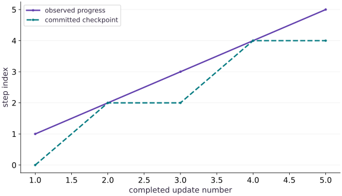

# Health, logs, and workload observability

Phase 16: Workload operations · about 85 minutes · CPU

This worked reference is validated on CPU. Accelerator compatibility requires a separate source review and target execution receipt. Use the execution matrix to review device selection and data ownership before adapting a separate target program.

**Before this lesson:** [Accelerator jobs and runtime lifecycle](https://www.tahabouhsine.com/jaxpathways/lesson-operations-01.html).

## What you will be able to do

- Build useful summaries from structured events emitted by a real worker.
- Define throughput with explicit numerator, denominator and synchronization boundary.
- Estimate uncheckpointed work from progress and checkpoint events.

## The problem

A process is alive and prints messages, yet useful training may have stopped. What signals distinguish real progress from noise, and what could be lost if the process fails now? We will measure synchronized updates, count examples and compare progress with the latest committed checkpoint using events emitted by actual runs.

## The idea

Logs tell us what a process reported; accepted checkpoints tell us what can be resumed. Monitoring should connect these signals without treating them as interchangeable. Their difference helps estimate the consequences of a failure.

## Keep observed progress separate from recoverable progress

Monitoring is useful when its counters identify distinct facts. `progress.step` is work completed in memory; a `checkpoint` event is state replaced on disk. In the failed drill, events report steps 1 through 5, but the accepted checkpoint is step 4. That one-step gap is one completed update, or 8 examples at this run's batch size, which may need replay.

The figure plots both counters against completed update number: progress reaches 5 while the saved line ends at 4. A flat checkpoint line between its writes is expected; a flat progress line may be a stall, blocked logger, or failed collector. Check the process and another signal before deciding which. The next useful question is whether the mismatch is only expected checkpoint cadence or a missing progress event.

### Pause and reason

Does a recent log line prove that its reported step is durable?

<details><summary>Compare your reasoning</summary>

No. It proves the observation reached the log. Recovery durability depends on the accepted checkpoint and storage contract.

</details>

## An event needs meaning and units

Each `progress` record carries a step, loss, example count, synchronized update seconds, and a hash of the resulting state. A `checkpoint` record names the step actually accepted on disk. A heartbeat would only say that a process responded; it must not add examples or advance the training counter. The monotonic timestamps support durations within this process, not clock comparisons across machines. When you inspect a trace, use event type and unit together rather than treating every increasing number as progress.

## Time completed computation

JAX can return control before device work has finished. The worker calls `block_until_ready` before stopping the update timer, so `update_s` includes dispatch plus completion of that compiled minibatch. It excludes import, compilation, JSON logging, and checkpoint writes; warmup has its own event. A dispatch-only timer would make the update look faster than the completed work actually was. Compare timers only when their start and stop boundaries match.

## Two throughputs answer different questions

In the healthy run, 12 updates process 96 examples. Dividing by summed synchronized update time estimates the compiled update path; dividing the same 96 examples by supervisor wall time includes startup and checkpointing, so it is lower for this short job. The execution record reports that split directly. Neither rate is accelerator utilization: to answer a utilization question you need a device-specific counter, not examples divided by seconds.

$$
q_{\mathrm{update}}=\frac{N}{\sum_i t_i},\qquad q_{\mathrm{job}}=\frac{N}{T_{\mathrm{wall}}}
$$

## Freshness is about committed progress

Checkpoint cadence is every two updates. The injected failure occurs after update 5, leaving step 4 as the newest committed state and one completed update, 8 examples, outside it. That gap estimates replayable work, not recovery time: a slow checkpoint write or a different batch duration changes seconds at risk. For a time estimate, use measured update durations and say whether the final in-flight update completed.

$$
\mathrm{uncommitted\ updates}=\max(0,\mathrm{last\ progress\ step}-\mathrm{checkpoint\ step})
$$

## A declining loss is not a health guarantee

This fixture trains a line with sampled minibatches and momentum, so loss can rise when the next minibatch is harder or momentum overshoots. A lower loss does not verify fresh data or a durable checkpoint; a noisy loss does not prove a stall. Use the loss to inspect optimization, and event cadence plus the process handle to inspect liveness. The signals answer different questions.

## Scope of this collector

This worker captures stdout and stderr in memory and parses a few dozen events after exit. That makes the record easy to inspect, but it does not provide streaming alerts or a durable fleet log. A long-lived service needs bounded streaming, a persistent sink, aligned timestamps, and monitoring for queue backpressure. The lesson's concrete result is the local event trace and its checkpoint gap, not a production telemetry service.

## Compute a rate over one declared interval

Use one numerator and the matching measured interval.

```python
def rate_per_second(count, seconds):
    return count / seconds if seconds else 0.
```

The helper is used for both synchronized update time and whole-job wall time.

## Compute the recoverability gap

Compare observed progress with the accepted checkpoint.

```python
def checkpoint_gap(last_step, checkpoint_step):
    return max(0, last_step - checkpoint_step)
```

A log line and a durable checkpoint represent different boundaries.

## Translate missing updates into examples

Change the batch size only after interpreting the logged steps.

```python
def checkpointed_examples(last_step, checkpoint_step, batch_size):
    return checkpoint_gap(last_step, checkpoint_step) * batch_size
```

The count is meaningful because the fixture uses a fixed batch size.

## Run the example

```python
# Complete runnable example (operations-02)
"""Bounded local JAX subprocess supervisor and lifecycle verifier."""
from pathlib import Path
import hashlib
import json
import math
import os
import subprocess
import sys
import tempfile
import time


def digest(value):
    return hashlib.sha256(json.dumps(value, sort_keys=True, separators=(',', ':'), allow_nan=False).encode()).hexdigest()


def atomic_json(path, value):
    """Replace one local JSON file only after its bytes have been flushed."""
    path = Path(path)
    path.parent.mkdir(parents=True, exist_ok=True)
    fd, temporary = tempfile.mkstemp(prefix=path.name+'.', suffix='.tmp', dir=path.parent)
    try:
        with os.fdopen(fd, 'w') as stream:
            json.dump(value, stream, sort_keys=True, allow_nan=False)
            stream.flush()
            os.fsync(stream.fileno())
        os.replace(temporary, path)
    finally:
        if os.path.exists(temporary):
            os.unlink(temporary)

def rate_per_second(count, seconds):
    return count / seconds if seconds else 0.

def checkpoint_gap(last_step, checkpoint_step):
    return max(0, last_step - checkpoint_step)

def checkpointed_examples(last_step, checkpoint_step, batch_size):
    return checkpoint_gap(last_step, checkpoint_step) * batch_size

# This file is materialized only inside the caller-owned temporary run folder.
WORKER = r'''
import hashlib, json, os, sys, time
from pathlib import Path
import jax
import jax.numpy as jnp
import numpy as np
root = Path(sys.argv[1])
cfg = json.loads((root/'config.json').read_text())
worker_hash = hashlib.sha256(Path(__file__).read_bytes()).hexdigest()
def emit(event, **fields):
    print(json.dumps(dict(event=event, monotonic_s=time.monotonic(), **fields)), flush=True)
def digest(value):
    return hashlib.sha256(json.dumps(value,sort_keys=True,separators=(',', ':'),allow_nan=False).encode()).hexdigest()
def write_checkpoint(state):
    target = root/'checkpoint.json'
    temporary = root/'checkpoint.pending'
    with temporary.open('w') as stream:
        json.dump(dict(state,checksum=digest(state)),stream,sort_keys=True,allow_nan=False)
        stream.flush()
        os.fsync(stream.fileno())
    os.replace(temporary,target)
    emit('checkpoint',step=state['step'],state_hash=digest(state))
try:
    emit('started',pid=os.getpid(),backend=jax.default_backend(),device_count=jax.device_count())
    if jax.default_backend() != cfg['backend'] or jax.device_count() < cfg['min_devices']:
        raise ValueError('runtime backend/device contract failed')
    x = jnp.linspace(-1.,1.,64)
    y = 2*x+1
    data_hash = digest(dict(x=np.asarray(x).tolist(),y=np.asarray(y).tolist()))
    training = {name:cfg[name] for name in ('seed','learning_rate','momentum','batch_size')}
    config_hash = digest(training)
    if cfg['resume']:
        saved = json.loads((root/'checkpoint.json').read_text())
        checksum = saved.pop('checksum',None)
        if checksum != digest(saved) or saved.get('worker_hash') != worker_hash:
            raise ValueError('checkpoint checksum/source mismatch')
        if saved['schema_version'] != 1 or saved['config_hash'] != config_hash or saved['data_hash'] != data_hash:
            raise ValueError('checkpoint provenance mismatch')
        state = saved
        step = saved['step']
        params=jnp.array(saved['params'])
        velocity=jnp.array(saved['velocity'])
        key=jnp.array(saved['key'],dtype=jnp.uint32)
        if not isinstance(step,int) or isinstance(step,bool) or step < 0 or step > cfg['steps'] or params.shape != (2,) or velocity.shape != (2,) or key.shape != (2,):
            raise ValueError('invalid checkpoint state shape or step')
        if not bool(jnp.all(jnp.isfinite(params))) or not bool(jnp.all(jnp.isfinite(velocity))):
            raise ValueError('nonfinite checkpoint state')
        emit('restored',step=step,state_hash=digest(saved))
    else:
        step=0
        params=jnp.zeros(2)
        velocity=jnp.zeros(2)
        key=jax.random.PRNGKey(cfg['seed'])
    def update(params,velocity,key):
        key, sample = jax.random.split(key)
        indices=jax.random.choice(sample,64,(cfg['batch_size'],),replace=False)
        objective=lambda p:jnp.mean((p[0]*x[indices]+p[1]-y[indices])**2)
        loss, grad=jax.value_and_grad(objective)(params)
        velocity=cfg['momentum']*velocity+grad
        params=params-cfg['learning_rate']*velocity
        return params,velocity,key,loss
    compiled=jax.jit(update)
    # Compile and synchronize once without consuming actual training state.
    begin=time.perf_counter()
    warm=compiled(params,velocity,key)
    jax.block_until_ready(warm)
    emit('ready',compile_warmup_s=time.perf_counter()-begin,step=step)
    while step < cfg['steps']:
        if cfg.get('stall_at') == step:
            emit('stall_injected',step=step)
            time.sleep(cfg.get('stall_seconds',10.))
        begin=time.perf_counter()
        params,velocity,key,loss=compiled(params,velocity,key)
        jax.block_until_ready((params,velocity,key,loss))
        elapsed=time.perf_counter()-begin
        step+=1
        state=dict(schema_version=1,worker_hash=worker_hash,step=step,params=np.asarray(params).tolist(),velocity=np.asarray(velocity).tolist(),key=np.asarray(key).tolist(),config_hash=config_hash,data_hash=data_hash)
        emit('progress',step=step,loss=float(loss),examples=cfg['batch_size'],update_s=elapsed,state_hash=digest(state))
        if step % cfg['checkpoint_every'] == 0 or step == cfg['steps']:
            write_checkpoint(state)
        if cfg.get('fail_after') == step:
            raise RuntimeError('controlled failure after update')
    write_checkpoint(state)
    emit('completed',step=step,state_hash=digest(state))
except Exception as error:
    emit('failed',kind=type(error).__name__,message=str(error))
    raise SystemExit(23)
'''

# Step 3 — Add bounded launch and result collection
def default_config(**changes):
    cfg=dict(seed=3,learning_rate=.04,momentum=.8,batch_size=8,steps=8,
             checkpoint_every=2,backend='cpu',min_devices=1,resume=False,
             fail_after=None,stall_at=None,stall_seconds=10.)
    # Apply configuration overrides before validating the resulting fields.
    cfg.update(changes)
    for name in ('steps','checkpoint_every','batch_size','min_devices'):
        if not isinstance(cfg[name],int) or isinstance(cfg[name],bool) or cfg[name] < 1:
            raise ValueError(name+' must be a positive integer')
    if cfg['batch_size'] > 64 or not 0 <= cfg['momentum'] < 1 or not 0 < cfg['learning_rate'] < 1:
        raise ValueError('invalid training configuration')
    return cfg


def launch(root, config=None, timeout=10.):
    root=Path(root)
    root.mkdir(parents=True,exist_ok=True)
    cfg=default_config(**(config or {}))
    if timeout <= 0:
        raise ValueError('timeout must be positive')
    atomic_json(root/'config.json',cfg)
    worker=root/'worker.py'
    worker.write_text(WORKER)
    env=dict(os.environ,JAX_PLATFORMS=cfg['backend'],PYTHONUNBUFFERED='1')
    started=time.perf_counter()
    process=subprocess.Popen([sys.executable,str(worker),str(root)],stdout=subprocess.PIPE,stderr=subprocess.PIPE,text=True,env=env)
    timed_out=False
    try:
        stdout,stderr=process.communicate(timeout=timeout)
    except subprocess.TimeoutExpired:
        timed_out=True
        process.terminate()
        try:
            stdout,stderr=process.communicate(timeout=1.)
        except subprocess.TimeoutExpired:
            process.kill()
            stdout,stderr=process.communicate(timeout=1.)
    wall=time.perf_counter()-started
    events=[]
    malformed=[]
    for line in stdout.splitlines():
        if not line.strip():
            continue
        try:
            event=json.loads(line)
            if not isinstance(event,dict) or 'event' not in event:
                raise ValueError('not an event')
            events.append(event)
        except (ValueError,TypeError):
            malformed.append(line)
    status='timed_out' if timed_out else 'completed' if process.returncode == 0 and not malformed and events and events[-1]['event']=='completed' else 'failed'
    result=dict(status=status,returncode=process.returncode,wall_s=wall,events=events,stderr=stderr,
                worker_hash=hashlib.sha256(WORKER.encode()).hexdigest(),config=cfg,malformed_stdout=malformed)
    atomic_json(root/'run.json',result)
    return result

# Step 4 — Summarize event boundaries
def summarize(result):
    updates=[e for e in result['events'] if e['event']=='progress']
    checkpoints=[e['step'] for e in result['events'] if e['event']=='checkpoint']
    count=sum(e['examples'] for e in updates)
    update_s=sum(e['update_s'] for e in updates)
    latest=max((e['step'] for e in updates),default=0)
    checkpoint=max(checkpoints,default=0)
    return dict(status=result['status'],updates=len(updates),examples=count,last_step=latest,checkpoint_step=checkpoint,
                uncheckpointed_updates=checkpoint_gap(latest,checkpoint),
                uncheckpointed_examples=checkpointed_examples(latest,checkpoint,result['config']['batch_size']),update_s=update_s,
                update_examples_per_s=rate_per_second(count,update_s),
                job_examples_per_s=rate_per_second(count,result['wall_s']),
                update_duty_fraction=update_s/result['wall_s'] if result['wall_s'] else 0.)

# Step 5 — Run a healthy job and a controlled incident
# Keep this run’s database and artifacts in a scratch directory removed on exit.
with tempfile.TemporaryDirectory(prefix='ops-signals-') as folder:
    observed=launch(Path(folder)/'healthy',dict(steps=12))
    interrupted=launch(Path(folder)/'failed',dict(steps=12,fail_after=5))
healthy=summarize(observed)
incident=summarize(interrupted)
progress=[e for e in observed['events'] if e['event']=='progress']
assert healthy['examples']==96 and healthy['updates']==12
assert incident['last_step']==5 and incident['checkpoint_step']==4
assert incident['uncheckpointed_updates']==1
assert healthy['job_examples_per_s'] < healthy['update_examples_per_s']
print('healthy:',healthy)
print('incident:',incident)
```

Expected: The healthy run records $96$ processed examples. The failure occurs at step $5$, with checkpoint step $4$, so one completed update must be replayed.

## Observed progress and committed progress diverge before failure

**Predict:** Will the checkpoint line always equal the progress line?



**Recorded CPU computation**

### Read the figure

The x-axis is completed update number, and the y-axis is step index. The failed trace has progress at steps 1–5, while the checkpoint staircase advances at 2 and 4 and ends at 4. At failure, the vertical gap is one update, or 8 examples for this batch size. These are step counts from the emitted events, not estimated utilization.

### Connect it to the computation

A checkpoint plateau between writes is expected; the final gap matters because failure makes update 5 replayable from step 4. The run record reports the incident as failed with 40 examples observed, 8 uncheckpointed, and a completed-checkpoint boundary at step 4. If cadence changed from every two updates to every one, predict that the final gap would shrink to zero, at the cost of more checkpoint writes. The plot does not measure replay time or storage durability.

```python
committed=0
points=[]
saved=[]
for event in interrupted['events']:
    if event['event']=='checkpoint': committed=event['step']
    if event['event']=='progress':
        points.append(event['step'])
        saved.append(committed)
# At each completed step include a checkpoint emitted immediately afterward.
for i,step_number in enumerate(points):
    saved[i]=max([e['step'] for e in interrupted['events'] if e['event']=='checkpoint' and e['step']<=step_number],default=0)
visual_data={'kind':'line','x':points,'xlabel':'completed update number','ylabel':'step index','series':[{'label':'observed progress','y':points},{'label':'committed checkpoint','y':saved}]}
```

## Recorded reference execution

CPU run: 2026-10-27T17:10:21.936406+00:00. JAX 0.9.2.

```text
healthy: {'status': 'completed', 'updates': 12, 'examples': 96, 'last_step': 12, 'checkpoint_step': 12, 'uncheckpointed_updates': 0, 'uncheckpointed_examples': 0, 'update_s': 0.020353708881884813, 'update_examples_per_s': 4716.585097934746, 'job_examples_per_s': 86.91440289879009, 'update_duty_fraction': 0.018427400565050198}
incident: {'status': 'failed', 'updates': 5, 'examples': 40, 'last_step': 5, 'checkpoint_step': 4, 'uncheckpointed_updates': 1, 'uncheckpointed_examples': 8, 'update_s': 0.0008766651153564453, 'update_examples_per_s': 45627.457166168075, 'job_examples_per_s': 38.270822211904765, 'update_duty_fraction': 0.0008387673692296375}
examples / synchronized seconds: 96 0.020353708881884813
measured update duty fraction, not hardware utilization: 0.018427400565050198
PASS: operations-02

```

## Recompute throughput independently

**Predict before running:** Should averaging per-step rates equal total examples divided by total time?

```python
# Experiment — Recompute throughput independently
total_examples=sum(e['examples'] for e in progress)
total_time=sum(e['update_s'] for e in progress)
assert abs(total_examples/total_time-healthy['update_examples_per_s']) < 1e-6
assert all(e['update_s']>0 for e in progress)
print('examples / synchronized seconds:',total_examples,total_time)
```

**Expected:** The summary matches the independently accumulated numerator and denominator.

Summing work and time weights slow steps appropriately; an unweighted mean of rates generally answers a different question.

## Locate the incident boundary

**Predict before running:** Is the last successful update necessarily present in the checkpoint?

```python
# Experiment — Locate the incident boundary: A progress log is not a committed state artifact.
names=[e['event'] for e in interrupted['events']]
assert names[-1]=='failed'
assert [e['step'] for e in interrupted['events'] if e['event']=='checkpoint']==[2,4]
assert [e['step'] for e in interrupted['events'] if e['event']=='progress'][-1]==5
```

**Expected:** The event order exposes exactly one completed update after the latest checkpoint.

A progress log is not a committed state artifact. Recovery must select the committed boundary.

## Make it yours

Use the emitted healthy and incident logs to recompute synchronized examples/s and the step-5 versus checkpoint-4 gap. Change checkpoint_every from 2 to 3, rerun, and describe how the actual failure log changes the recovery gap.

### How to write this exercise — Step-by-step recipe & starter scaffold

**Inputs:**
- The synchronized-update duration and supervisor wall-clock duration for the same run.

**Outputs:**
- The fraction of supervisor wall time spent in synchronized updates and a precise list of excluded intervals.

**Invariants to check:**
- The duty fraction is synchronized-update time divided by supervisor wall time, and does not claim to include time outside that boundary.

**Hints:**
- Use durations measured over the same run window.
- Name setup, queue, and checkpoint intervals only if the supervisor timing boundary excludes them.

**Starter code scaffold (fill in the TODOs):**

```python
def compute_update_duty_fraction(synchronized_update_seconds, supervisor_wall_seconds):
    # TODO: Divide synchronized update time by supervisor wall time and state what that interval excludes.
    raise NotImplementedError
```

<details><summary>Reference solution</summary>

```python
# Exercise solution
duty=sum(e['update_s'] for e in progress)/observed['wall_s']
assert 0 < duty < 1
assert abs(duty-healthy['update_duty_fraction']) < 1e-9
print('measured update duty fraction, not hardware utilization:',duty)
```

</details>

## Catch an average-of-rates error

**Transfer / diagnosis**

Two updates process $8$ examples each in $1$ and $3$ seconds. Compare the average rate with the rate of all completed work.

<details><summary>Hint</summary>

Sum examples and seconds first.

</details>

### How to write: Catch an average-of-rates error — Step-by-step recipe & starter scaffold

**Inputs:**
- Two updates process $8$ examples each in $1$ and $3$ seconds. Compare the average rate with the rate of all completed work.

**Outputs:**
- Unweighted mean of rates and total-work throughput.

**Invariants to check:**
- Aggregate throughput is total examples divided by total elapsed seconds.

**Hints:**
- Sum examples and seconds first.
- Sum numerators and denominators before dividing.

**Starter code scaffold (fill in the TODOs):**

```python
import math

def practice_catch_an_average_of_rates_error(example_counts, elapsed_seconds):
    """Complete the catch an average-of-rates error check."""
    # TODO: ('Compute mean of the two update rates and total examples divided by total seconds for the 8-example updates.', 'Both rate summaries with the total-work rate identified.', 'The aggregate rate uses summed examples over summed elapsed time.')
    raise NotImplementedError
```

<details><summary>Reference solution and reasoning</summary>

```python
# Catch an average-of-rates error (Transfer / diagnosis)
durations=[1.,3.]
counts=[8,8]
wrong=sum(n/t for n,t in zip(counts,durations))/2
right=sum(counts)/sum(durations)
assert abs(wrong-16/3)<1e-12 and right==4.
```

The short step gets excessive influence when rates are averaged without accounting for their duration.

</details>

## Change the checkpoint cadence

**Transfer / diagnosis**

Run with checkpoint cadence $3$ and fail after update $5$. Predict the committed step and replay count.

<details><summary>Hint</summary>

Expect the most recent multiple of the checkpoint interval before the failure.

</details>

### How to write: Change the checkpoint cadence — Step-by-step recipe & starter scaffold

**Inputs:**
- Run with checkpoint cadence $3$ and fail after update $5$. Predict the committed step and replay count.

**Outputs:**
- Committed checkpoint step and amount of replay after failure.

**Invariants to check:**
- A failure after update five cannot advance beyond the last completed cadence checkpoint.

**Hints:**
- Expect the most recent multiple of the checkpoint interval before the failure.
- Distinguish attempted updates from committed state.

**Starter code scaffold (fill in the TODOs):**

```python
from pathlib import Path
import hashlib
import json
import math
import os
import time
import numpy as np

def practice_change_the_checkpoint_cadence(updates, checkpoint_every, failure_after):
    """Complete the change the checkpoint cadence check."""
    # TODO: ('Simulate checkpoint interval three and failure after update five, then replay from the last committed step.', 'Committed step and replay count from the declared cadence.', 'Only committed checkpoints survive the injected failure.')
    raise NotImplementedError
```

<details><summary>Reference solution and reasoning</summary>

```python
# Change the checkpoint cadence (Transfer / diagnosis)
# Keep this run’s database and artifacts in a scratch directory removed on exit.
with tempfile.TemporaryDirectory() as folder:
    changed=launch(folder,dict(checkpoint_every=3,fail_after=5))
stats=summarize(changed)
assert stats['checkpoint_step']==3 and stats['uncheckpointed_updates']==2
```

The run tests a changed operational policy rather than assuming every failure loses exactly one update.

</details>

## Check your understanding

What does update duty fraction establish in this lab?

1. GPU compute-unit occupancy
2. Cluster utilization across hosts
3. The fraction of this job’s wall time inside the measured synchronized update boundary

<details><summary>Answer and explanation</summary>

**1. GPU compute-unit occupancy**

Wall time inside an update is not a hardware occupancy counter. Use a device profiler for utilization claims.

**2. Cluster utilization across hosts**

A local loop does not measure a fleet. State the measured process, device and timing boundary.

**3. The fraction of this job’s wall time inside the measured synchronized update boundary (correct)**

The numerator and denominator describe an application timing boundary. They do not measure device occupancy, memory bandwidth or fleet allocation.

</details>

## Diagnose the result

If throughput is implausibly high, check synchronization and whether examples were counted twice. If checkpoint freshness looks perfect during a failure, verify that checkpoint events are emitted only after replacement completes. If timestamps appear out of order across hosts, do not subtract unrelated monotonic clocks.

## Carry forward

- Choose metrics that answer a concrete operational decision.
- Specify the timing boundary before reporting a throughput or utilization-like ratio.

## Keep your evidence

Keep raw structured events, observed work counts, synchronized timing units and checkpoint lag. Derive job and update throughput with different boundaries.

Save your predictions, modified code, terminal outputs, and reasoning in your engineering portfolio.

## Primary references

- [Python subprocess management](https://docs.python.org/3/library/subprocess.html)
- [Python os.replace and fsync](https://docs.python.org/3/library/os.html#os.replace)
- [JAX asynchronous dispatch and synchronization](https://docs.jax.dev/en/latest/async_dispatch.html)
- [JAX device discovery](https://docs.jax.dev/en/latest/_autosummary/jax.devices.html)

