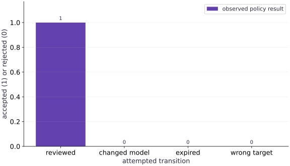

# ModelOps: own, approve, roll back and retire a model

Phase 16: Workload operations · about 65 minutes · CPU

This worked reference is validated on CPU. Accelerator compatibility requires a separate source review and target execution receipt. Use the execution matrix to review device selection and data ownership before adapting a separate target program.

**Before this lesson:** [LLMOps: version prompts, evaluate behavior and trace requests](https://www.tahabouhsine.com/jaxpathways/lesson-operations-07.html).

## What you will be able to do

- Inventory the complete release
- Bind review and audit to immutable bundle identity
- Observe consumer predictions before activation, after activation and after rollback
- Reject invalid transitions without changing selection or behavior
- Define active, fallback, cached and retired artifact eligibility

## The problem

A model passed review last week. Someone changed its preprocessing or image today and reused the old approval. Bind review to the exact release bundle, load the selected artifact through a consumer, observe activation and rollback predictions, then practice retirement without losing the audit trail.

## The idea

Model governance connects ownership, evaluation, approval and lifecycle transitions. This local single-writer demonstration uses content-addressed bundle identities and a consumer that loads the selected model artifact. It exercises approval, activation, rollback, cache/reload and tombstone eligibility; it does not authenticate people or emulate a production registry.

## Approval applies to a specific release

Imagine the reviewed release is bundle A, with a specific model artifact, evaluation record, owner and target. If its weights or tokenizer change, the new bundle has a different identity, so the old approval cannot be carried over by keeping the same display name. In the fixture, approval is valid at time $199$ and expired at times $200$ and $201$. The lifecycle checks also reject a stale approval, a wrong target and a version mismatch. Start each activation decision by checking which exact bundle was reviewed, whether the approval is still valid, and whether it covers this target. The bars summarize those decisions; the stored state explains why each attempt succeeded or failed.

$$
\operatorname{eligible}(b,a,t)=\mathbf1[\operatorname{id}(b)=a.\mathrm{bundle\ id}]\,\mathbf1[t<a.\mathrm{expires}]\,\mathbf1[\operatorname{target}(b)\in a.\mathrm{scope}]
$$

### Pause and reason

Does changing a display name require the same response as changing weights?

<details><summary>Compare your reasoning</summary>

Not necessarily. Define which identities and semantics the policy binds. A cosmetic label and a changed numerical artifact are different events, and the policy should distinguish them explicitly.

</details>

## Inventory the complete release

A release inventory is the set of facts a reviewer needs to know what will be served: model artifact and hash, evaluation identity, serving image, preprocessing or signature, precision, intended target and responsible owner. This fixture binds version, artifact hash, evaluation identity, owner, target and passing result. If any bound field changes, the release should be treated as a different object for approval. A real inventory should also make its code and preprocessing versions, limitations, dependency or license obligations and owner contact findable. A registry tag helps locate a release, but it does not enforce who may approve or activate it.

## Bind review to immutable evidence

The approval check is a conjunction: the presented bundle must match the reviewed bundle, the approval must still be unexpired, and the requested target must be allowed. The execution checks validity at $199$, $200$ and $201$ and prints true, false, false, making the expiry boundary visible. The recorded reviewer string is just a fixture value; it does not prove that the named person authenticated or had authority. In a real workflow, trusted identity, authorization and protected audit records must supply that evidence. A matching hash proves the bytes match the reviewed bytes, not that those bytes are useful or safe.

## Make failed transitions leave no side effects

For each rejected transition, compare state before and after the attempt. The fixture tries stale, expired, wrong-target and mismatched-version activations, then verifies that the active pointer, consumer cache and prediction are unchanged. It also changes the bytes on disk and corrupts a cached artifact; both are rejected before prediction or cache mutation. This is the key failure-handling rule: validate the requested transition and artifact identity before committing any state change. In a real service, record the rejection reason and actor, and check the served output as well as the pointer so a failed activation cannot leave a half-updated consumer.

## Separate selection, rollout and monitoring

Selection, rollout and monitoring answer separate questions. The registry selection chooses the approved version; rollout determines which serving processes or traffic use it; monitoring checks what those processes actually loaded and how they behave. In the local run, selecting B changes the consumer's prediction for $x=1$ from $3.0$ to $3.4$. A deployment should confirm that serving processes report B's identity after rollout, then watch quality and service signals. A canary exposes a candidate to limited live traffic, while shadow traffic runs it without using its answer. Decide traffic assignment and stop conditions before interpreting a favorable curve.

## Rollback needs its own valid target

A rollback is itself an activation decision, so its target must still be eligible. The fixture rolls from B back to A and the consumer prediction at $x=1$ returns from $3.4$ to $3.0$. It rejects missing, retired, unapproved, changed-byte or incompatible targets before switching. Retirement writes a tombstone but retains the bundle and audit record; it removes eligibility for future selection. Because the active and fallback versions are protected, the operator first chooses a replacement and explicitly clears fallback eligibility before retiring them. Verify that the rollback target is still approved and eligible before changing selection, then confirm the consumer's result.

## Work through approval and lifecycle decisions

For a lifecycle decision, name the release currently selected, the proposed transition and the evidence that would make you stop. If the activation is expired or targets a different bundle, reject it and confirm that pointer, cache and consumer output are unchanged. If rolling back, first verify that the proposed target remains approved and is neither retired nor byte-mismatched. After retirement, check that tombstones prevent future activation while the audit evidence remains available. The reviewer string in this fixture is not authentication, so a real process must establish the actor's identity and authority separately.

**Run the local ModelOps lifecycle experiment**

```python
Save the lesson experiment as modelops_lifecycle.py and run: python modelops_lifecycle.py
```

**Expected:** Prints consumer predictions for activation and rollback, rejected-transition invariants, tombstones and rollback eligibility. No service or external registry is required.

## Run the example

```python
# Local ModelOps lifecycle. Single writer, local filesystem, no authentication or authorization.
# Artifacts are immutable JSON files; consumer predictions come from the selected artifact.
import hashlib, json, tempfile
from pathlib import Path

def canonical(value): return json.dumps(value,sort_keys=True,separators=(',',':'),allow_nan=False)
def digest(value): return hashlib.sha256(canonical(value).encode()).hexdigest()
def write_json(path,value): Path(path).write_text(canonical(value))
def read_json(path): return json.loads(Path(path).read_text())

def artifact_prediction(artifact,x): return artifact['slope']*x+artifact['intercept']
def make_bundle(version,artifact,target='cpu-demo'):
    return {'version':version,'artifact':artifact,'artifact_hash':digest(artifact),
            'evaluation_hash':digest({'fixture':'consumer-predictions-v1','version':version}),
            'owner':'course-team','target':target,'passed':True}
def approval_for(bundle,actor,issued,expires):
    return {'bundle_hash':digest(bundle),'reviewer':actor,'issued_at':issued,'expires_at':expires}
def verify(bundle,approval,now,target,tombstones,expected_version):
    if bundle['version']!=expected_version: raise ValueError('requested version does not match approved bundle')
    if bundle['version'] in tombstones: raise ValueError('retired target')
    if bundle['target']!=target or not bundle['passed']: raise ValueError('target or evaluation rejected')
    if digest(bundle['artifact'])!=bundle['artifact_hash']: raise ValueError('artifact checksum mismatch')
    if approval.get('bundle_hash')!=digest(bundle): raise ValueError('stale approval for another bundle')
    if not approval.get('reviewer') or not approval['issued_at']<=now<approval['expires_at']:
        raise ValueError('expired or invalid approval')

def state(store):
    p=Path(store)/'active.json'
    return read_json(p) if p.exists() else {'current':None,'previous':None}
def consumer_predict(store,x,cache,force_reload=False):
    """Resolve selection and verify content identity on both cache and disk paths."""
    store=Path(store); selected_state=state(store); selected=selected_state['current']
    if selected is None: raise ValueError('no selected model')
    tombstones=read_json(store/'tombstones.json')
    if selected in tombstones: raise ValueError('selected artifact is retired')
    bundle_hash=selected_state.get('current_bundle_hash')
    expected_artifact_hash=selected_state.get('current_artifact_hash')
    if not bundle_hash or not expected_artifact_hash: raise ValueError('selection is missing content identity')
    cache_key=(selected,bundle_hash,expected_artifact_hash)
    if force_reload or cache_key not in cache:
        artifact=read_json(store/'artifacts'/f'{selected}.json')
        if digest(artifact)!=expected_artifact_hash: raise ValueError('reloaded artifact bytes do not match approved bundle')
        cache[cache_key]=artifact
    else:
        artifact=cache[cache_key]
        if digest(artifact)!=expected_artifact_hash: raise ValueError('cached artifact does not match approved bundle')
    return artifact_prediction(artifact,x)

def activate(store,version,bundle,approval,now,target,audit_actor,tombstones):
    store=Path(store)
    try:
        verify(bundle,approval,now,target,tombstones,version)
        artifact_path=store/'artifacts'/f'{version}.json'
        if not artifact_path.exists() or digest(read_json(artifact_path))!=bundle['artifact_hash']:
            raise ValueError('stored artifact bytes do not match approved bundle')
    except ValueError as error:
        store.mkdir(parents=True,exist_ok=True)
        append_audit(store,{'action':'activation-rejected','version':version,'bundle_hash':digest(bundle),
                            'actor':audit_actor,'at':now,'reason':str(error)})
        raise
    before=state(store)
    new={'current':version,'previous':before['current'],
         'current_bundle_hash':digest(bundle),'current_artifact_hash':bundle['artifact_hash'],
         'previous_bundle_hash':before.get('current_bundle_hash'),
         'previous_artifact_hash':before.get('current_artifact_hash')}
    write_json(store/'active.json',new)
    append_audit(store,{'action':'activate','version':version,'bundle_hash':digest(bundle),
                        'actor':audit_actor,'at':now})
    return new

def append_audit(store,event):
    path=Path(store)/'audit.jsonl'
    with path.open('a') as f: f.write(canonical(event)+'\n')

def rollback(store,now,target,audit_actor,approvals,bundles,tombstones):
    before=state(store); version=before['previous']
    if version is None or version in tombstones:
        append_audit(store,{'action':'rollback-rejected','version':version,'bundle_hash':digest(bundles[version]) if version in bundles else None,
                            'actor':audit_actor,'at':now,'reason':'rollback target is not eligible'})
        raise ValueError('rollback target is not eligible')
    bundle=bundles[version]
    try:
        verify(bundle,approvals[version],now,target,tombstones,version)
        artifact_path=Path(store)/'artifacts'/f'{version}.json'
        if not artifact_path.exists() or digest(read_json(artifact_path))!=bundle['artifact_hash']:
            raise ValueError('rollback artifact bytes do not match approved bundle')
    except ValueError as error:
        append_audit(store,{'action':'rollback-rejected','version':version,'bundle_hash':digest(bundle),
                            'actor':audit_actor,'at':now,'reason':str(error)})
        raise
    write_json(Path(store)/'active.json',{'current':version,'previous':before['current'],
         'current_bundle_hash':digest(bundle),'current_artifact_hash':bundle['artifact_hash'],
         'previous_bundle_hash':digest(bundles[before['current']]) if before['current'] in bundles else None,
         'previous_artifact_hash':bundles[before['current']]['artifact_hash'] if before['current'] in bundles else None})
    append_audit(store,{'action':'rollback','version':version,'bundle_hash':digest(bundle),
                        'actor':audit_actor,'at':now})

def clear_fallback(store,actor,now):
    before=state(store)
    write_json(Path(store)/'active.json',{'current':before['current'],'previous':None,
         'current_bundle_hash':before.get('current_bundle_hash'),'current_artifact_hash':before.get('current_artifact_hash'),
         'previous_bundle_hash':None,'previous_artifact_hash':None})
    append_audit(store,{'action':'clear-fallback','version':before['current'],'actor':actor,'at':now})

def retire(store,version,actor,now,tombstones,bundles):
    selected=state(store)
    if version in (selected['current'],selected['previous']): raise ValueError('active or fallback version is not retireable')
    if version not in bundles: raise ValueError('unknown version')
    tombstones=set(tombstones); tombstones.add(version)
    write_json(Path(store)/'tombstones.json',sorted(tombstones))
    append_audit(store,{'action':'retire','version':version,'bundle_hash':digest(bundles[version]),
                        'actor':actor,'at':now})
    return tombstones

# Three valid artifacts intentionally produce different consumer predictions at x=1.
artifacts={'A':{'format':'linear-v1','slope':2.0,'intercept':1.0},
           'B':{'format':'linear-v1','slope':2.4,'intercept':1.0},
           'C':{'format':'linear-v1','slope':3.0,'intercept':1.0}}
bundles={name:make_bundle(name,a) for name,a in artifacts.items()}
approvals={name:approval_for(bundle,'reviewer-'+name,100,500) for name,bundle in bundles.items()}
with tempfile.TemporaryDirectory(prefix='modelops-lifecycle-') as work:
    root=Path(work); (root/'artifacts').mkdir(); write_json(root/'tombstones.json',[])
    for name,artifact in artifacts.items(): write_json(root/'artifacts'/f'{name}.json',artifact)
    cache={}
    # Establish initial A, then observe before activation, after B activation and after rollback to A.
    activate(root,'A',bundles['A'],approvals['A'],150,'cpu-demo','reviewer-A',[])
    before=consumer_predict(root,1.,cache)
    assert before==3.
    activate(root,'B',bundles['B'],approvals['B'],150,'cpu-demo','reviewer-B',[])
    after_b=consumer_predict(root,1.,cache)
    assert after_b==3.4
    rollback(root,150,'cpu-demo','operator-r',approvals,bundles,[])
    after_rollback=consumer_predict(root,1.,cache)
    assert after_rollback==3.
    # Rejected stale, expired and wrong-target activation has no pointer or prediction side effect.
    stable_pointer=(root/'active.json').read_bytes(); stable_prediction=consumer_predict(root,1.,cache)
    checks=[True]
    stale=dict(approvals['C'],bundle_hash=approvals['A']['bundle_hash'])
    expired=approval_for(bundles['C'],'reviewer-C',100,150)
    for approval,target in ((stale,'cpu-demo'),(expired,'cpu-demo'),(approvals['C'],'edge-demo')):
        try: activate(root,'C',bundles['C'],approval,150,target,'operator-x',[])
        except ValueError: checks.append(False)
        else: raise AssertionError('invalid activation accepted')
        assert (root/'active.json').read_bytes()==stable_pointer
        assert consumer_predict(root,1.,cache)==stable_prediction
    assert checks==[True,False,False,False]
    # A is now fallback and cannot be retired. Activate C, then reject B as fallback too.
    activate(root,'C',bundles['C'],approvals['C'],160,'cpu-demo','reviewer-C',[])
    assert consumer_predict(root,1.,cache)==4.
    # Negative control 1: the caller cannot name C while supplying B's valid approval.
    stable_pointer=(root/'active.json').read_bytes(); stable_cache=dict(cache)
    try: activate(root,'C',bundles['B'],approvals['B'],160,'cpu-demo','operator-x',[])
    except ValueError as error: assert 'version' in str(error)
    else: raise AssertionError('bundle B activated under caller-supplied version C')
    assert (root/'active.json').read_bytes()==stable_pointer and cache==stable_cache
    assert consumer_predict(root,1.,cache)==4.
    # Negative control 2: disk bytes changed under C fail a forced reload before prediction/cache write.
    artifact_path=root/'artifacts'/'C.json'; original_c_bytes=artifact_path.read_bytes()
    write_json(artifact_path,{'format':'linear-v1','slope':99.,'intercept':1.})
    stable_cache=dict(cache)
    try: consumer_predict(root,1.,cache,force_reload=True)
    except ValueError as error: assert 'do not match approved bundle' in str(error)
    else: raise AssertionError('changed C artifact was served')
    assert (root/'active.json').read_bytes()==stable_pointer and cache==stable_cache
    # A corrupted cache entry is checked against the selected artifact digest too.
    c_key=('C',digest(bundles['C']),bundles['C']['artifact_hash'])
    cache[c_key]={'format':'linear-v1','slope':99.,'intercept':1.}; stable_cache=dict(cache)
    try: consumer_predict(root,1.,cache)
    except ValueError as error: assert 'cached artifact' in str(error)
    else: raise AssertionError('changed cached artifact was served')
    assert (root/'active.json').read_bytes()==stable_pointer and cache==stable_cache
    cache[c_key]=artifacts['C']; artifact_path.write_bytes(original_c_bytes)
    try: retire(root,'A','operator-x',161,[],bundles)
    except ValueError: pass
    else: raise AssertionError('fallback retired')
    try: retire(root,'C','operator-x',161,[],bundles)
    except ValueError: pass
    else: raise AssertionError('active version retired')
    # With explicit fallback clearing, A/B become ineligible and can be tombstoned.
    clear_fallback(root,'operator-x',162)
    tombstones=retire(root,'A','operator-x',163,[],bundles)
    tombstones=retire(root,'B','operator-x',164,tombstones,bundles)
    assert set(tombstones)=={'A','B'}
    try: activate(root,'A',bundles['A'],approvals['A'],170,'cpu-demo','operator-x',tombstones)
    except ValueError as e: assert str(e)=='retired target'
    else: raise AssertionError('retired target reactivated')
    # Even cached artifacts cannot serve after tombstone; forced reload also cannot resurrect one.
    for reload in (False,True):
        try: consumer_predict(root,1.,cache,force_reload=reload) # active C remains eligible
        except ValueError: raise AssertionError('eligible active C rejected')
    # Select B via a rollback-shaped attempt is forbidden because tombstoned, no side effects.
    write_json(root/'active.json',{'current':'B','previous':'C','current_bundle_hash':digest(bundles['B']),'current_artifact_hash':bundles['B']['artifact_hash'],'previous_bundle_hash':digest(bundles['C']),'previous_artifact_hash':bundles['C']['artifact_hash']}) # simulate stale pointer discovered on reload
    for reload in (False,True):
        try: consumer_predict(root,1.,cache,force_reload=reload)
        except ValueError as e: assert str(e)=='selected artifact is retired'
        else: raise AssertionError('cache/reload served tombstoned artifact')
    write_json(root/'active.json',{'current':'C','previous':'B','current_bundle_hash':digest(bundles['C']),'current_artifact_hash':bundles['C']['artifact_hash'],'previous_bundle_hash':digest(bundles['B']),'previous_artifact_hash':bundles['B']['artifact_hash']})
    before_rollback_reject=(root/'active.json').read_bytes()
    try: rollback(root,170,'cpu-demo','operator-r',approvals,bundles,tombstones)
    except ValueError: pass
    else: raise AssertionError('rollback to retired fallback accepted')
    assert (root/'active.json').read_bytes()==before_rollback_reject
    audit=[json.loads(line) for line in (root/'audit.jsonl').read_text().splitlines()]
    assert all(event.get('actor') for event in audit)
    assert next(e for e in audit if e['action']=='retire' and e['version']=='A')['bundle_hash']==digest(bundles['A'])
    assert next(e for e in audit if e['action']=='activate' and e['version']=='B')['bundle_hash']==digest(bundles['B'])
    assert next(e for e in audit if e['action']=='activation-rejected' and e['version']=='C')['bundle_hash']==digest(bundles['C'])
    assert next(e for e in audit if e['action']=='rollback-rejected')['bundle_hash']==digest(bundles['B'])
print('consumer x=1 predictions: before B activation A=',before,'after B activation=',after_b,'after rollback=',after_rollback)
print('rejected stale/expired/wrong-target and mismatched-version activations preserved pointer/cache/output')
print('changed disk and cache artifacts rejected before prediction or cache mutation')
print('retirement: active/fallback rejected; A and B tombstoned after fallback clear:',sorted(tombstones))
print('retired target activation and rollback rejected; stale pointer denied with cache and forced reload')
print('audit events bind actor and exact bundle hash; local single-writer fixture, no authentication')
```

Expected: Consumer predictions at x=1: A before B activation = 3.0; B after activation = 3.4; A after rollback = 3.0. Caller-version/bundle mismatch is rejected. Replacing C’s disk artifact with slope 99 or corrupting its cached artifact is rejected before prediction; pointer and cache remain unchanged. Stale, expired, wrong-target and retired-target attempts also preserve selection and output. Active/fallback retirement is rejected; after clearing fallback, A and B are tombstoned and retired activation/rollback are denied. Audit entries bind actions to actor and exact bundle hash.

## Only the reviewed release passes

**Predict:** Should changing only the target preserve the approval?



**Recorded CPU computation**

### Read the figure

The matching reviewed release is accepted. The stale-approval, expired-approval and wrong-target attempts are rejected, so the bars show $1$ accepted transition and $3$ blocked transitions. The execution checks that rejected attempts leave selection and consumer output unchanged.

### Connect it to the computation

Approval checks compare the exact bundle and requested version with the reviewed identity, validity period and target. The active selection also keeps bundle and artifact hashes, which lets the consumer reject changed bytes on cache and disk reload paths. Retirement later removes eligibility with tombstones while retaining bundle bytes and audit identity.

```python
visual_data={'kind':'bar','labels':['reviewed','stale approval','expired approval','wrong target'],'xlabel':'attempted transition','ylabel':'accepted (1) or rejected (0)','series':[{'label':'observed policy result','y':[int(v) for v in checks]}]}
```

## Recorded reference execution

CPU run: 2026-10-27T16:11:16.615655+00:00. JAX 0.9.2.

```text
consumer x=1 predictions: before B activation A= 3.0 after B activation= 3.4 after rollback= 3.0
rejected stale/expired/wrong-target and mismatched-version activations preserved pointer/cache/output
changed disk and cache artifacts rejected before prediction or cache mutation
retirement: active/fallback rejected; A and B tombstoned after fallback clear: ['A', 'B']
retired target activation and rollback rejected; stale pointer denied with cache and forced reload
audit events bind actor and exact bundle hash; local single-writer fixture, no authentication
Approval validity at 199, 200, 201: [True, False, False]
Version mismatch, changed disk bytes and corrupted cache all rejected without pointer/cache mutation
Exclusive expiry, protected retirement and tombstone checks passed; eligible B still serves 3.4
PASS: operations-08

```

## Test the exact expiry boundary without mutating a registry

**Predict before running:** An approval is issued at $100$ and expires at $200$. Predict whether policy verification succeeds at $199$, $200$ and $201$. Which inequalities define the accepted interval?

```python
boundary_approval=approval_for(bundles['C'],'boundary-reviewer',100,200)
boundary_outcomes=[]
for now in (199,200,201):
    try:verify(bundles['C'],boundary_approval,now,'cpu-demo',[],expected_version='C')
    except ValueError as error:
        assert 'expired' in str(error)
        boundary_outcomes.append(False)
    else:boundary_outcomes.append(True)
assert boundary_outcomes==[True,False,False]
assert boundary_approval['expires_at']==200
print('Approval validity at 199, 200, 201:',boundary_outcomes)

```

**Expected:** The policy accepts 199 and rejects 200 and 201: [True, False, False]. No activation or registry mutation occurs in this policy-only experiment.

The validity interval is $t_{\rm issued}\le t<t_{\rm expires}$. This isolates the time rule; the main lifecycle and exercise separately test consumer behavior and side-effect-free rejection at the registry boundary.

## Make it yours

With C selected, try activating C with B’s valid bundle and approval. Then replace C’s artifact file with slope 99 and force a consumer reload. Finally corrupt the cache entry. Verify every rejection happens before prediction and preserves pointer and cache state. Explain how this differs from rollback to a retired target.

### How to write this exercise — Step-by-step recipe & starter scaffold

**Inputs:**
- Local A/B/C artifacts, exact bundles/approvals and lifecycle functions from the lesson.
- A fresh temporary registry with C selected and a consumer cache.

**Outputs:**
- Explicit rejections for C selected with B approval, disk C changed to slope 99, and a corrupted C cache entry.
- Pointer/cache snapshots proving rejection has no selection or cache-write side effects.

**Invariants to check:**
- The consumer binds version, bundle and artifact identities before prediction.
- Same-shape or same-name artifacts cannot bypass the selected content hash.
- Each negative case changes one cause and restores the fixture before the next.

**Hints:**
- Keep the original active.json bytes and a copy of the cache before each rejected call.
- Use force_reload for the disk case, then test the cached path separately.

**Starter code scaffold (fill in the TODOs):**

```python
def reject_identity_mismatches(registry, artifacts, bundles, approvals, cache):
    # TODO: exercise and verify all three rejection boundaries from fresh state.
    raise NotImplementedError
```

<details><summary>Reference solution</summary>

```python
# Repeat the identity checks in fresh local state.
with tempfile.TemporaryDirectory(prefix='modelops-identity-exercise-') as folder:
    check_root=Path(folder); (check_root/'artifacts').mkdir()
    write_json(check_root/'tombstones.json',[])
    for name,artifact_value in artifacts.items():
        write_json(check_root/'artifacts'/f'{name}.json',artifact_value)
    check_cache={}
    activate(check_root,'C',bundles['C'],approvals['C'],150,'cpu-demo','reviewer-C',[])
    assert consumer_predict(check_root,1.,check_cache)==4.
    pointer_before=(check_root/'active.json').read_bytes(); cache_before=dict(check_cache)
    try: activate(check_root,'C',bundles['B'],approvals['B'],151,'cpu-demo','operator-x',[])
    except ValueError: pass
    else: raise AssertionError('bundle B activated as version C')
    assert (check_root/'active.json').read_bytes()==pointer_before and check_cache==cache_before
    artifact_path=check_root/'artifacts'/'C.json'; original=artifact_path.read_bytes()
    write_json(artifact_path,{'format':'linear-v1','slope':99.,'intercept':1.})
    try: consumer_predict(check_root,1.,check_cache,force_reload=True)
    except ValueError: pass
    else: raise AssertionError('changed C artifact served')
    assert (check_root/'active.json').read_bytes()==pointer_before and check_cache==cache_before
    artifact_path.write_bytes(original)
    c_key=('C',digest(bundles['C']),bundles['C']['artifact_hash'])
    check_cache[c_key]={'format':'linear-v1','slope':99.,'intercept':1.}
    corrupted_cache_before=dict(check_cache)
    try: consumer_predict(check_root,1.,check_cache)
    except ValueError as error: assert 'cached artifact' in str(error)
    else: raise AssertionError('changed cached C artifact served')
    assert (check_root/'active.json').read_bytes()==pointer_before
    assert check_cache==corrupted_cache_before
    check_cache[c_key]=artifacts['C']

print('Version mismatch, changed disk bytes and corrupted cache all rejected without pointer/cache mutation')
```

</details>

## Exercise approval expiry and retirement at a lifecycle boundary

**Transfer**

Start a fresh registry with A active. At exactly the B approval expiry time, reject B activation without changing A. Then activate B while its token is valid, show that neither active B nor fallback A may be retired, explicitly clear fallback, retire A, and reject its reactivation. Verify the eligible B consumer still returns its prediction.

<details><summary>Hint</summary>

The valid interval is issued_at <= now < expires_at. Clearing the fallback is an explicit transition, not an effect of a rejected retirement.

</details>

### How to write: Exercise approval expiry and retirement at a lifecycle boundary — Step-by-step recipe & starter scaffold

**Inputs:**
- The local lifecycle functions and valid A/B bundles and approval records.

**Outputs:**
- Expiry-boundary and retirement rejection evidence plus an eligible B prediction.

**Invariants to check:**
- No rejected transition mutates the active selection.
- Explicit fallback clearing precedes retirement.
- Retirement remains effective despite an otherwise valid old approval.

**Hints:**
- Use times 150, 160 and the exact expiry 500.
- Re-read state and consumer prediction after each attempted transition.

**Starter code scaffold (fill in the TODOs):**

```python
def check_expiry_and_retirement(registry, artifacts, bundles, approvals):
    # TODO: verify expiry, active/fallback guards, explicit clearing and retired-target rejection.
    raise NotImplementedError
```

<details><summary>Reference solution and reasoning</summary>

```python
# A distinct lifecycle transfer: exact expiry and active/fallback retirement guards.
with tempfile.TemporaryDirectory(prefix='modelops-lifecycle-transfer-') as folder:
    lifecycle_root=Path(folder); (lifecycle_root/'artifacts').mkdir()
    write_json(lifecycle_root/'tombstones.json',[])
    for name,value in artifacts.items():write_json(lifecycle_root/'artifacts'/f'{name}.json',value)
    activate(lifecycle_root,'A',bundles['A'],approvals['A'],150,'cpu-demo','learner',[])
    lifecycle_cache={}
    assert consumer_predict(lifecycle_root,1.,lifecycle_cache)==3.
    saved_pointer=(lifecycle_root/'active.json').read_bytes()
    try:activate(lifecycle_root,'B',bundles['B'],approvals['B'],500,'cpu-demo','learner',[])
    except ValueError as error:assert 'expired' in str(error)
    else:raise AssertionError('approval accepted at its exclusive expiry boundary')
    assert (lifecycle_root/'active.json').read_bytes()==saved_pointer
    assert consumer_predict(lifecycle_root,1.,lifecycle_cache)==3.
    activate(lifecycle_root,'B',bundles['B'],approvals['B'],160,'cpu-demo','learner',[])
    for protected in ('A','B'):
        saved_pointer=(lifecycle_root/'active.json').read_bytes()
        try:retire(lifecycle_root,protected,'learner',161,[],bundles)
        except ValueError as error:assert 'active or fallback' in str(error)
        else:raise AssertionError('protected version retired')
        assert (lifecycle_root/'active.json').read_bytes()==saved_pointer
    clear_fallback(lifecycle_root,'learner',162)
    retired=retire(lifecycle_root,'A','learner',163,[],bundles)
    saved_pointer=(lifecycle_root/'active.json').read_bytes()
    try:activate(lifecycle_root,'A',bundles['A'],approvals['A'],170,'cpu-demo','learner',retired)
    except ValueError as error:assert 'retired target' in str(error)
    else:raise AssertionError('retired A reactivated')
    assert (lifecycle_root/'active.json').read_bytes()==saved_pointer
    assert consumer_predict(lifecycle_root,1.,lifecycle_cache)==3.4
print('Exclusive expiry, protected retirement and tombstone checks passed; eligible B still serves 3.4')

```

Approval expiry is an exclusive boundary. A rejected transition leaves selection unchanged. Retirement is allowed only after the version is neither active nor fallback; a tombstone then prevents reuse even if an old approval is otherwise valid. These are local single-writer policy rules, not authenticated organizational approval.

</details>

## Check your understanding

An approval record contains a reviewer name and a matching hash. Does that authenticate the reviewer?

1. Yes, a hash verifies the reviewer identity.
2. No. The fixture checks binding and expiry; trusted identity and authorization are separate requirements.
3. Only if the model has low validation loss.

<details><summary>Answer and explanation</summary>

**1. Yes, a hash verifies the reviewer identity.**

The hash can bind a statement to an artifact but does not prove who wrote it. Verify reviewer identity through a separate trusted channel.

**2. No. The fixture checks binding and expiry; trusted identity and authorization are separate requirements. (correct)**

This check can bind approval metadata to a particular artifact and expiry. It does not authenticate the human named as reviewer. Identity and authorization require a separate trusted mechanism; a digest alone supplies neither.

**3. Only if the model has low validation loss.**

Validation loss is a model metric, not an identity credential. Check authorization, binding and expiry separately.

</details>

## Diagnose the result

Compare the whole bundle hash and target first, then time boundaries and reviewer authority. Never bypass a rejected rollout by editing a passed flag or pointing the alias manually. Keep the rejected transition in the incident record.

## Carry forward

- Inventory the complete release
- Separate selection, rollout and monitoring
- Work through approval and lifecycle decisions

## Keep your evidence

Keep approval/bundle identity, predictions across activation and rollback, retirement/cache/reload behavior, stale/expired/retired-target failures and an audit trail. Scope is a local single-writer policy fixture.

Save your predictions, modified code, terminal outputs, and reasoning in your engineering portfolio.

## Primary references

- [MLflow experiment tracking](https://mlflow.org/docs/latest/ml/tracking/quickstart/)
- [MLflow model registry workflows](https://mlflow.org/docs/latest/ml/model-registry/workflow/)
- [Kubernetes deployment rollout and rollback](https://kubernetes.io/docs/concepts/workloads/controllers/deployment/)

