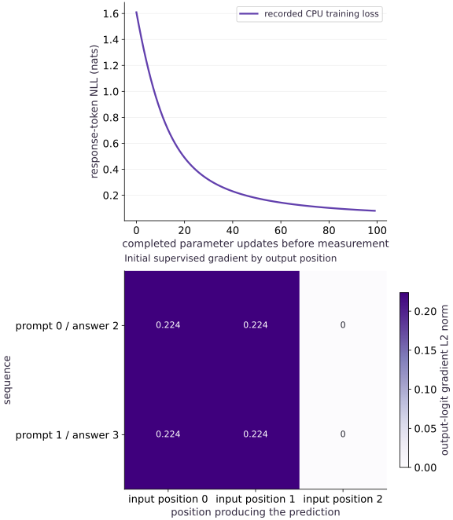

# Supervised fine-tuning with response-only token loss

Phase 18: Post-training: SFT, LoRA, reward models and RLHF · about 105 minutes · CPU

This worked reference is validated on CPU. Accelerator compatibility requires a separate source review and target execution receipt. Use the execution matrix to review device selection and data ownership before adapting a separate target program.

## What you will be able to do

- Align predictions with their target tokens
- Separate the attention mask from the loss mask
- Verify the changed-condition exercise and explain the limits of this fixture.
- Transfer response-only supervised fine-tuning to the identity-matched saved foundations decoder and measure a fixed held-out baseline.

## The problem

A conversation contains instructions and an answer. If we want to teach answer behavior, which tokens should receive loss? We will shift targets explicitly and exclude prompt tokens without hiding the prompt from the model.

## The idea

Supervised fine-tuning teaches desired responses under a causal prediction objective. Response-only training scores selected target tokens while retaining prompt context. Correct token/role alignment determines which behavior the loss actually rewards.

## Shift the supervision with the target

Start with one rule: logit position $t$ is scored against token $t+1$. The response mask must therefore mark target positions, then shift with the target IDs. At the boundary, the prompt token can produce the logit for the first answer token, so masking by the input role would drop exactly the prediction we want to teach.

Prompt tokens still provide causal context and can carry gradients through later response predictions. First inspect the two aligned rows in the example; then check the gradient audit to see this boundary rule in action. The recorded table loss falls from $\log 5\approx1.609$ to $0.0799$ over $100$ updates. That confirms this five-token table learned its masked transitions, not that it learned general instruction following.

### Pause and reason

Why can prompt-related parameters change during response-only training?

<details><summary>Compare your reasoning</summary>

The prompt influences scored response predictions through the computation. Removing direct loss at prompt positions does not remove all gradient paths through prompt context.

</details>

## Before coding: write the target table

Before writing a loss, make the alignment visible. For tokens $[0,2,4]$, position $0$ predicts target $2$ and position $1$ predicts target $4$; position $2$ has no next token. If token $0$ is prompt context and $2$ and $4$ are answer and end-of-answer, the target-role row is $[\text{prompt},\text{answer},\text{end}]$. The first scored prediction comes from a prompt position. Write input, shifted target, and target role as separate rows; then verify the mask against them.

## Align predictions with their target tokens

Implement the table you just wrote: slice logits to `[:, :-1]`, targets to `[:, 1:]`, and use the role mask at `[:, 1:]`. The first answer target is supervised from the preceding prompt token. As a quick check, the gradient audit reports nonzero gradients for prompt rows $0$ and $1$, while the unused final-token row $4$ is zero. If the prompt rows were zero, inspect the mask shift before changing optimization settings.

## Separate the attention mask from the loss mask

Keep two questions separate. The causal attention mask decides which earlier tokens the model may read; the response loss mask decides which next-token predictions count. A prompt target may be excluded from the loss while its token remains visible as context. In this example the last position has no next token. In padded or packed batches, additionally exclude padding targets and prevent attention across document boundaries.

## Work through sums, counts and unequal answer lengths

Now determine what the reduction means. With five equally likely tokens, each selected target costs $\log 5$ nats. One selected target contributes $\log5$; three contribute $3\log5$. Divide the total by the total number of selected targets and both batches have mean $\log5$. The helper returns per-sequence sums, so preserve the sum and count until the final reduction. For unequal losses, a sequence with one token loss of $2$ and another with three token losses of $1$ has token mean $1.25$ but sequence mean $1.5$. Choose the weighting deliberately; do not average unequal microbatch means.

## Follow the first gradient to the prompt row

Trace one derivative to confirm the alignment. Under uniform five-class logits, the correct class $2$ has cross-entropy derivative $-0.8$, and each other class has $0.2$, before reduction. Gradient descent raises the correct logit. Since row $0$ predicts the first answer token, that prompt row receives the signal; the recorded gradient check confirms it. This is a gradient through the prediction computation, not a reason to expose future answer tokens. Keep causal attention independently correct.

## Choose a reduction and keep its denominator

Choose the training unit before batching. This lab sums negative log probabilities over response and end tokens, then divides by the number of valid target tokens. That gives each token equal weight, so longer responses contribute more total influence. Equal weight per sequence is a different objective. Record the numerator and both token and sequence counts so the choice remains inspectable.

$$
L_{\mathrm{SFT}}=-\frac{\sum_{b,t}m_{b,t+1}\log p_\theta(x_{b,t+1}\mid x_{b,\le t})}{\sum_{b,t}m_{b,t+1}}
$$

## Fine-tune an identified base model

For an actual SFT run, first identify the object being adapted: checkpoint, tokenizer, chat template, data revision, and special-token rules. Split by source or conversation identity before formatting. This small executable example instead starts from uniform logits to make target selection and the denominator easy to audit; the next LoRA lesson supplies a separate trained-base example.

## Check behavior and forgetting separately

Use the falling training curve as an objective check, then ask whether behavior transferred. Hold out prompts, fix decoding, review outputs, and retain a base-task evaluation for forgetting. The SFT handoff below records held-out response NLL before and after one update; treat that as a diagnostic rather than a response-quality score. Do not use final test prompts to tune formatting or duration.

## Why the tiny table is not enough for instruction following

The table sees only the current token. Thus contexts $[1,0]$ and $[3,0]$ produce identical next-token distributions, even when their desired next tokens differ. The challenge exercise checks this collision. More updates cannot recover information the architecture does not represent; use a context-aware model for that task.

When moving to a real decoder, inspect role spans on the exact formatted string, keep padding out of targets, preserve document attention boundaries when packing, and compare held-out behavior plus a retained base task. This is the point where an objective implementation gives way to model and data evaluation.

## Carry the saved foundations decoder into response-only SFT

Prerequisite: complete the causal-model and tokenizer identity checks in the [Decoder foundations project guide](https://www.tahabouhsine.com/jaxpathways/project-guides/text-harness-foundations.html). The full-workspace transfer loads `projects/text-harness/foundations/reference/run/inference-package` and verifies the parameter and tokenizer digests in `package.json`. The package supplies inference weights and configuration, not the pretraining optimizer state, so initialize a fresh optimizer for SFT.

The fixed synthetic split uses disjoint prompt groups. The saved-decoder run verified the expected parameter and tokenizer digests, counted $3$ and $4$ response targets including EOS while excluding prompt and padding, and reduced training NLL from $5.84720$ to $5.84633$ after one update. Held-out response NLL changed from [$5.89631$, $5.89306$] to [$5.89614$, $5.89310$]. Read these as small loss changes on this fixture; they do not establish useful generated answers. The output child bundle records its parent identity.

To reproduce this route, use the full repository, the listed foundation source and inference-package files, JAX/JAXlib $\text{0.9.2}$, NumPy $\text{2.4.4}$, and Tokenizers $\text{0.22.2}$. The standalone `main.py` table example does not require that package; this handoff is a separate transfer exercise.

### Pause and reason

What is copied from the saved inference package, and what is initialized anew at the post-training boundary?

<details><summary>Compare your reasoning</summary>

Copy the verified model parameters, tokenizer and model configuration. Initialize new optimizer state for the SFT objective; the inference package does not contain the causal pretraining optimizer state.

</details>

## 1. Define sequence log-probability sums

Create main.py in your activated course environment. Paste this block, then run python main.py; function definitions alone print nothing.

```python
# Step 1 — 1. Define sequence log-probability sums: The slice removes the final logit and first token.
import jax
import jax.numpy as jnp
import numpy as np

def response_logps(logits, tokens, response_mask):
    # logits at t predict token t+1; the role mask belongs to the target token.
    logp = jax.nn.log_softmax(logits[:, :-1, :], axis=-1)
    selected = jnp.take_along_axis(logp, tokens[:, 1:, None], axis=-1)[..., 0]
    return jnp.sum(jnp.where(response_mask[:, 1:], selected, 0.0), axis=-1)

def validate_mask(selected, shape):
    # Transfer the device result to the host for an independent NumPy comparison.
    a = np.asarray(selected)
    if a.shape != shape or a.dtype != np.bool_ or not a.any():
        raise ValueError('a nonempty Boolean mask of the target shape is required')
```

The slice removes the final logit and first token. The role mask is shifted with targets, preserving supervision of the first answer token.

## 2. Align prompt, response and target masks

Append this block to main.py and run python main.py again. Keep the earlier blocks above it.

```python
# Token 0/1 is a prompt; 2/3 is its response; 4 marks the end.
tokens = jnp.array([[0, 2, 4], [1, 3, 4]], jnp.int32)
roles = jnp.array([[False, True, True]] * 2)
validate_mask(roles[:, 1:], tokens[:, 1:].shape)
p = jnp.zeros((5, 5))
history = []

def sft_objective(p):
    return -jnp.sum(response_logps(p[tokens], tokens, roles)) / jnp.sum(roles[:, 1:])

step = jax.jit(jax.value_and_grad(sft_objective))
```

Inspect tokens and roles together. Every row has two valid next-token targets, so the loss denominator is four.

## 3. Fit the transition table and check the final position

Append this block to main.py and run python main.py again. Keep the earlier blocks above it.

```python
# Step 3 — 3. Fit the transition table and check the final position: The table learns only local transitions.
for _ in range(100):
    value, g = step(p)
    history.append(float(value))
    p = p - 0.5 * g

np.testing.assert_allclose(history[0], np.log(5), atol=1e-6)
assert history[-1] < 0.15
assert np.array_equal(np.argmax(np.asarray(p)[[0, 1]], axis=1), [2, 3])
# The final position predicts nothing and has no contribution.
base_logits = p[tokens]
changed = base_logits.at[:, -1, :].set(100.0)
np.testing.assert_allclose(
    response_logps(changed, tokens, roles),
    response_logps(base_logits, tokens, roles),
)
print('Response-only token NLL initial/final:', history[0], history[-1])
```

The table learns only local transitions. Its falling loss verifies these examples; the context-collision exercise exposes its architectural limit.

## Run the example

```python
# Step 1 — 1. Define sequence log-probability sums: The slice removes the final logit and first token.
import jax
import jax.numpy as jnp
import numpy as np

def response_logps(logits, tokens, response_mask):
    # logits at t predict token t+1; the role mask belongs to the target token.
    logp = jax.nn.log_softmax(logits[:, :-1, :], axis=-1)
    selected = jnp.take_along_axis(logp, tokens[:, 1:, None], axis=-1)[..., 0]
    return jnp.sum(jnp.where(response_mask[:, 1:], selected, 0.0), axis=-1)

def validate_mask(selected, shape):
    # Transfer the device result to the host for an independent NumPy comparison.
    a = np.asarray(selected)
    if a.shape != shape or a.dtype != np.bool_ or not a.any():
        raise ValueError('a nonempty Boolean mask of the target shape is required')

# Token 0/1 is a prompt; 2/3 is its response; 4 marks the end.
tokens = jnp.array([[0, 2, 4], [1, 3, 4]], jnp.int32)
roles = jnp.array([[False, True, True]] * 2)
validate_mask(roles[:, 1:], tokens[:, 1:].shape)
p = jnp.zeros((5, 5))
history = []

def sft_objective(p):
    return -jnp.sum(response_logps(p[tokens], tokens, roles)) / jnp.sum(roles[:, 1:])

step = jax.jit(jax.value_and_grad(sft_objective))

# Step 3 — 3. Fit the transition table and check the final position: The table learns only local transitions.
for _ in range(100):
    value, g = step(p)
    history.append(float(value))
    p = p - 0.5 * g

np.testing.assert_allclose(history[0], np.log(5), atol=1e-6)
assert history[-1] < 0.15
assert np.array_equal(np.argmax(np.asarray(p)[[0, 1]], axis=1), [2, 3])
# The final position predicts nothing and has no contribution.
base_logits = p[tokens]
changed = base_logits.at[:, -1, :].set(100.0)
np.testing.assert_allclose(
    response_logps(changed, tokens, roles),
    response_logps(base_logits, tokens, roles),
)
print('Response-only token NLL initial/final:', history[0], history[-1])
```

Expected: Response-only loss decreases from log(5) to below 0.15.

## Supervised fine-tuning with response-only token loss — recorded experiment

**Predict:** Predict the zero-gradient column before looking at the heatmap. Does a prompt input position necessarily have zero gradient?



**Recorded CPU computation**

### Read the figure

Read the curve as response-token mean NLL measured before each update: it starts at $\log5\approx1.609$ for uniform five-way predictions and ends at $0.0799$ after $100$ updates. The second panel audits initial logit-gradient norms by input position. The prompt position that predicts the first answer has nonzero gradient, as does the answer position predicting end-of-answer; the final position has no next-token target and is zero. This confirms the shift and mask for this table. It is not a measure of language-model quality.

### Connect it to the computation

Use the target table to predict which positions should be scored, then compare that prediction with the gradient panel. The no-target exercise checks the denominator, while the context-collision exercise shows why fitting this table cannot establish instruction-following ability.

```python
visual_data={'kind':'line','xlabel':'completed parameter updates before measurement','ylabel':'response-token NLL (nats)','series':[{'label':'recorded CPU training loss','x':list(range(len(history))),'y':history}]}
for panel in visual_data.get('panels',[visual_data]):
    panel['x']=panel['series'][0]['x']

initial_output_grads=jax.grad(lambda values:-jnp.sum(response_logps(values,tokens,roles))/jnp.sum(roles[:,1:]))(jnp.zeros((2,3,5)))
# Transfer the device result to the host for an independent NumPy comparison.
extra_panel={'kind':'heatmap','values':np.asarray(jnp.linalg.norm(initial_output_grads,axis=-1)).tolist(),'rows':['prompt 0 / answer 2','prompt 1 / answer 3'],'columns':['input position 0','input position 1','input position 2'],'unit':'output-logit gradient L2 norm','xlabel':'position producing the prediction','ylabel':'sequence','title':'Initial supervised gradient by output position'}
visual_data={"panels":[*visual_data.get("panels",[visual_data]),extra_panel]}
```

## Recorded reference execution

CPU run: 2026-10-27T16:12:01.504208+00:00. JAX 0.9.2.

```text
Response-only token NLL initial/final: 1.6094379425048828 0.07985548675060272
Response-only token NLL initial/final: 1.6094379425048828 0.07985548675060272
Prompt rows learn to predict first answers; the final end-token row has no target.
Supervised targets per sequence: [2 3]
Two first-response targets: 0.07894014567136765
No-target SFT batch rejected
Identical final tokens force identical table predictions despite different contexts.
saved decoder identity: 271cb6457de5da3f727c343c64b7bd350c00e503ea7ac847eecf51fbd5558802 c92b534443cc6a1eacd5e78406b2c42e59553df704a07102a03c639d3694f586
response target count includes EOS and excludes prompt/PAD; example counts: [3, 4]
one SFT step train NLL before/after: 5.847196578979492 5.8463287353515625
heldout response NLL baseline/after: [5.896312713623047, 5.893064022064209] [5.896141529083252, 5.89309549331665]
child inference bundle parent-bound; no optimizer resume or quality claim
PASS: posttraining-01

```

## Prove the target-mask shift

**Predict before running:** Which table rows should get gradients when only answer and end tokens are supervised?

```python
# Experiment — Prove the target-mask shift
g = jax.grad(sft_objective)(jnp.zeros((5, 5)))
assert np.linalg.norm(np.asarray(g)[0]) > 0 and np.linalg.norm(np.asarray(g)[1]) > 0
# Transfer the device result to the host for an independent NumPy comparison.
np.testing.assert_array_equal(np.asarray(g)[4], 0.0)
print('Prompt rows learn to predict first answers; the final end-token row has no target.')
```

**Expected:** Rows for prompt IDs have nonzero gradients; the unused final-token row has zero gradient.

The prediction made at the prompt position is supervised because its target is an answer. Input-role masking would confuse context with target eligibility.

## Check a ragged batch against a scalar loop

**Predict before running:** Will independent token sums recover the response objective when answers have unequal lengths?

```python
# Experiment — Check a ragged batch against a scalar loop: Padding and role masks affect the target after shifting.
ragged_tokens = jnp.array([[0, 2, 4, 4], [1, 3, 2, 4]])
ragged_roles = jnp.array([[False, True, True, False], [False, True, True, True]])
ragged_logits = jnp.arange(2 * 4 * 5, dtype=jnp.float32).reshape(2, 4, 5) / 19
observed = response_logps(ragged_logits, ragged_tokens, ragged_roles)
# Transfer the device result to the host for an independent NumPy comparison.
arr = np.asarray(ragged_logits, dtype=np.float64)
expected = []
for row in range(2):
    total = 0.0
    for position in range(3):
        if ragged_roles[row, position + 1]:
            values = arr[row, position]
            log_normalizer = values.max() + np.log(np.exp(values - values.max()).sum())
            total += values[int(ragged_tokens[row, position + 1])] - log_normalizer
    expected.append(total)
np.testing.assert_allclose(observed, expected, atol=1e-6)
print('Supervised targets per sequence:', np.asarray(ragged_roles[:, 1:].sum(1)))
```

**Expected:** The target counts are two and three; scalar sequence sums match the vectorized implementation.

Padding and role masks affect the target after shifting. The host loop makes every included prediction explicit.

## Make it yours

Score only the first response token in each sequence and compare the resulting count and objective.

### How to write this exercise — Step-by-step recipe & starter scaffold

**Inputs:**
- Causal logits, token IDs, role labels, and a response-only target mask.

**Outputs:**
- The count and mean loss for only the first response token per sequence.

**Invariants to check:**
- Logits at time t score token t+1; prompt targets are excluded after shifting.

**Hints:**
- Shift token and role arrays consistently.
- Count selected shifted targets before averaging.

**Starter code scaffold (fill in the TODOs):**

```python
import jax.numpy as jnp
import numpy as np

def score_first_response_token(logits, tokens, roles):
    # TODO: construct the shifted target mask and return the selected loss and count.
    raise NotImplementedError
```

<details><summary>Reference solution</summary>

```python
# Exercise solution
first_only = roles.at[:, 2].set(False)
value = -jnp.sum(response_logps(p[tokens], tokens, first_only)) / jnp.sum(
    first_only[:, 1:]
)
assert int(jnp.sum(first_only[:, 1:])) == 2
# Ensure all array elements remain finite: `np.isfinite(float(value))`
assert np.isfinite(float(value))
print('Two first-response targets:', float(value))
```

</details>

## Reject a batch with no answer targets

**Transfer**

Validate an all-prompt batch before computing the token average.

<details><summary>Hint</summary>

Use the shifted target mask, not the unshifted input mask.

</details>

### How to write: Reject a batch with no answer targets — Step-by-step recipe & starter scaffold

**Inputs:**
- A batch whose roles mark every token as prompt context.

**Outputs:**
- A validation error or explicit skip result before averaging token loss.

**Invariants to check:**
- An all-prompt batch never creates a zero-denominator supervised update.

**Hints:**
- Build the mask for shifted target positions.
- Choose and document reject-versus-skip behavior.

**Starter code scaffold (fill in the TODOs):**

```python
import jax.numpy as jnp
import numpy as np

def validate_response_targets(tokens, roles):
    # TODO: validate the shifted response mask and return its selected-token count.
    raise NotImplementedError
```

<details><summary>Reference solution and reasoning</summary>

```python
# Reject a batch with no answer targets (Transfer)
try:
    validate_mask(jnp.zeros_like(roles[:, 1:]), tokens[:, 1:].shape)
except ValueError:
    print('No-target SFT batch rejected')
else:
    raise AssertionError('empty supervision accepted')
```

An empty answer mask should trigger a clear skip/rejection policy before the update; a fabricated zero objective disguises lost training data.

</details>

## Create a failure this model cannot fix

**Challenge**

Build two contexts ending in token zero but requiring different next tokens. Prove that the transition table gives identical distributions. Name the model capability needed to resolve the conflict.

<details><summary>Hint</summary>

Keep the final input token equal and change an earlier token.

</details>

### How to write: Create a failure this model cannot fix — Step-by-step recipe & starter scaffold

**Inputs:**
- Two contexts with the same final token but different required next-token labels.

**Outputs:**
- The shared transition-table distributions and an explanation-ready conflict indicator.

**Invariants to check:**
- A first-order token transition model has identical outputs for identical final token IDs.

**Hints:**
- Encode the two examples with the exact same context state.
- Compare full next-token distributions, not just top predictions.

**Starter code scaffold (fill in the TODOs):**

```python
import jax.numpy as jnp
import numpy as np

def expose_context_aliasing(context_a, context_b, labels, transition_table):
    # TODO: compare next-token distributions for contexts sharing the same final token.
    raise NotImplementedError
```

<details><summary>Reference solution and reasoning</summary>

```python
# Create a failure this model cannot fix (Challenge)
contexts = jnp.array([[1, 0], [3, 0]])
last_logits = p[contexts[:, -1]]
np.testing.assert_array_equal(last_logits[0], last_logits[1])
conflicting_targets = jnp.array([2, 3])
assert conflicting_targets[0] != conflicting_targets[1]
print('Identical final tokens force identical table predictions despite different contexts.')
```

A model that conditions on the earlier context can represent this distinction. More iterations on the same transition-table architecture cannot.

</details>

## Run one response-masked SFT update from the saved foundations decoder

**Transfer**

In the full workspace, verify the retained foundations package hashes, then run one small SFT update on fixed synthetic prompt/response pairs with prompt-group-disjoint training and held-out splits. Use shifted targets with a response-only mask, EOS included and padding excluded. Record a held-out response NLL before the update and after it. Save the child inference parameters with a manifest binding them to the parent package identity. Do not treat a held-out NLL change as proof of useful responses.

<details><summary>Hint</summary>

The logit at position t predicts the target at t+1. Build the Boolean mask from target positions: include positions from the prompt length through the last response token, including EOS. Initialize new optimizer state rather than pretending to resume the foundations training optimizer.

</details>

### How to write: Run one response-masked SFT update from the saved foundations decoder — Step-by-step recipe & starter scaffold

**Inputs:**
- The foundations inference package: package.json, params.npz and tokenizer.json
- Verified model.py, config.py and train.py source files
- Fixed synthetic train pairs and held-out prompt/response pairs

**Outputs:**
- Verified parent and tokenizer identity
- Response-masked SFT objective and one child parameter update
- Before/after train and held-out response NLL
- A child inference parameter archive and parent-bound manifest

**Invariants to check:**
- Do not resume optimizer state from the inference package; initialize it anew
- Shift logits and targets by one position
- Score response tokens and EOS only; exclude prompt and PAD targets
- Use the same held-out pairs before and after
- Record the exact parent and tokenizer digests in the child manifest
- Train and held-out prompt token sequences are disjoint; assert the prompt-group split before fitting.

**Hints:**
- Load via train.load_model_package with the manifest identity, then verify the pinned hashes.
- Use the target-side mask with `target_positions >= len(prefix)` and `< len(ids)`.
- Use one declared step size and report metrics even when they do not improve.
- The full-workspace package is required for this transfer practice; the ordinary SFT table example remains self-contained.

**Starter code scaffold (fill in the TODOs):**

```python
# Full-workspace practice; follow the saved-model loader and response-mask contract.
raise NotImplementedError
```

<details><summary>Reference solution and reasoning</summary>

```python
# Full-workspace saved-decoder SFT transfer. Requires the pinned foundation package and requirements.
import hashlib, json, sys, tempfile
from pathlib import Path
import jax
import jax.numpy as jnp
import numpy as np
from tokenizers import Tokenizer

ROOT = Path.cwd()
FOUNDATIONS = ROOT / "projects/text-harness/foundations"
PACKAGE = FOUNDATIONS / "reference/run/inference-package"
sys.path.insert(0, str(FOUNDATIONS))
import model as decoder
import train
manifest = json.loads((PACKAGE / "package.json").read_text())
expected_source_hashes = {'model.py': '94a88ae7fd6a251b5b190b4631496e04bb71a31c1bfe418511fdd37ffef034c9', 'config.py': '5c05801a7ec1a15b3978c87c77ac4e64d1b056c60487cbcff3cdf72475c8bb64', 'train.py': 'ee9f3bc73505ce8e00fe9680589d97805593e5c8c035cba4709b5f334eb27a2b'}
for name, expected in expected_source_hashes.items():
    actual = hashlib.sha256((FOUNDATIONS / name).read_bytes()).hexdigest()
    assert actual == expected == manifest["identity"]["code_sha256"][name], (name, actual)

assert manifest["params_sha256"] == "271cb6457de5da3f727c343c64b7bd350c00e503ea7ac847eecf51fbd5558802"
assert manifest["processor_sha256"] == "c92b534443cc6a1eacd5e78406b2c42e59553df704a07102a03c639d3694f586"
params, config, loaded = train.load_model_package(PACKAGE, manifest["identity"])
assert hashlib.sha256((PACKAGE / "tokenizer.json").read_bytes()).hexdigest() == loaded["processor_sha256"]
tokenizer = Tokenizer.from_file(str(PACKAGE / "tokenizer.json"))
parent = jax.tree.map(lambda leaf: jnp.array(leaf), params)
parent_snapshot = [np.asarray(leaf).copy() for leaf in jax.tree.leaves(parent)]
PAD, BOS, EOS = 0, 1, 2

def encode(text):
    return tokenizer.encode(text, add_special_tokens=False).ids

def packed(prompt, response):
    prefix = [BOS] + encode(prompt)
    answer = encode(response) + [EOS]
    ids = prefix + answer
    if len(ids) > config.context:
        raise ValueError("fixture sequence exceeds saved model context")
    tokens = np.full((1, config.context), PAD, np.int32)
    tokens[0, :len(ids)] = ids
    target_positions = np.arange(1, config.context)
    # Mask belongs to targets at positions 1..T-1, not input positions 0..T-2.
    target_mask = (target_positions >= len(prefix)) & (target_positions < len(ids))
    target_mask &= tokens[0, 1:] != PAD
    return jnp.asarray(tokens), jnp.asarray(target_mask), len(answer)

def sequence_nll(model_params, prompt, response):
    tokens, mask, count = packed(prompt, response)
    logits = decoder.logits(model_params, tokens, config, valid_mask=tokens != PAD)
    log_probs = jax.nn.log_softmax(logits[:, :-1].astype(jnp.float32), axis=-1)
    targets = tokens[:, 1:]
    selected = jnp.take_along_axis(log_probs, targets[..., None], axis=-1)[..., 0]
    return -jnp.sum(jnp.where(mask[None, :], selected, 0.0)) / count

train_pairs = [("Q: ", "yes"), ("A: ", "help")]
heldout = [("R: ", "clear"), ("B: ", "unknown")]
train_prompt_groups = {tuple([BOS] + encode(prompt)) for prompt, _ in train_pairs}
heldout_prompt_groups = {tuple([BOS] + encode(prompt)) for prompt, _ in heldout}
assert train_prompt_groups.isdisjoint(heldout_prompt_groups)
heldout_before = np.asarray([float(sequence_nll(parent, p, r)) for p,r in heldout])
# One learner-controlled change: the declared SFT step size. Optimizer state is new.
learning_rate = 1e-4

def objective(candidate):
    return jnp.mean(jnp.stack([sequence_nll(candidate, p, r) for p,r in train_pairs]))

train_before = float(objective(params))
loss, grads = jax.value_and_grad(objective)(params)
params = jax.tree.map(lambda w,g: w - learning_rate*g, params, grads)
train_after = float(objective(params))
heldout_after = np.asarray([float(sequence_nll(params, p, r)) for p,r in heldout])
for before, after in zip(heldout_before, heldout_after):
    assert np.isfinite(before) and np.isfinite(after)
np.testing.assert_array_equal(params["token_embed"].shape, parent["token_embed"].shape)
assert all(np.array_equal(saved, np.asarray(leaf)) for saved,leaf in zip(parent_snapshot, jax.tree.leaves(parent)))

# Save an inference child with numeric state and an explicit parent/tokenizer/config binding.
with tempfile.TemporaryDirectory() as folder:
    output = Path(folder)
    leaves, _ = jax.tree.flatten(params)
    np.savez(output / "child-params.npz", **{f"leaf_{i:04d}": np.asarray(x) for i,x in enumerate(leaves)})
    child_bytes = (output / "child-params.npz").read_bytes()
    child_manifest = {
        "schema": 1, "parent_params_sha256": manifest["params_sha256"],
        "tokenizer_sha256": manifest["processor_sha256"],
        "model_config_sha256": manifest["model_config_sha256"],
        "child_params_sha256": hashlib.sha256(child_bytes).hexdigest(),
        "posttraining_stage": "single_response_masked_sft_step",
        "learning_rate": learning_rate, "optimizer_state": "new; not included",
        "train_examples": len(train_pairs), "heldout_examples": len(heldout),
    }
    (output / "manifest.json").write_text(json.dumps(child_manifest, sort_keys=True, indent=2))
    saved = json.loads((output / "manifest.json").read_text())
    assert saved["parent_params_sha256"] == manifest["params_sha256"]
    assert saved["child_params_sha256"] == hashlib.sha256((output / "child-params.npz").read_bytes()).hexdigest()
print("saved decoder identity:", manifest["params_sha256"], manifest["processor_sha256"])
print("response target count includes EOS and excludes prompt/PAD; example counts:", [packed(p,r)[2] for p,r in train_pairs])
print("one SFT step train NLL before/after:", train_before, train_after)
print("heldout response NLL baseline/after:", heldout_before.tolist(), heldout_after.tolist())
print("child inference bundle parent-bound; no optimizer resume or quality claim")
```

The trained object begins from the retained inference weights, while the SFT optimizer is newly initialized. Each response NLL counts only answer and EOS targets. Before and after measurements use the same held-out examples and tokenizer. The child manifest contains parent and tokenizer hashes so the output can be traced back to the saved sequence model. A one-step score change is an objective measurement, not response usefulness evidence. Train and held-out prompt token groups are explicitly asserted disjoint before the update.

</details>

## Check your understanding

Should prompt inputs disappear when using response-only loss?

1. No. They remain context; only their target eligibility changes.
2. Yes. Masking a prompt token out of the loss also removes it from causal attention.
3. No, but the logit produced at the final prompt position must be excluded because its input role is prompt.

<details><summary>Answer and explanation</summary>

**1. No. They remain context; only their target eligibility changes. (correct)**

Attention visibility and supervised output positions are separate contracts.

**2. Yes. Masking a prompt token out of the loss also removes it from causal attention.**

A response-only loss keeps prompt tokens as conditioning inputs. Attention visibility and target eligibility are separate contracts.

**3. No, but the logit produced at the final prompt position must be excluded because its input role is prompt.**

Eligibility belongs to the shifted target token, not simply the role of the input position. Inspect the last prompt position’s next-token target.

</details>

## Diagnose the result

When the first answer token fails to learn, inspect the shifted mask. When answer length changes the metric, compare token versus sequence weighting and retain valid target counts.

## Carry forward

- Shift the role mask with target tokens $t+1$ so the prediction made at the last prompt position still supervises the first response token.
- Keep causal attention visibility separate from the response loss mask, and carry numerator and valid-target counts explicitly when answers have unequal lengths.

## Keep your evidence

Keep ragged mask/gradient oracles and saved-decoder/tokenizer identities, declared one-step SFT budget, pre/post held-out response NLL and the parent-bound child manifest. This is synthetic transfer evidence.

Save your predictions, modified code, terminal outputs, and reasoning in your engineering portfolio.

## Primary references

- [InstructGPT: supervised demonstrations and preference training](https://arxiv.org/abs/2203.02155)

