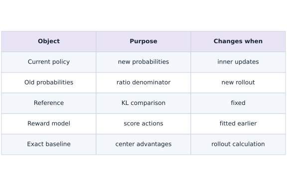
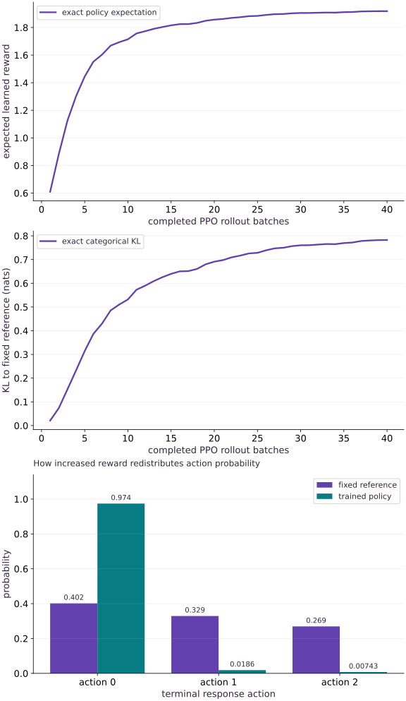

# RLHF mechanics: a frozen reward and PPO policy updates

Phase 18: Post-training: SFT, LoRA, reward models and RLHF · about 105 minutes · CPU

This worked reference is validated on CPU. Accelerator compatibility requires a separate source review and target execution receipt. Use the execution matrix to review device selection and data ownership before adapting a separate target program.

**Before this lesson:** [Learn a reward model from pairwise preferences](https://www.tahabouhsine.com/jaxpathways/lesson-posttraining-03.html); [rl-01](https://www.tahabouhsine.com/jaxpathways/lesson-rl-01.html); [rl-02](https://www.tahabouhsine.com/jaxpathways/lesson-rl-02.html); [rl-03](https://www.tahabouhsine.com/jaxpathways/lesson-rl-03.html); [rl-04](https://www.tahabouhsine.com/jaxpathways/lesson-rl-04.html).

## What you will be able to do

- Keep three identities separate
- Collect actions before optimizing them
- Verify the changed-condition exercise and explain the limits of this fixture.

## The problem

After fitting a reward model, how do its scores change a policy? We will collect actual sampled actions, freeze the behavior probabilities for each rollout batch and inspect improvement together with drift from a fixed reference.

## The idea

This lesson isolates RLHF mechanics in a small categorical bandit. A trainable policy is compared with rollout-time probabilities and a fixed reference, while a previously fitted reward model supplies frozen scores. Each role has a different update lifetime.

## Keep the four policy-and-reward roles distinct

Keep the objects in this run separate. The frozen reward model assigns scalar scores to terminal actions; it was fitted from pairwise preferences earlier. A preference probability such as $\sigma(r_+-r_-)$ is the reward model's likelihood for a comparison, not the policy's probability of sampling an action. PPO uses policy action probabilities to form its current-to-old ratio.

For one rollout batch, old action log probabilities and advantages are fixed while current policy parameters update. At the next batch, the old snapshot refreshes. The reference policy and reward model stay fixed across the run. This exercise has three terminal actions, an exact expected-reward baseline, and exact categorical KL; there is no learned value head or GAE here. A larger sequence exercise adds those components separately.

### Different objects have different update lifetimes

**Predict:** Which frozen object refreshes between rollout batches: old policy probabilities or the reference policy?



*Architecture and dataflow mechanism diagram.*

Each table row names an object's role and update lifetime: current policy parameters change on inner steps; old action log probabilities refresh only with a new rollout; reference probabilities and reward scores stay fixed; the exact baseline is computed for each rollout. The action-0 probability moves from 0.402 under the reference to 0.974 under the trained policy, alongside a final 0.782-nat KL, making the separate reference row operationally visible. Predict what goes wrong if the old snapshot refreshes every inner step: the ratio denominator resets, while the fixed reference still measures total drift. This bandit has an enumerable baseline and no learned value head. The optional sequence-PPO appendix adds a critic and EOS/timeout GAE, but its held-out reward floor failed.

### Pause and reason

Which frozen object refreshes between rollout batches: old policy probabilities or the reference policy?

<details><summary>Compare your reasoning</summary>

Old rollout-time probabilities refresh. The reference remains fixed under this lesson's contract. Confusing them changes the optimization objective.

</details>

## Before coding: identify four different objects

The current policy supplies probabilities used to sample actions and changes on each optimizer step. The old behavior probabilities are the saved denominator for this batch's PPO ratio; they stay fixed through its inner epochs, then refresh at the next rollout. The reference probabilities define KL and remain fixed across batches. The reward model supplies the scalar score and also remains fixed. These are four different snapshots, even when the current policy initially has the same values as the old or reference policy.

## Keep three identities separate

The worker samples one of three terminal actions and saves its old log probability. For this tiny action set it can enumerate the old policy's expected reward exactly, then subtract that baseline from the sampled action's frozen reward to obtain an advantage. The centered advantage is an update signal, not a preference probability or a new reward-model score. A language policy needs a value or other baseline because its full action space cannot be enumerated this way.

## Collect actions before optimizing them

Take $A=2$, ratio $\rho=1.5$, and clip range $[0.8,1.2]$: the unclipped product is 3 and the clipped product is 2.4, so PPO keeps 2.4 as the surrogate term. With $A=-2$ and $\rho=0.5$, the products are -1 and -1.6, so it keeps -1.6. The sign of the advantage determines which side is restrictive. The minimized loss is negative surrogate plus a KL penalty. Clipping limits this sampled objective; it does not freeze the policy or guarantee a global trust region.

## Work a signed clipping example

Subtracting a baseline that does not depend on the sampled action leaves the expected unclipped score-function gradient unchanged, because action probabilities sum to one. It can reduce sampling noise. Here all three actions are enumerable, so the code checks the baseline gradient against the exact expected-reward gradient rather than relying on a noisy sample. This identity does not make the clipped multi-epoch PPO estimator unbiased, and it is not a claim about a learned critic.

## Why a baseline can help without changing the expected gradient

For each sampled action, PPO computes $\rho=\exp(\log\pi_{\mathrm{current}}-\log\pi_{\mathrm{old}})$ and takes the minimum of the signed unclipped and clipped advantage products. In the code, old log probabilities and advantages are detached, so later optimizer steps cannot rewrite the batch that generated the action. Clipping is applied after multiplying by the signed advantage; clipping the ratio alone loses the negative-advantage behavior.

$$
\sum_a\pi(a)\nabla_\theta\log\pi(a)\,[r(a)-c]=\nabla_\theta\sum_a\pi(a)r(a)
$$

## Clip the surrogate with the advantage sign intact

The objective also penalizes exact categorical KL from the current policy to the fixed reference, with coefficient $\beta$. The figure's final expected learned reward is about 1.92, up from about 0.28 at the reference, while KL reaches about 0.78 nats. The probability panel shows action 0 rising from about 0.402 to 0.974, so reward rises as the policy moves away from its reference. Those are exact expectations over this three-action synthetic bandit, not human scores or language quality. The next decision is whether that reward gain justifies the measured reference drift under an independent task check.

$$
L=-\mathbb E\left[\min(\rho A,\operatorname{clip}(\rho,1-\epsilon,1+\epsilon)A)\right]+\beta D_{\mathrm{KL}}(\pi_\theta\Vert\pi_{\mathrm{ref}})
$$

## Measure reward and reference drift together

A policy can exploit a reward model's blind spots, so higher learned reward must be checked against an independent evaluator and difficult examples. This lesson's three actions are synthetic and include no held-out language response set. Its 40-batch result says the policy optimized this fixed score while moving from the reference; it does not establish alignment or generalization.

## Do not confuse reward optimization with alignment

For this finite action set, the exact optimum of expected fixed reward minus $\beta$ times forward KL has probabilities proportional to reference probability times $e^{r/\beta}$. It is a comparison point, not a promised endpoint for sampled clipped PPO. The recorded regularized objective is 1.762 for the trained policy and 1.799 at that optimum, so the run remains below the analytic reference. Reward rises from 0.282 to 1.919 while KL reaches 0.782 nats; read those quantities separately.

## Use the exact solution as a bounded optimization reference

The registered lesson is a bandit with an exact baseline, so it has no critic or GAE. In the optional saved-decoder sequence-PPO appendix, a new value head estimates expected remaining reward from each response prefix. GAE combines each step's reward-minus-value prediction with later temporal-difference residuals; at EOS it bootstraps zero, while a timeout bootstraps the final post-action value and stops the trace. Those are separate sequence mechanics, not present in this three-action loop. The retained appendix v5 report passed mechanics and replay review, but its strict held-out reward-improvement floor failed: child and parent both scored -0.009211 on eight held-out prompts and 29 valid actions. Equality does not meet a strictly positive improvement requirement, so do not describe that extension as a model-quality success.

$$
\pi^*(a)=\frac{\pi_{\mathrm{ref}}(a)e^{r(a)/\beta}}{\sum_b\pi_{\mathrm{ref}}(b)e^{r(b)/\beta}}
$$

## 1. Define the reward likelihood and signed PPO loss

Create main.py in your activated course environment. Paste this block, then run python main.py; function definitions alone print nothing.

```python
# Step 1 — 1. Define the reward likelihood and signed PPO loss: Keep reward fitting and policy loss separate.
import jax
import jax.numpy as jnp
import numpy as np

def preference_loss(w, chosen, rejected):
    margin = (chosen - rejected) @ w
    return jnp.mean(jax.nn.softplus(-margin))

def ppo_loss(
    logits, old_logps, actions, advantages, reference_logps, beta=0.1, clip=0.2
):
    logp = jax.nn.log_softmax(logits)
    ratios = jnp.exp(logp[actions] - jax.lax.stop_gradient(old_logps))
    advantages = jax.lax.stop_gradient(advantages)
    clipped = jnp.clip(ratios, 1.0 - clip, 1.0 + clip)
    surrogate = jnp.mean(jnp.minimum(ratios * advantages, clipped * advantages))
    # Exact categorical KL in this one-prompt, one-action teaching environment.
    kl = jnp.sum(
        jnp.exp(logp) * (logp - jax.lax.stop_gradient(reference_logps))
    )
    return -surrogate + beta * kl
```

Keep reward fitting and policy loss separate. Inside policy loss, old probabilities and advantages are constants for differentiation.

## 2. Fit and freeze reward, then identify reference state

Append this block to main.py and run python main.py again. Keep the earlier blocks above it.

```python
# Step 2 — 2. Fit and freeze reward, then identify reference state: The reference is stored before policy updates.
features = jnp.array([[1.0, 0.0], [0.0, 1.0], [-1.0, -1.0]])
chosen = features[jnp.array([0, 0, 1])]
rejected = features[jnp.array([1, 2, 2])]
reward_w = jnp.zeros(2)
reward_step = jax.jit(jax.grad(lambda w: preference_loss(w, chosen, rejected)))
for _ in range(100):
    reward_w = reward_w - 0.1 * reward_step(reward_w)
rewards = jax.lax.stop_gradient(features @ reward_w)
# A fixed reference policy and a learned reward, with one terminal response action.
reference = jax.nn.log_softmax(jnp.array([0.2, 0.0, -0.2]))
theta = jnp.array([0.2, 0.0, -0.2])
# Transfer the device result to the host for an independent NumPy comparison.
reference_copy = np.asarray(reference).copy()
# Create or split explicit PRNG key(s) (`key`) for reproducible randomness.
key = jax.random.key(11)
history = []
kl_history = []
step = jax.jit(jax.value_and_grad(ppo_loss))
```

The reference is stored before policy updates. This step also creates the sampling key and independent reward model.

## 3. Collect rollouts and reuse each batch correctly

Append this block to main.py and run python main.py again. Keep the earlier blocks above it.

```python
# Step 3 — 3. Collect rollouts and reuse each batch correctly
for iteration in range(40):
    old = jax.nn.log_softmax(theta)
    probs = jnp.exp(old)
    # Create or split explicit PRNG key(s) (`(key, draw)`) for reproducible randomness.
    key, draw = jax.random.split(key)
    actions = jax.random.categorical(draw, old, shape=(128,))
    old_selected = jax.lax.stop_gradient(old[actions])
    advantage = jax.lax.stop_gradient(
        rewards[actions] - jnp.sum(probs * rewards)
    )
    for _ in range(3):
        _, g = step(
            theta, old_selected, actions, advantage, reference, 0.2, 0.2
        )
        theta = theta - 0.15 * g
    logp = jax.nn.log_softmax(theta)
    history.append(float(jnp.sum(jnp.exp(logp) * rewards)))
    kl_history.append(float(jnp.sum(jnp.exp(logp) * (logp - reference))))

np.testing.assert_array_equal(reference, reference_copy)
initial_reward = float(jnp.sum(jnp.exp(reference) * rewards))
assert history[-1] > initial_reward and kl_history[-1] > 0
# Independent finite-action expectation: no evaluation sampling error here.
np.testing.assert_allclose(
    history[-1],
    sum(float(a) * float(b) for a, b in zip(jnp.exp(logp), rewards)),
    rtol=1e-6,
)
print(
    'Reward initial/final and final KL:',
    initial_reward,
    history[-1],
    kl_history[-1],
)
print(
    'Synthetic preference bandit with actual sampled PPO updates; synthetic preference target or language-generation claim.'
)
```

Each outer iteration collects a fresh batch; each inner step reuses its saved behavior probabilities. Plot points occur after a rollout batch, unlike pre-update loss curves in other lessons.

## Run the example

```python
# Step 1 — 1. Define the reward likelihood and signed PPO loss: Keep reward fitting and policy loss separate.
import jax
import jax.numpy as jnp
import numpy as np

def preference_loss(w, chosen, rejected):
    margin = (chosen - rejected) @ w
    return jnp.mean(jax.nn.softplus(-margin))

def ppo_loss(
    logits, old_logps, actions, advantages, reference_logps, beta=0.1, clip=0.2
):
    logp = jax.nn.log_softmax(logits)
    ratios = jnp.exp(logp[actions] - jax.lax.stop_gradient(old_logps))
    advantages = jax.lax.stop_gradient(advantages)
    clipped = jnp.clip(ratios, 1.0 - clip, 1.0 + clip)
    surrogate = jnp.mean(jnp.minimum(ratios * advantages, clipped * advantages))
    # Exact categorical KL in this one-prompt, one-action teaching environment.
    kl = jnp.sum(
        jnp.exp(logp) * (logp - jax.lax.stop_gradient(reference_logps))
    )
    return -surrogate + beta * kl

# Step 2 — 2. Fit and freeze reward, then identify reference state: The reference is stored before policy updates.
features = jnp.array([[1.0, 0.0], [0.0, 1.0], [-1.0, -1.0]])
chosen = features[jnp.array([0, 0, 1])]
rejected = features[jnp.array([1, 2, 2])]
reward_w = jnp.zeros(2)
reward_step = jax.jit(jax.grad(lambda w: preference_loss(w, chosen, rejected)))
for _ in range(100):
    reward_w = reward_w - 0.1 * reward_step(reward_w)
rewards = jax.lax.stop_gradient(features @ reward_w)
# A fixed reference policy and a learned reward, with one terminal response action.
reference = jax.nn.log_softmax(jnp.array([0.2, 0.0, -0.2]))
theta = jnp.array([0.2, 0.0, -0.2])
# Transfer the device result to the host for an independent NumPy comparison.
reference_copy = np.asarray(reference).copy()
# Create or split explicit PRNG key(s) (`key`) for reproducible randomness.
key = jax.random.key(11)
history = []
kl_history = []
step = jax.jit(jax.value_and_grad(ppo_loss))

# Step 3 — 3. Collect rollouts and reuse each batch correctly
for iteration in range(40):
    old = jax.nn.log_softmax(theta)
    probs = jnp.exp(old)
    # Create or split explicit PRNG key(s) (`(key, draw)`) for reproducible randomness.
    key, draw = jax.random.split(key)
    actions = jax.random.categorical(draw, old, shape=(128,))
    old_selected = jax.lax.stop_gradient(old[actions])
    advantage = jax.lax.stop_gradient(
        rewards[actions] - jnp.sum(probs * rewards)
    )
    for _ in range(3):
        _, g = step(
            theta, old_selected, actions, advantage, reference, 0.2, 0.2
        )
        theta = theta - 0.15 * g
    logp = jax.nn.log_softmax(theta)
    history.append(float(jnp.sum(jnp.exp(logp) * rewards)))
    kl_history.append(float(jnp.sum(jnp.exp(logp) * (logp - reference))))

np.testing.assert_array_equal(reference, reference_copy)
initial_reward = float(jnp.sum(jnp.exp(reference) * rewards))
assert history[-1] > initial_reward and kl_history[-1] > 0
# Independent finite-action expectation: no evaluation sampling error here.
np.testing.assert_allclose(
    history[-1],
    sum(float(a) * float(b) for a, b in zip(jnp.exp(logp), rewards)),
    rtol=1e-6,
)
print(
    'Reward initial/final and final KL:',
    initial_reward,
    history[-1],
    kl_history[-1],
)
print(
    'Synthetic preference bandit with actual sampled PPO updates; synthetic preference target or language-generation claim.'
)
```

Expected: Sampled PPO updates increase exact expected learned reward while the reference stays unchanged.

## RLHF mechanics: a frozen reward and PPO policy updates — recorded experiment

**Predict:** Which action gains probability as reward rises, and why does that also change reference KL?



**Recorded CPU computation**

### Read the figure

The first x-axis is completed rollout batch (1–40); its y-axis is exact expected learned reward, rising from 0.610 after batch 1 to 1.919 after batch 40 (the reference starts at 0.282). The second y-axis is exact categorical KL to the fixed reference in nats, ending at 0.782. In the probability panel, x names terminal actions and y is probability: action 0 moves from 0.402 under the reference to 0.974 under the trained policy. Keep reward units, nats, and probabilities separate.

### Connect it to the computation

The fixed reward favors action 0, so concentration on that action explains both the reward gain and reference drift. The exact regularized objective is 1.762 for the trained policy versus 1.799 at the analytic optimum; sampled clipped PPO approached but did not reach that reference. This is a synthetic three-action bandit with no learned critic, GAE, held-out response set, or human judgments. Predict what a larger KL coefficient should do: it should resist concentration and reduce drift, though the actual sampled trajectory must be measured.

```python
visual_data={'panels':[{'kind':'line','xlabel':'completed PPO rollout batches','ylabel':'expected learned reward','series':[{'label':'exact policy expectation','x':list(range(1,len(history)+1)),'y':history}]},{'kind':'line','xlabel':'completed PPO rollout batches','ylabel':'KL to fixed reference (nats)','series':[{'label':'exact categorical KL','x':list(range(1,len(kl_history)+1)),'y':kl_history}]}]}
for panel in visual_data.get('panels',[visual_data]):
    panel['x']=panel['series'][0]['x']

# Transfer the device result to the host for an independent NumPy comparison.
extra_panel={'kind':'bar','x':[0,1,2],'labels':['action 0','action 1','action 2'],'series':[{'label':'fixed reference','y':np.asarray(jnp.exp(reference)).tolist()},{'label':'trained policy','y':np.asarray(jnp.exp(logp)).tolist()}],'xlabel':'terminal response action','ylabel':'probability','title':'How increased reward redistributes action probability'}
visual_data={"panels":[*visual_data.get("panels",[visual_data]),extra_panel]}
```

## Recorded reference execution

CPU run: 2026-10-27T17:27:04.951903+00:00. JAX 0.9.2.

```text
Reward initial/final and final KL: 0.28191882371902466 1.9185447692871094 0.7824773192405701
Synthetic preference bandit with actual sampled PPO updates; synthetic preference target or language-generation claim.
Reward initial/final and final KL: 0.28191882371902466 1.9185447692871094 0.7824773192405701
Synthetic preference bandit with actual sampled PPO updates; synthetic preference target or language-generation claim.
Clipped surrogate terms: [ 2.4 -1.6]
Enumerated baseline score gradient matches exact expected-reward gradient.
Reference/final KL: 0.0 0.7824773192405701
Behavior log probabilities and advantages are detached.
Regularized objective reference/trained/optimum: 0.28191882371902466 1.7620493173599243 1.7987911701202393
PASS: posttraining-04

```

## Inspect both clipping directions

**Predict before running:** For a positive advantage with ratio above the upper bound, and a negative advantage below the lower bound, which product is retained?

```python
# Experiment — Inspect both clipping directions: The negative-advantage case selects the more negative product.
ratios = np.array([1.5, 0.5])
advantages = np.array([2.0, -2.0])
terms = np.minimum(
    ratios * advantages, np.clip(ratios, 0.8, 1.2) * advantages
)
np.testing.assert_allclose(terms, [2.4, -1.6])
print('Clipped surrogate terms:', terms)
```

**Expected:** The terms are [2.4, -1.6].

The negative-advantage case selects the more negative product. This is why clipping must be applied inside the signed surrogate.

## Enumerate the baseline cancellation

**Predict before running:** Does subtracting a fixed baseline change the exact policy gradient before clipping?

```python
# Experiment — Enumerate the baseline cancellation: Enumeration removes sampling error.
probe = jnp.array([0.3, -0.2, 0.1])
probe_probs = jax.nn.softmax(probe)
constant = float(jnp.sum(probe_probs * rewards))
score_jacobian = jax.jacrev(jax.nn.log_softmax)(probe)
# Reduce along axis=0 to compute `enumerated`.
enumerated = jnp.sum(
    probe_probs[:, None] * (rewards - constant)[:, None] * score_jacobian,
    axis=0,
)
exact = jax.grad(lambda logits: jnp.sum(jax.nn.softmax(logits) * rewards))(
    probe
)
np.testing.assert_allclose(enumerated, exact, atol=1e-6)
print('Enumerated baseline score gradient matches exact expected-reward gradient.')
```

**Expected:** The two gradients agree up to float32 rounding.

Enumeration removes sampling error. This tests the unclipped estimator identity; it does not assert that every clipped update equals exact gradient ascent.

## Make it yours

Check the KL at the fixed reference and compare it with the final policy’s exact KL.

### How to write this exercise — Step-by-step recipe & starter scaffold

**Inputs:**
- Reference-policy log probabilities and final-policy log probabilities for the same categorical action set.

**Outputs:**
- The self-KL and $D_{\mathrm{KL}}(\pi_{\mathrm{final}}\parallel\pi_{\mathrm{ref}})$ for the exact categorical distributions.

**Invariants to check:**
- The self-KL is zero up to floating-point tolerance; compute $D_{\mathrm{KL}}(\pi_{\mathrm{final}}\parallel\pi_{\mathrm{ref}})=\sum_a \pi_{\mathrm{final}}(a)\log(\pi_{\mathrm{final}}(a)/\pi_{\mathrm{ref}}(a))$, never the reverse direction.

**Hints:**
- Normalize both log-probability vectors.
- Weight each log ratio by the corresponding final-policy probability.

**Starter code scaffold (fill in the TODOs):**

```python
import jax.numpy as jnp

def compare_reference_and_policy_kl(reference_logps, final_policy_logps):
    # TODO: compute self-KL and D_KL(final policy || frozen reference).
    raise NotImplementedError
```

<details><summary>Reference solution</summary>

```python
# Exercise solution
zero_kl = float(jnp.sum(jnp.exp(reference) * (reference - reference)))
assert zero_kl == 0.0 and kl_history[-1] > zero_kl
print('Reference/final KL:', zero_kl, kl_history[-1])
```

</details>

## Verify detached behavior information

**Transfer**

Differentiate the objective with respect to supplied old log probabilities and advantages; both must be fixed within this update.

<details><summary>Hint</summary>

Use argnums to inspect only those two inputs.

</details>

### How to write: Verify detached behavior information — Step-by-step recipe & starter scaffold

**Inputs:**
- A callable PPO objective, policy logits, supplied old action log probabilities, sampled actions, advantages, reference log probabilities, and PPO coefficients.

**Outputs:**
- Gradients of the objective with respect to old log probabilities and advantages.

**Invariants to check:**
- Both rollout-time inputs are stop-gradient constants in this update, while policy logits remain differentiable.

**Hints:**
- Differentiate the supplied objective with respect to the two rollout arrays only.
- Check zero arrays with their original shapes.

**Starter code scaffold (fill in the TODOs):**

```python
import jax
import jax.numpy as jnp

def check_rollout_inputs_are_detached(ppo_objective, logits, old_logps, actions, advantages, reference_logps, clip, beta):
    # TODO: differentiate the objective with respect to old_logps and advantages.
    raise NotImplementedError
```

<details><summary>Reference solution and reasoning</summary>

```python
# Verify detached behavior information (Transfer)
old_grad, adv_grad = jax.grad(ppo_loss, argnums=(1, 3))(
    theta, old_selected, actions, advantage, reference, 0.2, 0.2
)
np.testing.assert_array_equal(old_grad, np.zeros(old_grad.shape))
np.testing.assert_array_equal(adv_grad, np.zeros(adv_grad.shape))
print('Behavior log probabilities and advantages are detached.')
```

Detaching is not enough if you recompute old probabilities after every optimizer step. Store their values at collection time and verify identity across all epochs on that batch.

</details>

## Compare with the finite-action regularized optimum

**Challenge**

Compute the analytic optimum for beta 0.2, then compare its regularized objective with the trained policy and the reference.

<details><summary>Hint</summary>

Evaluate expected reward minus beta times KL for all three policies, and compute the optimum in log space.

</details>

### How to write: Compare with the finite-action regularized optimum — Step-by-step recipe & starter scaffold

**Inputs:**
- A finite action set, frozen reference distribution, reward vector, beta equal to 0.2, and trained policy.

**Outputs:**
- The analytic regularized optimum and matching regularized objective values for the reference and trained policy.

**Invariants to check:**
- Every objective uses D_KL(policy || reference) with the same reward, frozen reference, and beta.

**Hints:**
- Normalize reward-adjusted reference log probabilities with log-sum-exp.
- Compare objective values, including the policy-to-reference KL, rather than only the highest-probability action.

**Starter code scaffold (fill in the TODOs):**

```python
import jax.numpy as jnp
import numpy as np

def compare_policy_with_regularized_optimum(reward, reference_probs, policy_probs, beta):
    # TODO: construct the finite-action optimum and evaluate all policies with D_KL(policy || reference).
    raise NotImplementedError
```

<details><summary>Reference solution and reasoning</summary>

```python
# Compare with the finite-action regularized optimum (Challenge)
beta = 0.2
optimal_logp = jax.nn.log_softmax(reference + rewards / beta)

def regularized(logp):
    return jnp.sum(jnp.exp(logp) * rewards) - beta * jnp.sum(
        jnp.exp(logp) * (logp - reference)
    )

optimum = float(regularized(optimal_logp))
trained = float(regularized(logp))
baseline = float(regularized(reference))
assert optimum >= trained - 1e-5 and optimum >= baseline - 1e-5
print(
    'Regularized objective reference/trained/optimum:',
    baseline,
    trained,
    optimum,
)
```

An independently derived optimum bounds this finite-action objective. It does not qualify language generation or the reward model’s judgment.

</details>

## Check your understanding

Which policy is refreshed for the next rollout batch?

1. The behavior policy follows the current policy; the reference policy remains frozen.
2. Both the behavior policy and the reference policy update after every inner PPO gradient step.
3. The reference policy refreshes each rollout while old behavior probabilities remain fixed for the entire run.

<details><summary>Answer and explanation</summary>

**1. The behavior policy follows the current policy; the reference policy remains frozen. (correct)**

Behavior identity belongs to the collected data. Reference identity belongs to the regularized objective.

**2. Both the behavior policy and the reference policy update after every inner PPO gradient step.**

Behavior probabilities stay fixed within the collected rollout’s update epochs. The candidate policy changes; the reference remains frozen.

**3. The reference policy refreshes each rollout while old behavior probabilities remain fixed for the entire run.**

Keeping the old behavior forever makes later rollout ratios describe the wrong collection policy. Refresh behavior data for each new rollout.

</details>

## Diagnose the result

If ratios always equal one during repeated updates, inspect whether old log probabilities are being recomputed. If reward grows while external quality falls, investigate reward exploitation instead of declaring alignment.

## Carry forward

- Keep four update lifetimes distinct: the current policy updates each inner PPO step, behavior log probabilities and advantages stay fixed across epochs on a rollout batch, and the reference policy and reward model stay frozen across the run.
- Apply ratio clipping inside the signed product $\min(\rho A, \operatorname{clip}(\rho, 1-\epsilon, 1+\epsilon)A)$ and track expected reward alongside reference KL $D_{\mathrm{KL}}(\pi_\theta\Vert\pi_{\mathrm{ref}})$.

## Keep your evidence

Keep reward/reference identity, collected old probabilities, signed clipping checks, exact reward/KL history and detached behavior information.

Save your predictions, modified code, terminal outputs, and reasoning in your engineering portfolio.

## Primary references

- [InstructGPT and RLHF](https://arxiv.org/abs/2203.02155)
- [PPO](https://arxiv.org/abs/1707.06347)

