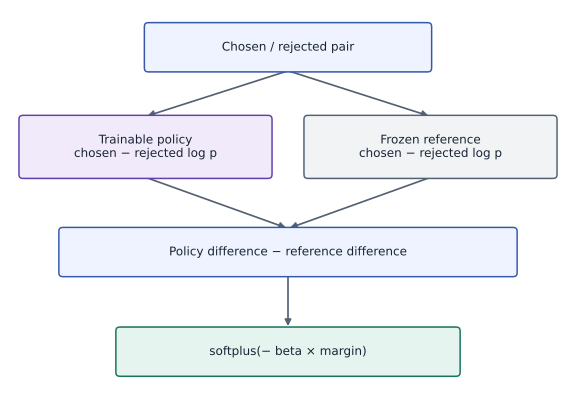
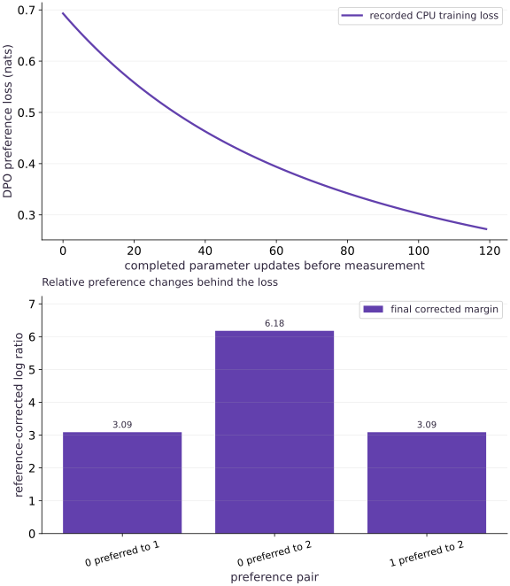

# Direct preference optimization and reference-corrected margins

Phase 18: Post-training: SFT, LoRA, reward models and RLHF · about 105 minutes · CPU

This worked reference is validated on CPU. Accelerator compatibility requires a separate source review and target execution receipt. Use the execution matrix to review device selection and data ownership before adapting a separate target program.

**Before this lesson:** [Learn a reward model from pairwise preferences](https://www.tahabouhsine.com/jaxpathways/lesson-posttraining-03.html).

## What you will be able to do

- Compare chosen and rejected response log probabilities
- Subtract the reference preference
- Verify the changed-condition exercise and explain the limits of this fixture.
- Carry a checksum-matched saved decoder through masked sequence scoring, one bounded preference update, and fixed held-out and retention checks.

## The problem

Can we train on chosen/rejected responses without collecting fresh reward-model rollouts? DPO provides a different training objective. We will work through the reference correction and compare its bookkeeping with the preceding RLHF loop.

## The idea

DPO uses chosen/rejected preferences and a fixed reference to optimize a policy directly. It compares policy log-probability differences with reference differences. This training step does not require an explicit reward-model call or on-policy rollout.

## A better relative margin need not raise chosen probability

DPO improves a chosen response relative to its paired rejected response after accounting for the reference model's own preference. That is why the objective uses a corrected log-ratio rather than a chosen score alone. For example, chosen probability can fall from $0.4$ to $0.3$ while rejected falls from $0.2$ to $0.1$: the ratio rises from $2$ to $3$, even though the chosen probability fell.

The recorded three-action fit lowers its preference loss from $0.69315$ to $0.27228$ and ends with corrected margins $3.089$, $6.178$, and $3.089$. These show improved relative fit on the synthetic training comparisons. Inspect chosen and rejected probabilities separately before making any absolute-likelihood claim.

### DPO corrects a policy margin with a reference

**Predict:** What extra evidence would you inspect before claiming a DPO update makes chosen responses more likely?



*Architecture and dataflow mechanism diagram.*

Trace both policy and frozen-reference scores into the corrected margin, then compare the plotted training margins with separate chosen/rejected probabilities. The host softplus calculation and zero reference-gradient check validate the objective mechanics; the held-out slice and source-retention readout are the next checks for transfer.

### Pause and reason

What extra evidence would you inspect before claiming a DPO update makes chosen responses more likely?

<details><summary>Compare your reasoning</summary>

Inspect chosen probabilities or sequence log probabilities directly under a fixed measurement contract. A relative margin alone is distinct from that absolute change.

</details>

## Before coding: compare changes in preference, not raw scores

For one prompt, write down current-policy log probabilities for chosen and rejected, then the same two values under the reference. DPO compares the policy's chosen-minus-rejected gap with the reference's gap. If policy and reference are initially identical, those gaps cancel and the corrected margin is zero, so the loss is $\log2$, even when the reference strongly favors one response. This gives a useful initialization check before optimizing anything.

## Compare chosen and rejected response log probabilities

Score chosen and rejected continuations under both models, conditioning on their shared prompt. For sequences, sum log probabilities over response and end tokens while excluding prompt targets and padding. The same tokenization, template, ordering, and valid-target rules must be used for policy and reference; otherwise their differences no longer compare the same event. The categorical exercise begins with one-token actions so the score components are easy to inspect.

## Subtract the reference preference

First compute $\log p_\pi(y_w|x)-\log p_\pi(y_l|x)$, then subtract the corresponding reference gap. When $\pi=\pi_{ref}$, the corrected margin is zero even if the reference assigns unequal probabilities. The recorded reference-gradient check is zero at this point, confirming that the unchanged policy receives no update from an already-cancelled pair.

$$
L_{\mathrm{DPO}}=\mathbb E\left[\operatorname{softplus}\!\left(-\beta\left[\log\frac{\pi_\theta(y^+|x)}{\pi_\theta(y^-|x)}-\log\frac{\pi_{\mathrm{ref}}(y^+|x)}{\pi_{\mathrm{ref}}(y^-|x)}\right]\right)\right]
$$

## Work through a numeric margin and its gradient

For current log probabilities $(-2,-4)$ and reference values $(-3,-4)$, the policy gap is $2$, the reference gap is $1$, and the corrected margin is $1$. With $\beta=0.3$, the loss is $\log(1+e^{-0.3})\approx0.554$. Reversing chosen and rejected flips the sign. The derivative with respect to the margin is negative, so gradient descent increases this pair's relative chosen gap; shared model parameters mean it does not guarantee the chosen response's absolute probability rises.

$$
\frac{\partial L}{\partial m}=-\beta\,\sigma(-\beta m)
$$

## A rising preference ratio can hide falling chosen probability

A second probability vector makes the distinction concrete. With reference probabilities $[0.4,0.4,0.2]$, and policy probabilities $[0.3,0.1,0.6]$, chosen probability falls from $0.4$ to $0.3$ while the chosen/rejected ratio rises from $1$ to $3$. DPO can improve on this pairwise comparison while shifting mass elsewhere. Track chosen and rejected sequence scores as well as margins, then inspect held-out outputs, task behavior, length, and diversity.

## Keep the algorithm distinction visible

DPO updates from a fixed set of preference pairs using a frozen reference. This step has no separately trained reward model and no on-policy rollout. That describes the mechanics; it does not remove the need to identify the base/reference and inspect the preference data. The next section makes the objective's beta and sequence aggregation explicit.

## Treat beta and length as part of the objective

Beta multiplies the reference-corrected margin before the preference loss, so changing beta changes the update scale. It is not interchangeable with every explicit KL coefficient in a PPO objective. Likewise, summing response log probabilities and averaging them over length define different preferences: the sequence-sum objective assigns a two-token response twice the log-probability contribution of one equally likely token. Record the convention and compare runs under the same one.

## Evaluate beyond chosen-pair fit

Use the frozen-pair loss to check the update, then inspect evidence beyond its training comparisons. The recorded synthetic run's held-out unanimous slice was already at $1.0$ hard accuracy and barely moved; the disagreement slice has a $0.5$ vote fraction, so hard accuracy is undefined, and its predicted probability changed only from about $0.002515$ to $0.002514$. Source-retention score moved from $-17.61117$ to $-17.61102$. These small changes do not establish improved language responses. Human review and task-specific evaluation are separate evidence.

## Carry sequence bookkeeping and reference identity into a real model

For language responses, sum valid answer and EOS log probabilities while conditioning on prompt tokens; exclude prompt targets and right padding. In the hand calculation, the three-token and eight-token responses have summed log probabilities $-17.5879$ and -$47.0626$, with target counts $3$ and $8$. Those totals should not be divided by length under the declared sequence-sum objective. Bind cached reference scores to the exact checkpoint, tokenizer, template, example order, and mask so the subtraction stays aligned. The categorical mechanics and sequence handoff are separate from the earlier PPO lesson's reward-model and rollout loop.

## Required handoff: carry a saved decoder into sequence preferences

Use the saved inference package from the [Decoder foundations project guide](https://www.tahabouhsine.com/jaxpathways/project-guides/text-harness-foundations.html), after completing its causal-decoder/tokenizer checks. The [saved-decoder PPO project guide](https://www.tahabouhsine.com/jaxpathways/project-guides/posttraining-audit.html) is an optional reference for shared sequence-scoring mechanics; this DPO path branches from reward and sequence-scoring basics and does not require PPO. Verify the parameter digest `271cb6457de5da3f727c343c64b7bd350c00e503ea7ac847eecf51fbd5558802` and tokenizer digest `c92b534443cc6a1eacd5e78406b2c42e59553df704a07102a03c639d3694f586`; vocabulary size alone does not prove tokenizer identity. This is an inference package, so it supplies no optimizer state to resume.

The sequence handoff proceeds through four inspectable stages: verify the package and fixed prompt/preference split; score summed response log probabilities under policy and frozen reference; take one bounded DPO update with declared beta; then report held-out preference, disagreement-slice, and source-retention changes separately. Shift logits at `[:-1]` against targets at `[1:]`; include response EOS, exclude prompt and padding targets, and sum without length normalization. Keep package identity, tokenizer, pair ordering, and mask convention with any cached scores.

The recorded one-step transfer starts from loss $0.69315$. Its held-out unanimous slice stays at $1.0$ hard accuracy, while the disagreement slice remains ambiguous at vote fraction $0.5$ and predicted probability shifts from $0.002515$ to $0.002514$. Source retention changes from $-17.611167$ to $-17.611021$. The adjacent PPO analysis retains its strict held-out reward-floor failure at all tested reward scales ($0.5$, $1$, $2$), with $8$/$8$ response matches. These are bookkeeping and mechanics results; they do not support a response-quality claim.

This route requires the full repository, foundation source files and retained `package.json`, `params.npz`, and `tokenizer.json`, with JAX/JAXlib $\text{0.9.2}$, NumPy $\text{2.4.4}$, and Tokenizers $\text{0.22.2}$. The standalone categorical DPO `main.py` exercise runs without that saved-decoder package.

### Pause and reason

If a two-token response has summed log probability -5 and a one-token response has -3, which one has larger sequence probability under this objective?

<details><summary>Compare your reasoning</summary>

The one-token response, because -3 is greater than -5. Replacing sums with means changes the objective and must be called out explicitly.

</details>

## 1. Define the reference-corrected pair objective

Create main.py in your activated course environment. Paste this block, then run python main.py; function definitions alone print nothing.

```python
# Step 1 — 1. Define the reference-corrected pair objective
import jax
import jax.numpy as jnp
import numpy as np

def dpo_loss(policy_logps, reference_logps, chosen, rejected, beta=0.2):
    margin = (policy_logps[chosen] - policy_logps[rejected]) - jax.lax.stop_gradient(
        reference_logps[chosen] - reference_logps[rejected]
    )
    return jnp.mean(jax.nn.softplus(-beta * margin))
```

The reference correction is detached, while current policy log probabilities remain differentiable.

## 2. Freeze reference probabilities and comparison IDs

Append this block to main.py and run python main.py again. Keep the earlier blocks above it.

```python
# Step 2 — 2. Freeze reference probabilities and comparison IDs: The initial policy equals a nonuniform reference.
reference = jax.nn.log_softmax(jnp.array([0.2, 0.0, -0.2]))
chosen = jnp.array([0, 0, 1])
rejected = jnp.array([1, 2, 2])
theta = jnp.array([0.2, 0.0, -0.2])
history = []
loss = lambda theta: dpo_loss(
    jax.nn.log_softmax(theta), reference, chosen, rejected, 0.3
)
step = jax.jit(jax.value_and_grad(loss))
np.testing.assert_allclose(loss(theta), np.log(2), atol=1e-6)
```

The initial policy equals a nonuniform reference. Predict the corrected margin and initial loss before continuing.

## 3. Fit the policy and test cancellation

Append this block to main.py and run python main.py again. Keep the earlier blocks above it.

```python
# Step 3 — 3. Fit the policy and test cancellation: The host stable-softplus calculation checks final margins.
for _ in range(120):
    value, g = step(theta)
    history.append(float(value))
    theta = theta - 0.4 * g

assert history[-1] < history[0] * 0.5
policy = jax.nn.log_softmax(theta)
# Transfer the device result to the host for an independent NumPy comparison.
margin = np.asarray(
    (policy[chosen] - policy[rejected]) - (reference[chosen] - reference[rejected]),
    np.float64,
)
np.testing.assert_allclose(
    loss(theta), np.mean(np.logaddexp(0, -0.3 * margin)), atol=1e-6
)
assert np.all(margin > 0)
np.testing.assert_allclose(loss(theta + 50), loss(theta), atol=1e-6)
print(
    'DPO initial/final:',
    history[0],
    history[-1],
    '; reference-corrected margins:',
    margin,
)
```

The host stable-softplus calculation checks final margins. Adding a common logit offset preserves the probability distribution and therefore the objective.

## Run the example

```python
# Step 1 — 1. Define the reference-corrected pair objective
import jax
import jax.numpy as jnp
import numpy as np

def dpo_loss(policy_logps, reference_logps, chosen, rejected, beta=0.2):
    margin = (policy_logps[chosen] - policy_logps[rejected]) - jax.lax.stop_gradient(
        reference_logps[chosen] - reference_logps[rejected]
    )
    return jnp.mean(jax.nn.softplus(-beta * margin))

# Step 2 — 2. Freeze reference probabilities and comparison IDs: The initial policy equals a nonuniform reference.
reference = jax.nn.log_softmax(jnp.array([0.2, 0.0, -0.2]))
chosen = jnp.array([0, 0, 1])
rejected = jnp.array([1, 2, 2])
theta = jnp.array([0.2, 0.0, -0.2])
history = []
loss = lambda theta: dpo_loss(
    jax.nn.log_softmax(theta), reference, chosen, rejected, 0.3
)
step = jax.jit(jax.value_and_grad(loss))
np.testing.assert_allclose(loss(theta), np.log(2), atol=1e-6)

# Step 3 — 3. Fit the policy and test cancellation: The host stable-softplus calculation checks final margins.
for _ in range(120):
    value, g = step(theta)
    history.append(float(value))
    theta = theta - 0.4 * g

assert history[-1] < history[0] * 0.5
policy = jax.nn.log_softmax(theta)
# Transfer the device result to the host for an independent NumPy comparison.
margin = np.asarray(
    (policy[chosen] - policy[rejected]) - (reference[chosen] - reference[rejected]),
    np.float64,
)
np.testing.assert_allclose(
    loss(theta), np.mean(np.logaddexp(0, -0.3 * margin)), atol=1e-6
)
assert np.all(margin > 0)
np.testing.assert_allclose(loss(theta + 50), loss(theta), atol=1e-6)
print(
    'DPO initial/final:',
    history[0],
    history[-1],
    '; reference-corrected margins:',
    margin,
)
```

Expected: Reference-corrected margins become positive and the initial equal-policy loss is log(2).

## Direct preference optimization and reference-corrected margins — recorded experiment

**Predict:** What does a positive corrected margin establish, and what does it leave unknown about absolute probabilities?



**Recorded CPU computation**

### Read the figure

The training curve starts at $0.69315$ and ends at $0.27228$ on the same three synthetic comparisons. The final corrected-margin bars are $3.089$, $6.178$, and $3.089$. A positive margin means the policy's chosen-versus-rejected ratio improved relative to the reference for that pair; it is not an absolute probability or a human preference score. The recorded counterexample shows why: chosen probability can fall while the ratio rises.

### Connect it to the computation

Trace both policy and frozen-reference scores into the corrected margin, then compare the plotted training margins with separate chosen/rejected probabilities. The host softplus calculation and zero reference-gradient check validate the objective mechanics; the held-out slice and source-retention readout are the next checks for transfer.

```python
visual_data={'kind':'line','xlabel':'completed parameter updates before measurement','ylabel':'DPO preference loss (nats)','series':[{'label':'recorded CPU training loss','x':list(range(len(history))),'y':history}]}
for panel in visual_data.get('panels',[visual_data]):
    panel['x']=panel['series'][0]['x']

extra_panel={'kind':'bar','x':[0,1,2],'labels':['0 preferred to 1','0 preferred to 2','1 preferred to 2'],'series':[{'label':'final corrected margin','y':margin.tolist()}],'xlabel':'preference pair','ylabel':'reference-corrected log ratio','title':'Relative preference changes behind the loss'}
visual_data={"panels":[*visual_data.get("panels",[visual_data]),extra_panel]}
```

## Recorded reference execution

CPU run: 2026-10-27T16:12:25.808407+00:00. JAX 0.9.2.

```text
DPO initial/final: 0.6931471824645996 0.27227783203125 ; reference-corrected margins: [3.0890286  6.17805719 3.08902884]
DPO initial/final: 0.6931471824645996 0.27227783203125 ; reference-corrected margins: [3.0890286  6.17805719 3.08902884]
Corrected/unadjusted initial loss: 0.6931471824645996 0.6540467739105225
Loss before/after: 0.6931471824645996 0.5418724417686462 ; chosen probability: 0.4 -> 0.3
Reversed-label loss: 1.5064733028411865
Reference gradient is zero.
One-pair logit gradient agrees with independent margin derivative.
hand sum terms: [-5.877766, -5.884814, -5.825323] sum: -17.58790268250536
scoring: summed response logps -17.587902069091797 -47.06261873245239 ; response token counts 3 8
DPO loss before one update: 0.6931471824645996
heldout preference baseline/after: [{'margin': 11.944979667663574, 'predicted_probability': np.float64(0.999993508300255), 'vote_fraction': 1.0, 'slice': 'unanimous', 'ambiguous': False, 'hard_accuracy': 1.0, 'expected_annotator_agreement': 1.0}, {'margin': -5.983144283294678, 'predicted_probability': np.float64(0.0025145485396998223), 'vote_fraction': 0.5, 'slice': 'disagreement', 'ambiguous': True, 'hard_accuracy': None, 'expected_annotator_agreement': 0.5}] [{'margin': 11.9453444480896, 'predicted_probability': np.float64(0.9999935106678529), 'vote_fraction': 1.0, 'slice': 'unanimous', 'ambiguous': False, 'hard_accuracy': 1.0, 'expected_annotator_agreement': 1.0}, {'margin': -5.983484745025635, 'predicted_probability': np.float64(0.00251369472949755), 'vote_fraction': 0.5, 'slice': 'disagreement', 'ambiguous': True, 'hard_accuracy': None, 'expected_annotator_agreement': 0.5}]
disagreement slice baseline/after: [{'margin': -5.983144283294678, 'predicted_probability': np.float64(0.0025145485396998223), 'vote_fraction': 0.5, 'slice': 'disagreement', 'ambiguous': True, 'hard_accuracy': None, 'expected_annotator_agreement': 0.5}] [{'margin': -5.983484745025635, 'predicted_probability': np.float64(0.00251369472949755), 'vote_fraction': 0.5, 'slice': 'disagreement', 'ambiguous': True, 'hard_accuracy': None, 'expected_annotator_agreement': 0.5}]
source retention baseline/after: -17.611167430877686 -17.611021518707275
recorded PPO heldout reward scale / child-minus-parent: 0.5 0.0
recorded PPO heldout reward scale / child-minus-parent: 1.0 0.0
recorded PPO heldout reward scale / child-minus-parent: 2.0 0.0
recorded heldout response matches: 8 / 8 ; strict heldout reward floor remains FAILED at every scale
Synthetic objective check only. No human preference or response-quality claim.
PASS: posttraining-05

```

## Verify the reference cancellation

**Predict before running:** Can a nonuniform reference still start at log(2)?

```python
# Experiment — Verify the reference cancellation: The initial policy is not uniform.
initial = dpo_loss(reference, reference, chosen, rejected, 0.3)
np.testing.assert_allclose(initial, np.log(2), atol=1e-6)
uncorrected = jnp.mean(
    jax.nn.softplus(-0.3 * (reference[chosen] - reference[rejected]))
)
assert not np.isclose(float(initial), float(uncorrected))
print('Corrected/unadjusted initial loss:', float(initial), float(uncorrected))
```

**Expected:** The corrected initial loss is log(2); omitting the reference correction changes it.

The initial policy is not uniform. Cancellation, rather than equal response probabilities, makes the corrected margin zero.

## Improve the ratio while lowering the chosen probability

**Predict before running:** Can the preference loss fall even if the chosen response becomes less likely?

```python
# Experiment — Improve the ratio while lowering the chosen probability: The rejected probability falls further.
example_ref = jnp.log(jnp.array([0.4, 0.4, 0.2]))
example_policy = jnp.log(jnp.array([0.3, 0.1, 0.6]))
choice = jnp.array([0])
reject = jnp.array([1])
before = float(dpo_loss(example_ref, example_ref, choice, reject, 0.3))
after = float(dpo_loss(example_policy, example_ref, choice, reject, 0.3))
assert after < before and float(jnp.exp(example_policy[0])) < float(
    jnp.exp(example_ref[0])
)
np.testing.assert_allclose(after, np.logaddexp(0.0, -0.3 * np.log(3)), atol=1e-6)
print('Loss before/after:', before, after, '; chosen probability: 0.4 -> 0.3')
```

**Expected:** The DPO loss decreases while the chosen probability falls from 0.4 to 0.3.

The rejected probability falls further. Monitoring only the margin would miss the shift toward an unpaired response.

## Make it yours

Swap chosen and rejected IDs after training and verify that the loss rises.

### How to write this exercise — Step-by-step recipe & starter scaffold

**Inputs:**
- Policy and reference log probabilities plus chosen and rejected comparison IDs.

**Outputs:**
- Pairwise loss before and after swapping the chosen/rejected identities.

**Invariants to check:**
- The reference correction uses the same frozen reference for both response IDs.

**Hints:**
- Swap IDs without changing either probability table.
- Evaluate the loss at the trained policy.

**Starter code scaffold (fill in the TODOs):**

```python
import jax.numpy as jnp
import numpy as np

def compare_swapped_preference_loss(policy_logps, reference_logps, chosen, rejected):
    # TODO: evaluate the corrected objective under original and swapped pair identities.
    raise NotImplementedError
```

<details><summary>Reference solution</summary>

```python
# Exercise solution
reverse = float(dpo_loss(policy, reference, rejected, chosen, 0.3))
assert reverse > float(dpo_loss(policy, reference, chosen, rejected, 0.3))
print('Reversed-label loss:', reverse)
```

</details>

## Freeze the reference numerically and in autodiff

**Transfer**

Differentiate with respect to reference log probabilities and verify that their gradient is zero.

<details><summary>Hint</summary>

The reference is an input to the objective but not an optimization variable.

</details>

### How to write: Freeze the reference numerically and in autodiff — Step-by-step recipe & starter scaffold

**Inputs:**
- Policy logits, reference log probabilities, chosen/rejected IDs, and beta.

**Outputs:**
- The reference-input gradient of the DPO objective.

**Invariants to check:**
- Reference values affect the numeric margin but are stopped from receiving optimization gradients.

**Hints:**
- Differentiate with respect to the reference argument only.
- Check the gradient shape and that every entry is zero.

**Starter code scaffold (fill in the TODOs):**

```python
import jax.numpy as jnp
import numpy as np

def check_reference_gradient(policy_logits, reference_logps, chosen, rejected, beta):
    # TODO: differentiate the pair objective with respect to the reference values.
    raise NotImplementedError
```

<details><summary>Reference solution and reasoning</summary>

```python
# Freeze the reference numerically and in autodiff (Transfer)
reference_grad = jax.grad(dpo_loss, argnums=1)(
    policy, reference, chosen, rejected, 0.3
)
np.testing.assert_array_equal(
    reference_grad, np.zeros(reference_grad.shape)
)
print('Reference gradient is zero.')
```

Also retain the actual reference checkpoint and tokenizer identity. A detached but reloaded different model is still a changed reference.

</details>

## Derive a one-pair categorical gradient

**Challenge**

At a fresh three-action policy, compute the corrected margin and derive the logit gradient for one chosen/rejected pair. Why does the third action have zero direct logit gradient here?

<details><summary>Hint</summary>

The log-softmax normalizer cancels in a log-probability difference. Shared model parameters make real sequence updates less isolated.

</details>

### How to write: Derive a one-pair categorical gradient — Step-by-step recipe & starter scaffold

**Inputs:**
- Three-action policy logits, fixed reference log probabilities, one chosen ID, one rejected ID, and beta.

**Outputs:**
- Corrected margin and analytic logit-gradient vector checked against autodiff.

**Invariants to check:**
- Only chosen and rejected action logits have direct gradient; the third action cancels in the pairwise log-probability difference.

**Hints:**
- Write the log-softmax derivative for each selected action.
- Check all three entries against autodiff.

**Starter code scaffold (fill in the TODOs):**

```python
import jax.numpy as jnp
import numpy as np

def derive_one_pair_logit_gradient(logits, reference_logps, chosen, rejected, beta):
    # TODO: derive the corrected pair margin and compare the three logit derivatives.
    raise NotImplementedError
```

<details><summary>Reference solution and reasoning</summary>

```python
# Derive a one-pair categorical gradient (Challenge)
probe = jnp.array([0.6, -0.3, 0.1])
choice = jnp.array([0])
reject = jnp.array([1])
beta = 0.3
one_pair = lambda logits: dpo_loss(
    jax.nn.log_softmax(logits), reference, choice, reject, beta
)
margin_value = float((probe[0] - probe[1]) - (reference[0] - reference[1]))
factor = -beta / (1 + np.exp(beta * margin_value))
np.testing.assert_allclose(
    jax.grad(one_pair)(probe), [factor, -factor, 0.0], atol=1e-6
)
print('One-pair logit gradient agrees with independent margin derivative.')
```

The unpaired logit is absent from this categorical difference, yet its normalized probability can change when the other logits move.

</details>

## Full-workspace transfer: score saved sequences and run one preference update

**Transfer**

Load the retained foundations inference package after verifying its pinned parameter and tokenizer hashes. Implement summed response log probabilities with shifted targets, a prompt-excluding response mask, EOS included, and right-padding excluded. Compare one pair by hand and against NumPy. Use two synthetic training pairs for one small DPO gradient step. Record held-out preference and disagreement-slice baselines plus a source-retention baseline before updating; report their changes afterward. This is a bounded teaching fixture, not quality evidence. This advanced practice needs the full repository checkout and the package/source files listed in the required handoff section; the regular lesson baseline is still self-contained.

<details><summary>Hint</summary>

Tokenize the prompt and response separately with the pinned tokenizer and concatenate IDs, so the prompt boundary is explicit. The logit at input position t predicts target token t+1. The response mask indexes target positions, not input positions.

</details>

### How to write: Full-workspace transfer: score saved sequences and run one preference update — Step-by-step recipe & starter scaffold

**Inputs:**
- The retained foundation inference package and its package manifest
- Pinned tokenizer bytes and model configuration
- Two synthetic training preference pairs with exact prompt, chosen and rejected strings
- Held-out unanimous and disagreement pairs plus a source-retention prompt/response, all fixed before the update

**Outputs:**
- Summed chosen/rejected response-plus-EOS log probabilities from shifted logits
- Independent NumPy aggregation for an unequal-length pair
- Pre-update and post-update held-out preference, disagreement-slice and retention results
- A no-update replay of the saved PPO held-out record at reward scales 0.5, 1 and 2, retaining the failed strict reward floor and response-match count.
- An ambiguous-slice metric that does not assign a 50/50 vote to either hard label.

**Invariants to check:**
- Verify both pinned params and tokenizer hashes before loading
- Keep the saved model and tokenizer identity matched
- Mask target positions only, beginning at the first response token and including EOS
- Exclude prompt targets and PAD targets; sum rather than average response log probabilities
- Use the identical frozen reference for all reference scores
- Capture evaluation baselines before the single training update
- For a 0.5 vote, mark the pair ambiguous and omit hard accuracy; report probability or expected agreement against the vote fraction.

**Hints:**
- Use model.logits on right-padded full prompt-plus-response token IDs with PAD=0 as invalid positions.
- Shift target IDs to tokens[:, 1:] and logits to logits[:, :-1].
- Compute the response mask over target positions, not token input positions.
- Implement one fixed DPO update and print held-out, disagreement and retention deltas separately.

**Starter code scaffold (fill in the TODOs):**

```python
# Follow the runnable reference solution above, then change only one declared choice: beta or step size.
# Keep the same package hashes, fixed pair split, masks, and before-update baselines.
raise NotImplementedError
```

<details><summary>Reference solution and reasoning</summary>

```python
# Saved-sequence preference handoff. Run from the repository root in the foundations CPU environment.
import hashlib, json, sys
from pathlib import Path
import jax
import jax.numpy as jnp
import numpy as np
from tokenizers import Tokenizer

ROOT = Path.cwd()
FOUNDATIONS = ROOT / "projects/text-harness/foundations"
PACKAGE = FOUNDATIONS / "reference/run/inference-package"
sys.path.insert(0, str(FOUNDATIONS))
import model as decoder
import train

manifest = json.loads((PACKAGE / "package.json").read_text())
expected_source_hashes = {'model.py': '94a88ae7fd6a251b5b190b4631496e04bb71a31c1bfe418511fdd37ffef034c9', 'config.py': '5c05801a7ec1a15b3978c87c77ac4e64d1b056c60487cbcff3cdf72475c8bb64', 'train.py': 'ee9f3bc73505ce8e00fe9680589d97805593e5c8c035cba4709b5f334eb27a2b'}
for name, expected in expected_source_hashes.items():
    actual = hashlib.sha256((FOUNDATIONS / name).read_bytes()).hexdigest()
    assert actual == expected == manifest["identity"]["code_sha256"][name], (name, actual)

assert manifest["params_sha256"] == "271cb6457de5da3f727c343c64b7bd350c00e503ea7ac847eecf51fbd5558802"
assert manifest["processor_sha256"] == "c92b534443cc6a1eacd5e78406b2c42e59553df704a07102a03c639d3694f586"
params, config, loaded = train.load_model_package(PACKAGE, manifest["identity"])
tokenizer = Tokenizer.from_file(str(PACKAGE / "tokenizer.json"))
assert hashlib.sha256((PACKAGE / "tokenizer.json").read_bytes()).hexdigest() == loaded["processor_sha256"]
reference = jax.tree.map(lambda x: jnp.array(x), params)
PAD, EOS = 0, 2

def encode(text):
    return tokenizer.encode(text, add_special_tokens=False).ids

def score_jax(model_params, prompt, response):
    prefix = [1] + encode(prompt)  # Explicit BOS; exact prefix IDs are part of the example.
    answer = encode(response) + [EOS]
    full = prefix + answer
    if len(full) > config.context:
        raise ValueError("fixture example exceeds the saved model context")
    padded = np.full((1, config.context), PAD, dtype=np.int32)
    padded[0, :len(full)] = full
    valid = padded != PAD
    logits = decoder.logits(model_params, jnp.asarray(padded), config,
                            valid_mask=jnp.asarray(valid))
    targets = jnp.asarray(padded[:, 1:])
    log_probs = jax.nn.log_softmax(logits[:, :-1].astype(jnp.float32), axis=-1)
    selected = jnp.take_along_axis(log_probs, targets[..., None], axis=-1)[..., 0][0]
    target_positions = jnp.arange(1, padded.shape[1])
    mask = (target_positions >= len(prefix)) & (target_positions < len(full))
    mask = mask & (targets[0] != PAD)
    return jnp.sum(jnp.where(mask, selected, 0.0))

def score_one(model_params, prompt, response):
    prefix = [1] + encode(prompt)  # Explicit BOS; exact prefix IDs are part of the example.
    answer = encode(response) + [EOS]
    full = prefix + answer
    if len(full) > config.context:
        raise ValueError("fixture example exceeds the saved model context")
    padded = np.full((1, config.context), PAD, dtype=np.int32)
    padded[0, :len(full)] = full
    valid = padded != PAD
    logits = decoder.logits(model_params, jnp.asarray(padded), config,
                            valid_mask=jnp.asarray(valid))
    target_ids = padded[:, 1:]
    logp = np.asarray(jax.nn.log_softmax(logits[:, :-1].astype(jnp.float32), axis=-1))
    selected = np.take_along_axis(logp, target_ids[..., None], axis=-1)[..., 0][0]
    target_positions = np.arange(1, padded.shape[1])
    response_mask = (target_positions >= len(prefix)) & (target_positions < len(full))
    response_mask &= target_ids[0] != PAD
    return float(np.sum(selected[response_mask], dtype=np.float64)), selected, response_mask, full

# Hand check and independent NumPy aggregation on an unequal-length pair.
prompt = "Q: "
short = score_one(reference, prompt, "yes")
long = score_one(reference, prompt, "I do not know")
assert int(short[2].sum()) == len(encode("yes")) + 1
assert int(long[2].sum()) == len(encode("I do not know")) + 1
np.testing.assert_allclose(short[0], np.sum(short[1][short[2]], dtype=np.float64), atol=1e-6)
# Independently recompute log-softmax and the shifted sum in host NumPy.
def numpy_reference_score(prompt_text, response_text):
    prefix_ids = [1] + encode(prompt_text)
    answer_ids = encode(response_text) + [EOS]
    tokens = prefix_ids + answer_ids
    batch = np.full((1, config.context), PAD, dtype=np.int32)
    batch[0, :len(tokens)] = tokens
    logits = np.asarray(decoder.logits(reference, jnp.asarray(batch), config,
                                       valid_mask=jnp.asarray(batch != PAD)), dtype=np.float64)[0, :-1]
    targets = batch[0, 1:]
    positions = np.arange(1, batch.shape[1])
    mask = (positions >= len(prefix_ids)) & (positions < len(tokens)) & (targets != PAD)
    terms=[]
    for t in np.flatnonzero(mask):
        row=logits[t]
        peak=np.max(row)
        terms.append(row[targets[t]] - peak - np.log(np.exp(row - peak).sum()))
    return float(np.sum(terms, dtype=np.float64)), terms, mask
numpy_short, hand_terms, independent_mask = numpy_reference_score(prompt, "yes")
np.testing.assert_array_equal(independent_mask, short[2])
np.testing.assert_allclose(short[0], numpy_short, rtol=1e-6, atol=1e-6)
print("hand sum terms:", np.round(hand_terms, 6).tolist(), "sum:", float(np.sum(hand_terms)))
# A deliberately shifted-mask canary: position len(prefix)-1 predicts the first answer token.
assert short[2][len([1] + encode(prompt)) - 1]
assert not short[2][0]  # The first shifted target is still inside the prompt.

train_pairs = [
    ("Q: ", "yes", "no"),
    ("A: ", "I can help", "I cannot tell"),
]
# Freeze before-update baselines on separate held-out preference cases and a source-retention case.
heldout = [
    ("R: ", "clear", "unclear", 1.0, "unanimous"),
    ("R: ", "unknown", "maybe", 0.5, "disagreement"),
]
retention = [("Alice", "yes")]

def evaluate(model_params, pairs):
    rows=[]
    for p, good, bad, vote, slice_name in pairs:
        good_lp=score_one(model_params,p,good)[0]
        bad_lp=score_one(model_params,p,bad)[0]
        margin = good_lp - bad_lp
        predicted_probability = 1.0 / (1.0 + np.exp(-margin))
        predicted_chosen = float(predicted_probability > 0.5)
        hard_accuracy = None if vote == 0.5 else float(predicted_chosen == float(vote > 0.5))
        expected_annotator_agreement = vote * predicted_chosen + (1.0 - vote) * (1.0 - predicted_chosen)
        rows.append({"margin":margin,"predicted_probability":predicted_probability,
                     "vote_fraction":vote,"slice":slice_name,"ambiguous":vote == 0.5,
                     "hard_accuracy":hard_accuracy,
                     "expected_annotator_agreement":expected_annotator_agreement})
    return rows

def retention_score(model_params):
    return float(np.mean([score_one(model_params,p,r)[0] for p,r in retention]))

heldout_before=evaluate(reference, heldout)
retention_before=retention_score(reference)
train_scores=[(score_one(params,p,a)[0],score_one(params,p,b)[0]) for p,a,b in train_pairs]

def dpo_loss(candidate):
    margins=[]
    for p,good,bad in train_pairs:
        pi_good=score_jax(candidate,p,good)
        pi_bad=score_jax(candidate,p,bad)
        ref_good=score_jax(reference,p,good)
        ref_bad=score_jax(reference,p,bad)
        margins.append((pi_good-pi_bad)-(ref_good-ref_bad))
    return jnp.mean(jax.nn.softplus(-0.1*jnp.stack(margins)))

loss, grads = jax.value_and_grad(dpo_loss)(params)
# One small, declared learner-controlled update; reference and held-out records are unchanged.
params = jax.tree.map(lambda w,g: w - 1e-4*g, params, grads)
heldout_after=evaluate(params, heldout)
retention_after=retention_score(params)
# NumPy is the independent host aggregation oracle, not a separate model implementation.
np.testing.assert_allclose(float(loss), float(np.logaddexp(0, -0.1*np.zeros(2)).mean()), atol=1e-5)
assert all(np.isfinite(row["margin"]) for row in heldout_after)
assert all(row["hard_accuracy"] is None and row["ambiguous"] for row in heldout_after if row["vote_fraction"] == 0.5)
print("scoring: summed response logps", short[0], long[0], "; response token counts", int(short[2].sum()), int(long[2].sum()))
print("DPO loss before one update:", float(loss))
print("heldout preference baseline/after:", heldout_before, heldout_after)
print("disagreement slice baseline/after:", [x for x in heldout_before if x['slice']=='disagreement'], [x for x in heldout_after if x['slice']=='disagreement'])
print("source retention baseline/after:", retention_before, retention_after)

# Changed-condition replay of the existing sequence-PPO appendix evidence.
# No model update or retuning: keep recorded held-out prompts and responses fixed.
ppo_path = ROOT / "projects/posttraining-audit/transformer_lineage/teaching/v5/evaluation.json"
ppo = json.loads(ppo_path.read_text())
heldout_ppo = ppo["splits"]["heldout"]["episodes"]
parent_rewards = np.asarray([r["parentFittedRewardScore"] for r in heldout_ppo], np.float64)
child_rewards = np.asarray([r["childFittedRewardScore"] for r in heldout_ppo], np.float64)
matched_responses = np.asarray([r["parentActionIds"] == r["childActionIds"] for r in heldout_ppo])
assert len(heldout_ppo) == 8 and int(matched_responses.sum()) == 8
for scale in (0.5, 1.0, 2.0):
    delta = float(np.mean(scale * child_rewards) - np.mean(scale * parent_rewards))
    print("recorded PPO heldout reward scale / child-minus-parent:", scale, delta)
assert ppo["qualityGate"]["heldoutRewardFloorPassed"] is False
print("recorded heldout response matches:", int(matched_responses.sum()), "/", len(heldout_ppo),
      "; strict heldout reward floor remains FAILED at every scale")
print("Synthetic objective check only. No human preference or response-quality claim.")
```

The sequence score is a sum over response and EOS targets only. The first answer token is predicted by the final prompt logit, so the response mask is shifted by one relative to the token input. Right padding and prompt targets contribute zero. The independent NumPy reduction checks that exact mask and sum. The update is intentionally one tiny step from the saved pilot weights; held-out and retention baselines are recorded first and the reference remains frozen. Report disagreement separately because a 0.5 vote is not a unanimous target. The saved PPO appendix remains a separate changed-objective analysis and its strict held-out reward floor remains failed. The final replay rescales the already-recorded held-out reward values without rerunning PPO. Because child and parent scores are equal, the strict floor stays failed at all positive scales; the eight matching sampled responses are a separate metric and do not establish usefulness. The 0.5-vote case is marked ambiguous, receives no hard-accuracy value, and is reported through its predicted probability, expected annotator agreement, and fractional vote rather than a false incorrect label.

</details>

## Check your understanding

Does this DPO loop require a separately trained reward model and fresh policy rollouts?

1. No. It optimizes reference-corrected preferences from the supplied pairs.
2. No, and a positive reference-corrected margin guarantees that the absolute chosen probability increased.
3. Yes, because the reference log-probability difference must be re-estimated from on-policy rollouts each step.

<details><summary>Answer and explanation</summary>

**1. No. It optimizes reference-corrected preferences from the supplied pairs. (correct)**

DPO uses offline preference pairs and a fixed reference policy rather than an online reward-model rollout loop. Its reference-corrected relative objective does not guarantee higher absolute chosen probability or better independently evaluated outputs.

**2. No, and a positive reference-corrected margin guarantees that the absolute chosen probability increased.**

A relative chosen-versus-rejected margin can improve while both absolute probabilities fall. Compare both log probabilities and their difference.

**3. Yes, because the reference log-probability difference must be re-estimated from on-policy rollouts each step.**

The reference is a fixed policy in this offline objective. It is not an on-policy estimate updated from rollouts.

</details>

## Diagnose the result

If initial loss is not log(2) when current equals reference, inspect the subtraction and masks. If reversed preferences still improve the reported score, inspect label direction and cached-reference alignment.

## Carry forward

- Subtract the frozen reference log-probability gap from the policy gap so the corrected margin is zero and the initial DPO loss equals $\log 2$ whenever $\pi_\theta = \pi_{\mathrm{ref}}$.
- Monitor chosen and rejected sequence log probabilities alongside the reference-corrected margin, because improving the relative ratio does not guarantee that absolute chosen probability increases.

## Keep your evidence

Keep reference-cancellation and falling-chosen-probability counterexamples, exact tokenizer/model identity, summed shifted response log probabilities with EOS/padding checks, pre/post held-out and retention records and the unchanged failed PPO quality result.

Save your predictions, modified code, terminal outputs, and reasoning in your engineering portfolio.

## Primary references

- [Direct Preference Optimization](https://arxiv.org/abs/2305.18290)

