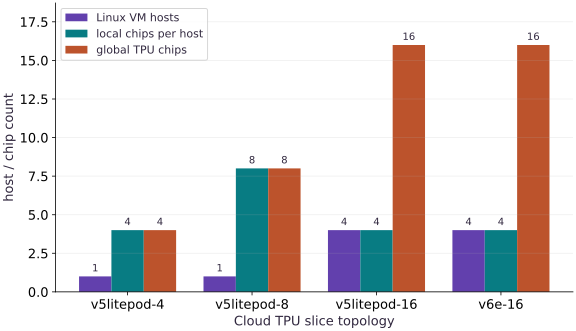

# Review scripts before TPU staging

Phase 20: TPU Workflows: Launching Jobs & Checkpointed Experiments · about 20 minutes · CPU

This worked reference is validated on CPU. Accelerator compatibility requires a separate source review and target execution receipt. Use the execution matrix to review device selection and data ownership before adapting a separate target program.

**Before this lesson:** [Stage and launch checkpointed TPU jobs](https://www.tahabouhsine.com/jaxpathways/lesson-tpu-02.html).

## What you will be able to do

- Classify each course script as CPU-only, review-required, single-host-compatible, or multi-host-qualified before staging.
- Keep CPU-only `distributed-02` on CPU; do not infer compatibility for Transformers, Pallas, or other lessons.
- Generate a TPU command only for a source-reviewed target with an explicit backend assertion, pinned dependencies, known topology, and data-ownership contract.
- Distinguish `--worker=all` process discovery from a multi-host program with verified global data and collective updates.

## The problem

A course script may contain CPU-specific device selection or assumptions that do not transfer to TPU. Before staging, classify the exact script as CPU-only, single-host accelerator-compatible, multi-host-qualified, or not yet reviewed. Multi-host discovery is a topology receipt; it is not evidence of distributed training.

## The idea

Use a per-script execution matrix. `distributed-02` is CPU-only because it explicitly selects CPU devices; route it to CPU. Treat other scripts as unreviewed until their exact source, backend selection, dependencies, topology assumptions, and data ownership are checked. Existing bounded receipts cover the v5e1 checkpointed launcher and precision target and the four-device single-host collective target; each is limited to its named source and configuration. Multi-host requires simultaneous worker launch and initialization, followed by distinct process-owned inputs and a checked global update. Keep discovery receipts separate from training receipts.

## Why every worker must launch and initialize

A multi-host collective is a coordinated computation: every participating process must initialize and enter the same named collective. The lesson's small update assumes one valid example per device and equal local device counts, so an average of local means equals the global mean. If valid counts differ, reduce gradient sums and counts separately, then divide once by the total count. A successful `--worker=all` launch only shows that workers started; retain each process receipt and check input ownership and the global update before calling it training evidence.

$$
g_{\text{global}} = \frac{\sum_{p=0}^{P-1} n_p g^{(p)}}{\sum_{p=0}^{P-1} n_p}; \qquad \text{this fixture assumes } n_p=1 \text{ valid example per device and equal devices per host}
$$

### Pause and reason

If a TPU slice has `hosts = 4` and `chips_per_host = 4` (`v5litepod-16`), what are `jax.local_device_count()` and `jax.device_count()` on each host after `jax.distributed.initialize()`?

<details><summary>Compare your reasoning</summary>

`jax.local_device_count()` is `4` (the chips attached to that host VM), while `jax.device_count()` is `16` (all chips across all 4 hosts in the Pod slice).

</details>

## 1. Route a script using the execution matrix

Route the exact source, not a lesson category. `distributed-02` selects CPU, so run it on CPU and keep its CPU receipt. The v5e1 launcher, precision target and four-device single-host collective each have separate, bounded receipts for their named sources, environments and layouts; those receipts do not qualify a different script. Before staging another program, inspect its backend selection and dependencies, then specify process/device topology and which process owns each input. Generate a TPU command only when those checks are complete.

**Run the known CPU-only distributed lesson in CPU mode**

```bash
LESSON_ID="distributed-02"
set -o pipefail
python "public/exercises/${LESSON_ID}.py" | tee "${LESSON_ID}-cpu.txt"
```

**Expected:** Executes the source-selected CPU path and saves its output. `pipefail` preserves a failed lesson exit status through `tee`; this receipt makes no TPU execution claim.

## 2. Separate multi-host discovery from a qualified training run

The discovery command launches all workers and calls `jax.distributed.initialize()`. This is a discovery check only: it reports the global topology but does not prove that data was partitioned correctly, that gradients were globally reduced, or that a checkpoint can be recovered. The one-step example below is an executable teaching program, not a reported TPU result. A real multi-host claim needs a named slice, simultaneous initialization, distinct process-owned inputs, independently checked global update values, synchronized checkpoint evidence and a receipt from every worker. The recorded sixteen-device v5e checkpoint run is separate: it used `resources/tpu-gcp/multihost_target.py` and its own receipts; it does not qualify this example.

**Record multi-host process and device discovery only**

```bash
gcloud compute tpus tpu-vm ssh "$TPU_NAME" --zone="$ZONE" --worker=all --command="set -euo pipefail; JAX_PLATFORMS=tpu ~/jax-tpu-lab/.venv/bin/python -c 'import jax; jax.distributed.initialize(); print(dict(process=jax.process_index(), process_count=jax.process_count(), global_devices=jax.device_count(), local_devices=jax.local_device_count()))'"
```

**Expected:** Each worker reports process and device counts. This verifies topology discovery only; it does not establish data ownership, a collective training update, or checkpoint recovery.

**Run a one-step multi-host collective update after discovery**

```bash
cat > ./multihost_collective.py <<'PY'
import json
import os
from pathlib import Path
from functools import partial
import jax
import jax.numpy as jnp
import numpy as np
from jax.experimental import multihost_utils

jax.distributed.initialize()
process_index = jax.process_index()
process_count = jax.process_count()
local_devices = jax.local_device_count()
# Each process owns one valid scalar example per local device; all processes must have equal local device counts for this equal-count mean.
x_local = jnp.full((local_devices,), float(process_index + 1), dtype=jnp.float32)
@partial(jax.pmap, axis_name="devices")
def update(theta, x):
    local_grad = 2.0 * (theta - x)
    # Equal-count fixture: one valid example per device, so global device count is also the global valid-example count.
    global_mean_grad = jax.lax.psum(local_grad, "devices") / jax.device_count()
    return theta - 0.1 * global_mean_grad, global_mean_grad

theta0 = jnp.zeros((local_devices,), dtype=jnp.float32)
theta1, grad = update(theta0, x_local)
jax.block_until_ready((theta1, grad))
expected_mean_gradient = -float(process_count + 1)  # assumes every process contributes one example per local device and local counts match
expected_theta = 0.1 * float(process_count + 1)
if not np.allclose(np.asarray(grad), expected_mean_gradient):
    raise RuntimeError("global reduction does not match the independently derived mean gradient")
if not np.allclose(np.asarray(theta1), expected_theta):
    raise RuntimeError("updated parameter does not match the expected global update")
if not np.allclose(np.asarray(theta1), np.asarray(theta1)[0]):
    raise RuntimeError("replicas produced different parameter updates")

out_dir = Path(os.environ.get("TPU_RUN_DIR", "~/jax-tpu-lab/multihost-run")).expanduser()
out_dir.mkdir(parents=True, exist_ok=True)
receipt = {"process_index": process_index, "process_count": process_count,
           "local_devices": local_devices, "global_devices": jax.device_count(),
           "owned_input": float(process_index + 1),
           "global_mean_gradient": float(np.asarray(grad)[0]),
           "updated_theta": float(np.asarray(theta1)[0]),
           "backend": jax.default_backend()}
(out_dir / f"worker-{process_index}.json").write_text(json.dumps(receipt, sort_keys=True) + "\n")
# Publish a single checkpoint only after all workers finish the same collective update.
multihost_utils.sync_global_devices("after-global-update")
if process_index == 0:
    tmp = out_dir / "checkpoint.json.tmp"
    tmp.write_text(json.dumps({"theta": receipt["updated_theta"], "global_devices": jax.device_count()}, sort_keys=True) + "\n")
    os.replace(tmp, out_dir / "checkpoint.json")
print(json.dumps(receipt, sort_keys=True))
PY
gcloud compute tpus tpu-vm scp ./multihost_collective.py "$TPU_NAME":~/jax-tpu-lab/ --zone="$ZONE" --worker=all
gcloud compute tpus tpu-vm ssh "$TPU_NAME" --zone="$ZONE" --worker=all --command="set -euo pipefail; mkdir -p ~/jax-tpu-lab/multihost-run; export TPU_RUN_DIR=~/jax-tpu-lab/multihost-run; JAX_PLATFORMS=tpu ~/jax-tpu-lab/.venv/bin/python ~/jax-tpu-lab/multihost_collective.py | tee ~/jax-tpu-lab/multihost-run/stdout-\$(hostname).jsonl"
```

**Expected:** Each process writes a worker-indexed receipt with its distinct input, global gradient, updated parameter, and observed backend. The independent expected values are mean gradient = -(process_count + 1) under the one-example-per-device, equal-local-device-count assumption and updated theta = 0.1 * (process_count + 1); these checks reject a local-only reduction. Process 0 publishes checkpoint.json after the global barrier. Treat these as TPU results only after running on and naming a multi-host slice.

**Copy each worker receipt and the process-0 checkpoint back before teardown**

```bash
mkdir -p ./tpu-runs
gcloud compute tpus tpu-vm scp --recurse "$TPU_NAME":~/jax-tpu-lab/multihost-run ./tpu-runs/ --zone="$ZONE" --worker=all
```

**Expected:** Copies each host-local multihost-run directory before TPU deletion. Verify one worker-N.json receipt per process, process-0 checkpoint.json, and one stdout log per host.

## Tabulate single-host and multi-host TPU slice topologies

Create main.py with SLICE_CATALOG and compute global_chips, total_hbm_gib, and multi_host.

```python
# Step 1 — Tabulate single-host and multi-host TPU slice topologies
import json
import jax
import numpy as np

SLICE_CATALOG = [
    {"slice": "v5litepod-4", "hosts": 1, "chips_per_host": 4, "hbm_per_chip_gib": 16},
    {"slice": "v5litepod-8", "hosts": 1, "chips_per_host": 8, "hbm_per_chip_gib": 16},
    {"slice": "v5litepod-16", "hosts": 4, "chips_per_host": 4, "hbm_per_chip_gib": 16},
    {"slice": "v6e-16", "hosts": 4, "chips_per_host": 4, "hbm_per_chip_gib": 32},
]
for entry in SLICE_CATALOG:
    entry["global_chips"] = entry["hosts"] * entry["chips_per_host"]
    entry["total_hbm_gib"] = entry["global_chips"] * entry["hbm_per_chip_gib"]
    entry["multi_host"] = entry["hosts"] > 1
```

Separating hosts from chips_per_host shows immediately when a slice crosses the single-host boundary into multi-host execution.

## Generate single-host and multi-host gcloud command pipelines

Use an explicit reviewed execution class; this fixture authorizes only the CPU route for distributed-02.

```python
def build_tpu_experiment_commands(tpu_name, zone, lesson_id, hosts=1, execution_class="review-required"):
    if execution_class == "review-required":
        raise ValueError("classify and review the script before generating a TPU launch command")
    if execution_class == "cpu-only":
        if hosts != 1:
            raise ValueError("CPU-only scripts must use the CPU route")
        return {"run": f"python public/exercises/{lesson_id}.py", "multi_host": False}
    if execution_class not in {"single-host-compatible", "multi-host-qualified"}:
        raise ValueError("unknown execution class")
    if execution_class == "single-host-compatible" and hosts != 1:
        raise ValueError("single-host scripts cannot run across a TPU Pod")
    if hosts > 1 and execution_class != "multi-host-qualified":
        raise ValueError("multi-host launch requires a qualified training program")
    if hosts < 1:
        raise ValueError("hosts must be positive")
    worker_flag = " --worker=all" if hosts > 1 else ""
    scp_stage = f"gcloud compute tpus tpu-vm scp public/exercises/{lesson_id}.py {tpu_name}:~/jax-tpu-lab/ --zone={zone}{worker_flag}"
    ssh_run = f"gcloud compute tpus tpu-vm ssh {tpu_name} --zone={zone}{worker_flag} --command='set -o pipefail; JAX_PLATFORMS=tpu ~/jax-tpu-lab/.venv/bin/python ~/jax-tpu-lab/{lesson_id}.py | tee ~/jax-tpu-lab/{lesson_id}-tpu.txt'"
    scp_fetch = f"gcloud compute tpus tpu-vm scp {tpu_name}:~/jax-tpu-lab/{lesson_id}-tpu.txt ./ --zone={zone}"
    return {"scp_stage": scp_stage, "ssh_run": ssh_run, "scp_fetch": scp_fetch, "multi_host": hosts > 1}

single_cmds = build_tpu_experiment_commands("jax-tpu-course", "us-west1-c", "distributed-02", hosts=1, execution_class="cpu-only")
assert single_cmds["run"] == "python public/exercises/distributed-02.py"
for kwargs in ({}, {"hosts": 4, "execution_class": "cpu-only"}):
    try:
        build_tpu_experiment_commands("jax-tpu-pod", "us-west1-c", "distributed-02", **kwargs)
    except ValueError:
        pass
    else:
        raise AssertionError("unreviewed or CPU-only work must not be routed to a TPU Pod")
print("CPU route:", single_cmds["run"])
```

The helper requires an explicit reviewed execution class. The only named course script in this example is CPU-only, so it has no TPU or Pod command.

## Step 3: Verify invariants on the completed state

Verify that the CPU route is preserved and unsafe TPU or Pod routes remain rejected.

```python
assert single_cmds["run"] == "python public/exercises/distributed-02.py"
assert single_cmds["multi_host"] is False
try:
    build_tpu_experiment_commands("jax-tpu-pod", "us-west1-c", "distributed-02", hosts=4, execution_class="cpu-only")
except ValueError:
    print("CPU-only route remains excluded from TPU Pod execution")
else:
    raise AssertionError("CPU-only work must not be routed to a TPU Pod")
```

The completed checks retain the CPU route and reject a Pod launch for this CPU-only source.

## Run the example

```python
import json
import jax
import numpy as np

SLICE_CATALOG = [
    {"slice": "v5litepod-4", "hosts": 1, "chips_per_host": 4, "hbm_per_chip_gib": 16},
    {"slice": "v5litepod-8", "hosts": 1, "chips_per_host": 8, "hbm_per_chip_gib": 16},
    {"slice": "v5litepod-16", "hosts": 4, "chips_per_host": 4, "hbm_per_chip_gib": 16},
    {"slice": "v6e-16", "hosts": 4, "chips_per_host": 4, "hbm_per_chip_gib": 32},
]
for entry in SLICE_CATALOG:
    entry["global_chips"] = entry["hosts"] * entry["chips_per_host"]
    entry["total_hbm_gib"] = entry["global_chips"] * entry["hbm_per_chip_gib"]
    entry["multi_host"] = entry["hosts"] > 1


def build_tpu_experiment_commands(tpu_name, zone, lesson_id, hosts=1, execution_class="review-required"):
    if execution_class == "review-required":
        raise ValueError("classify and review the script before generating a TPU launch command")
    if execution_class == "cpu-only":
        if hosts != 1:
            raise ValueError("CPU-only scripts must use the CPU route")
        return {"run": f"python public/exercises/{lesson_id}.py", "multi_host": False}
    if execution_class == "single-host-compatible" and hosts != 1:
        raise ValueError("single-host scripts cannot run across a TPU Pod")
    if hosts > 1 and execution_class != "multi-host-qualified":
        raise ValueError("multi-host launch requires a qualified training program")
    worker_flag = " --worker=all" if hosts > 1 else ""
    scp_stage = f"gcloud compute tpus tpu-vm scp public/exercises/{lesson_id}.py {tpu_name}:~/jax-tpu-lab/ --zone={zone}{worker_flag}"
    ssh_run = f"gcloud compute tpus tpu-vm ssh {tpu_name} --zone={zone}{worker_flag} --command='set -o pipefail; JAX_PLATFORMS=tpu ~/jax-tpu-lab/.venv/bin/python ~/jax-tpu-lab/{lesson_id}.py | tee ~/jax-tpu-lab/{lesson_id}-tpu.txt'"
    scp_fetch = f"gcloud compute tpus tpu-vm scp {tpu_name}:~/jax-tpu-lab/{lesson_id}-tpu.txt ./ --zone={zone}"
    return {"scp_stage": scp_stage, "ssh_run": ssh_run, "scp_fetch": scp_fetch, "multi_host": hosts > 1}

single_cmds = build_tpu_experiment_commands("jax-tpu-course", "us-west1-c", "distributed-02", hosts=1, execution_class="cpu-only")
pod_cmds = None  # This lesson has no multi-host-qualified training program.
# Assert the CPU route does not request TPU execution.
assert single_cmds["run"] == "python public/exercises/distributed-02.py"
try:
    build_tpu_experiment_commands("jax-tpu-pod", "us-west1-c", "distributed-02", hosts=4, execution_class="cpu-only")
except ValueError:
    print("Correctly rejected CPU-only lesson for TPU Pod execution")
else:
    raise AssertionError("CPU-only lesson must not be routed to TPU Pod")
print("Slice catalog global chips:", {s["slice"]: s["global_chips"] for s in SLICE_CATALOG})
print("CPU route:", single_cmds["run"])
```

Expected: Prints the slice topology catalog and the reviewed CPU route for distributed-02. The one-step collective example is unqualified; it is shown for source study only and does not constitute a verified TPU Pod launch.

## Host count, per-host local chips, and global TPU chips across single-host and Pod slices

**Predict:** How do `hosts`, `chips_per_host`, and `global_chips` change when moving from `v5litepod-4` and `v5litepod-8` to `v5litepod-16` and `v6e-16`?



**Recorded CPU computation**

### Read the figure

The horizontal axis lists four requested slices. The three bars per slice count VM hosts, local chips per host and global physical chips. `v5litepod-4` has 1 host × 4 chips = 4 global chips; `v5litepod-8` has 1 × 8 = 8. `v5litepod-16` and `v6e-16` each have 4 hosts × 4 local chips = 16 global chips. The host and chip counts are different units of topology, so read each bar series by its legend. The decision boundary is hosts: at four hosts, launch all workers and initialize distributed JAX; then verify local and global JAX device counts in each receipt.

### Connect it to the computation

The slice calculation shows why `--worker=all` is required for the two 16-chip, four-host layouts; it is not evidence that a workload trained across them. In a 4-host example with 4 local chips per host, the expected topology is 4 local chips and 16 global chips per host process, subject to the selected API's runtime mapping. Keep the CPU rehearsal and recorded target receipts separate, and require per-process receipts plus a checked global update before claiming multi-host training.

```python
visual_data = {
    'kind': 'bar',
    'labels': [s['slice'] for s in SLICE_CATALOG],
    'xlabel': 'Cloud TPU slice topology',
    'ylabel': 'host / chip count',
    'series': [
        {'label': 'Linux VM hosts', 'y': [float(s['hosts']) for s in SLICE_CATALOG]},
        {'label': 'local chips per host', 'y': [float(s['chips_per_host']) for s in SLICE_CATALOG]},
        {'label': 'global TPU chips', 'y': [float(s['global_chips']) for s in SLICE_CATALOG]},
    ],
}
```

## Recorded reference execution

CPU run: 2026-10-27T17:27:06.513981+00:00. JAX 0.9.2.

```text
CPU route: python public/exercises/distributed-02.py
CPU-only route remains excluded from TPU Pod execution
Correctly rejected CPU-only lesson for TPU Pod execution
Slice catalog global chips: {'v5litepod-4': 4, 'v5litepod-8': 8, 'v5litepod-16': 16, 'v6e-16': 16}
CPU route: python public/exercises/distributed-02.py
v5litepod-16 global chips: 16 Idle chips without --worker=all: 12
Total HBM GiB by slice: {'v5litepod-4': 64, 'v5litepod-8': 128, 'v5litepod-16': 256, 'v6e-16': 512}
CPU route: python public/exercises/distributed-02.py
Rejected unsafe route: {}
Rejected unsafe route: {'hosts': 4, 'execution_class': 'cpu-only'}
Multi-host Pod slices: ['v5litepod-16', 'v6e-16']
Per-host batch: 32 Global batch: 128
PASS: tpu-05

```

## Compare local vs global device counts across slices

**Predict before running:** How many global chips are left idle if you launch a script without `--worker=all` on `v5litepod-16`?

```python
# Experiment — Compare local vs global device counts across slices
v5e16 = next(s for s in SLICE_CATALOG if s["slice"] == "v5litepod-16")
idle_without_worker_all = v5e16["global_chips"] - v5e16["chips_per_host"]
print("v5litepod-16 global chips:", v5e16["global_chips"], "Idle chips without --worker=all:", idle_without_worker_all)
# Assert invariant `idle_without_worker_all == 12` holds
assert idle_without_worker_all == 12
```

**Expected:** Without `--worker=all`, 12 of the 16 TPU chips on `v5litepod-16` never receive a process.

Worker 0 only controls its own 4 local chips; the other 3 hosts (`3 * 4 = 12` chips) require `--worker=all`.

## Verify total HBM scaling from v5litepod-16 to v6e-16

**Predict before running:** How much total HBM is available across a 16-chip `v6e-16` Pod slice compared to `v5litepod-16`?

```python
# Experiment — Verify total HBM scaling from v5litepod-16 to v6e-16
hbm_by_slice = {s["slice"]: s["total_hbm_gib"] for s in SLICE_CATALOG}
print("Total HBM GiB by slice:", hbm_by_slice)
assert hbm_by_slice["v6e-16"] == 512 and hbm_by_slice["v5litepod-16"] == 256
```

**Expected:** v6e-16 provides 512 GiB of total HBM across 4 hosts (32 GiB/chip), double v5litepod-16's 256 GiB (16 GiB/chip).

Doubling per-chip HBM on Trillium (`v6e`) doubles the total sharded model state capacity for the same 4-host Pod topology.

## Make it yours

Use `build_tpu_experiment_commands` for the reviewed CPU-only `distributed-02` route. Then verify that its default unreviewed class and a four-host CPU-only request both raise `ValueError`.

### How to write this exercise — Step-by-step recipe & starter scaffold

**Inputs:**
- The reviewed script identifier distributed-02, default classification, and a four-host CPU-only request.

**Outputs:**
- Commands for the reviewed CPU route and ValueError checks for unsafe TPU routes.

**Invariants to check:**
- A CPU-only script is routed to CPU; unreviewed or incompatible multi-host requests fail closed.

**Hints:**
- Use the public command builder for every case.
- Do not infer distributed qualification from a host-count field.

**Starter code scaffold (fill in the TODOs):**

```python
import jax.numpy as jnp
import numpy as np

def audit_script_routes(build_tpu_experiment_commands):
    # TODO: build the reviewed CPU route and capture both expected route rejections.
    raise NotImplementedError
```

<details><summary>Reference solution</summary>

```python
cpu_cmds = build_tpu_experiment_commands("jax-tpu-course", "us-west1-c", "distributed-02", hosts=1, execution_class="cpu-only")
print("CPU route:", cpu_cmds["run"])
assert cpu_cmds["run"] == "python public/exercises/distributed-02.py"
for kwargs in ({}, {"hosts": 4, "execution_class": "cpu-only"}):
    try:
        build_tpu_experiment_commands("jax-tpu-pod", "us-west1-c", "distributed-02", **kwargs)
    except ValueError:
        print("Rejected unsafe route:", kwargs)
    else:
        raise AssertionError("unreviewed or CPU-only work must not be routed to a TPU Pod")
```

</details>

## Filter multi-host slices from the catalog

**Foundations**

List the slice names in `SLICE_CATALOG` that require `--worker=all` (`multi_host == True`).

<details><summary>Hint</summary>

Filter by `s['multi_host']`.

</details>

### How to write: Filter multi-host slices from the catalog — Step-by-step recipe & starter scaffold

**Inputs:**
- A slice catalog whose entries include the multi_host flag.

**Outputs:**
- Names of slices that require launching every worker.

**Invariants to check:**
- Only entries explicitly marked multi_host are included.

**Hints:**
- Filter by the boolean flag rather than slice-name patterns.
- A catalog result does not demonstrate that a multi-host job ran.

**Starter code scaffold (fill in the TODOs):**

```python
import jax.numpy as jnp
import numpy as np

def list_multihost_slices(slice_catalog):
    # TODO: return slice names with the explicit multi_host flag set.
    raise NotImplementedError
```

<details><summary>Reference solution and reasoning</summary>

```python
# Filter multi-host slices from the catalog (Foundations)
pod_slices = [s["slice"] for s in SLICE_CATALOG if s["multi_host"]]
print("Multi-host Pod slices:", pod_slices)
# Assert invariant `pod_slices == ["v5litepod-16"` holds
assert pod_slices == ["v5litepod-16", "v6e-16"]
```

Both 16-chip slices span 4 hosts (`4` chips per host) and therefore require multi-host coordination.

</details>

## Compute per-host vs global batch size on a 4-host Pod slice

**Transfer / diagnosis**

If each TPU chip processes a microbatch of $8$ sequences on `v5litepod-16` (`4` hosts, `4` chips/host), compute the per-host batch size and the global batch size per step.

<details><summary>Hint</summary>

Multiply `8 * chips_per_host` and `8 * global_chips`.

</details>

### How to write: Compute per-host vs global batch size on a 4-host Pod slice — Step-by-step recipe & starter scaffold

**Inputs:**
- Four hosts, four chips per host, and a microbatch of eight sequences per chip.

**Outputs:**
- Per-host and global sequences processed per step.

**Invariants to check:**
- Global batch equals per-host batch times host count; each chip contributes one microbatch.

**Hints:**
- Multiply by chips per host before multiplying by hosts.
- State that these are arithmetic counts, not measured throughput.

**Starter code scaffold (fill in the TODOs):**

```python
import jax.numpy as jnp
import numpy as np

def batch_sizes_per_step(hosts, chips_per_host, microbatch_per_chip):
    # TODO: return per-host and global sequence counts for one step.
    raise NotImplementedError
```

<details><summary>Reference solution and reasoning</summary>

```python
microbatch_per_chip = 8
per_host_batch = microbatch_per_chip * 4
global_batch = microbatch_per_chip * 16
print("Per-host batch:", per_host_batch, "Global batch:", global_batch)
# Assert invariant `per_host_batch == 32 and global_batch == 128` holds
assert per_host_batch == 32 and global_batch == 128
```

Each host feeds its 4 local chips (`32` sequences per host), yielding a synchronized global batch of `128` sequences across the 16-chip mesh.

</details>

## Check your understanding

You launch an ordinary TPU-VM SSH command on worker zero of a multi-host slice, without another launcher. What can happen?

1. Google Cloud automatically merges the 4 Linux hosts into 1 host
2. Only that worker starts the command; distributed initialization or collectives can wait for the missing participants
3. The script runs four times faster

<details><summary>Answer and explanation</summary>

**1. Google Cloud automatically merges the 4 Linux hosts into 1 host**

An SSH command does not automatically launch Python on every worker. Use an explicit per-host launcher with matching configuration.

**2. Only that worker starts the command; distributed initialization or collectives can wait for the missing participants (correct)**

An explicit launcher must start every participating process with compatible configuration. --worker=all is one Cloud TPU API method; other orchestrators can do the same job. Initialization, data ownership and collected worker receipts still require separate checks.

**3. The script runs four times faster**

Omitting participating workers cannot accelerate a collective that requires them. It can leave distributed initialization or communication waiting.

</details>

## Diagnose the result

If `gcloud compute tpus tpu-vm ssh --worker=all` fails on one worker because `.venv` is missing, run your `.venv` bootstrap command with `--worker=all` as well so every host has `~/jax-tpu-lab/.venv` installed.

## Carry forward

- Keep `distributed-02` on CPU. Before staging another script, inspect its exact backend selection and dependencies, assert the TPU backend and topology, and document which process owns each input.
- Every hardware receipt applies to its exact source, environment, devices and workload. `--worker=all` provides a launch mechanism; training and recovery need their own checked global updates and complete worker receipts. The recorded sixteen-device checkpoint test is separate from this lesson's one-step example.

## Keep your evidence

Keep the execution classification and rejected-route checks. For a target run, retain the exact source/environment hashes, selected backend and devices, data ownership, numerical check, and all worker receipts required by that target. A topology receipt alone is not a training result.

Save your predictions, modified code, terminal outputs, and reasoning in your engineering portfolio.

## Primary references

- [Multi-host and distributed JAX on TPU Pods](https://docs.jax.dev/en/latest/multi_process.html)
- [Run JAX code on Cloud TPU Pod slices](https://cloud.google.com/tpu/docs/run-calculation-jax)

