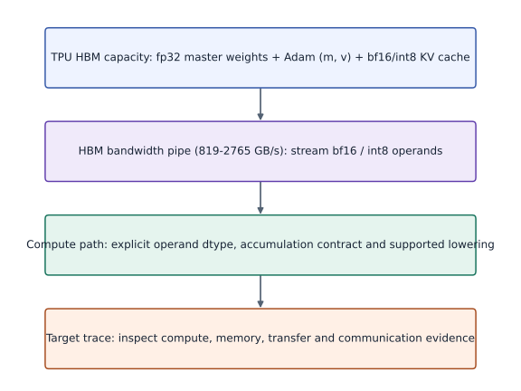
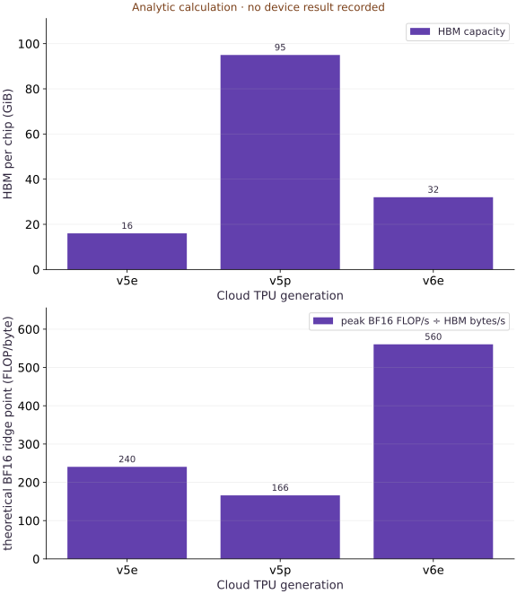

# TPU generations and HBM memory budgeting

Phase 21: TPU Systems: Generations, Memory, Precision & XProf · about 25 minutes · CPU

This worked reference is validated on CPU. Accelerator compatibility requires a separate source review and target execution receipt. Use the execution matrix to review device selection and data ownership before adapting a separate target program.

## What you will be able to do

- Compare Google Cloud TPU generations (`v5e`, `v5p`, `v6e` Trillium, and Ironwood) by HBM capacity, HBM bandwidth, and MXU BF16 throughput.
- Calculate the Roofline ridge point (`bf16_tflops / bw_gbs`) in FLOPs per byte for each TPU generation.
- Compute training-state and KV-cache HBM from explicit tensor byte counts, including master weights, compute weights, gradients, and Adam moments.
- Select the minimum single-host or Pod TPU slice that fits a given model's training state with activation headroom.

## The problem

Provisioning and launching a TPU VM is only half the engineering job: if you pick the wrong TPU generation or miscalculate parameter + optimizer + KV-cache HBM bytes, your TPU experiment will either fail with `RESOURCE_EXHAUSTED: Out of memory` or under-utilize the Matrix Multiply Unit (MXU).

## The idea

Budget capacity with a byte ledger before selecting a TPU slice, and treat the roofline ridge point as a theoretical screening estimate. GiB capacity and FLOP/byte ridge points are different quantities and must be read in separate panels. The worked training-state estimates state their tensor dtypes and exclusions; they are not observed runtime memory.

## Connect MXU arithmetic intensity and HBM capacity to TPU slice sizing

The ridge point is peak BF16 FLOP/s divided by HBM bandwidth. It is a theoretical balance point for a roofline model, not a measured bottleneck; use a target workload profile to investigate utilization. HBM capacity is a separate quantity.

For this lesson, the full-FP32 training-state ledger is 4 bytes/parameter for weights + 4 for gradients + 4 each for Adam first and second moments = 16 bytes/parameter. The mixed-BF16 ledger assumes an FP32 master weight (4), a BF16 compute copy (2), an FP32 gradient buffer (4), and two FP32 moments (8), totaling 18 bytes/parameter. This deliberately conservative case includes the compute copy and does not include activations, communication buffers, allocator overhead, or temporary copies. If gradients are kept in BF16, subtract 2 bytes/parameter and state that assumption.

$$
\text{Throughput}_{\text{tok/s}} = \frac{B_{\text{global}} \times L_{\text{seq}}}{T_{\text{step}}}
$$

### TPU HBM-to-MXU dataflow and mixed-precision state budget

**Predict:** Which tensors stay in `float32` in HBM and which operands stream as `bfloat16` into the MXU?



*Architecture and dataflow mechanism diagram.*

Follow the assumed mixed-precision ledger from HBM to compute: FP32 master weights and moments coexist with BF16 compute weights. A dot can request BF16 inputs and FP32 accumulation. A quantized path additionally needs its own scale and accumulation contract. The diagram names memory/compute boundaries; it does not show an observed kernel placement or prove an INT8 speedup.

### Pause and reason

For 7 billion parameters, how many GiB does the stated 18-byte mixed-BF16 ledger require before activations, and why is a ridge point not a measured bottleneck?

<details><summary>Compare your reasoning</summary>

The estimate is 7e9 × 18 / 2^30 ≈ 117.4 GiB. It excludes activations, communication buffers, allocator overhead and temporary copies, so it is only a capacity lower bound. The ridge point compares published peak compute and bandwidth; only a workload measurement and profile can identify an observed bottleneck.

</details>

## 1. Compare TPU generations (`v5e`, `v5p`, `v6e`, Ironwood) and calculate HBM budgets

Published per-chip specifications bound an initial capacity estimate. Actual fit also depends on per-device sharding, activations, buffers and runtime allocations:

- **TPU v5e (`v5litepod`)**: $16$ GiB HBM per chip, $819$ GB/s HBM bandwidth, $197$ BF16 TFLOP/s (`240.5` FLOP/byte ridge point). Single-host slices: `1`, `4` (`64` GiB), or `8` (`128` GiB) chips.
- **TPU v5p**: $95$ GiB HBM per chip, $2765$ GB/s HBM bandwidth, $459$ BF16 TFLOP/s (`166.0` FLOP/byte ridge point).
- **TPU v6e (Trillium)**: $32$ GiB HBM per chip, $1638$ GB/s HBM bandwidth, $918$ BF16 TFLOP/s (`560.4` FLOP/byte ridge point). Single-host slices: `1`, `4` (`128` GiB), or `8` (`256` GiB) chips.
- **TPU Ironwood (7th-gen scale)**: $192$ GiB HBM per chip, $7380$ GB/s HBM bandwidth.

**Run the TPU generation & HBM budgeting verifier on your TPU VM or workstation**

```bash
# Run the TPU generation & HBM budgeting verifier on your TPU VM or workstation
gcloud compute tpus tpu-vm scp public/exercises/tpu-03.py "$TPU_NAME":~/jax-tpu-lab/ --zone="$ZONE"
gcloud compute tpus tpu-vm ssh "$TPU_NAME" --zone="$ZONE" \
  --command="JAX_PLATFORMS=tpu ~/jax-tpu-lab/.venv/bin/python ~/jax-tpu-lab/tpu-03.py"
```

**Expected:** Prints the TPU ridge points (FLOP/byte) and the 7B and 1.5B training + KV-cache HBM budgets in GiB.

## Use chip specifications without confusing them with a runtime contract

Specifications checked on 2026-10-21 give v6e HBM bandwidth as 1638 GB/s. The comparison lesson uses the published cross-generation GiB capacity table. TPU7x is documented for both Compute Engine and GKE, with 192 GiB and 7380 GB/s per chip; its two chiplets are exposed as two JAX devices per chip. Therefore device count cannot universally be treated as chip count. Record machine type, topology, API and observed device kinds separately. Peak low-precision throughput is a hardware capability, not proof that a particular JAX expression or exported model uses that native path.

## Define TPU generation specs and compute Roofline ridge points

Create main.py with TPU_SPECS and calculate ridge_flops_per_byte for v5e, v5p, and v6e.

```python
# Step 1 — Define TPU generation specs and compute Roofline ridge points
import jax
import jax.numpy as jnp
import numpy as np

TPU_SPECS = [
    {"gen": "v5e", "hbm_gib": 16.0, "bw_gbs": 819.0, "bf16_tflops": 197.0},
    {"gen": "v5p", "hbm_gib": 95.0, "bw_gbs": 2765.0, "bf16_tflops": 459.0},
    {"gen": "v6e", "hbm_gib": 32.0, "bw_gbs": 1638.0, "bf16_tflops": 918.0},
]
for s in TPU_SPECS:
    s["ridge_flops_per_byte"] = round((s["bf16_tflops"] * 1e12) / (s["bw_gbs"] * 1e9), 1)
```

Converting TFLOP/s to FLOP/s and GB/s to byte/s introduces a factor of 1000. Their ratio is the ideal Roofline intersection, not a guarantee that a kernel saturates the MXU.

## Estimate training-state and KV-cache HBM budgets across precisions

Append estimate_memory_gib and compare 7B vs 1.5B model memory footprints.

```python
# Step 2 — Estimate training-state and KV-cache HBM budgets across precisions
def estimate_memory_gib(params_billions, kv_tokens, layers=32, kv_heads=8, head_dim=128):
    n_params = params_billions * 1e9
    kv_elements = 2.0 * layers * kv_tokens * kv_heads * head_dim
    gib = float(1024 ** 3)
    return {
        "fp32_train_state_gib": round((n_params * 16.0) / gib, 3),
        "mixed_bf16_train_state_gib": round((n_params * 18.0) / gib, 3),
        "kv_fp32_gib": round((kv_elements * 4.0) / gib, 3),
        "kv_bf16_gib": round((kv_elements * 2.0) / gib, 3),
        "kv_int8_gib": round((kv_elements * 1.0) / gib, 3),
    }


budget_7b = estimate_memory_gib(params_billions=7.0, kv_tokens=8192)
budget_1p5b = estimate_memory_gib(params_billions=1.5, kv_tokens=4096)
assert budget_7b["mixed_bf16_train_state_gib"] > 64.0 and budget_7b["mixed_bf16_train_state_gib"] < 128.0
# Assert invariant `budget_1p5b["mixed_bf16_train_state_gib"] < 64.0` holds
assert budget_1p5b["mixed_bf16_train_state_gib"] < 64.0
print("TPU ridge points (FLOP/byte):", {s["gen"]: s["ridge_flops_per_byte"] for s in TPU_SPECS})
print("7B memory budget (GiB):", budget_7b)
print("1.5B memory budget (GiB):", budget_1p5b)
```

Computing the named-tensor ledger identifies whether a topology has enough total HBM, but usable capacity must also reserve room for activations, communication buffers, temporary copies and allocator overhead. The 7B estimate exceeds the 80%-usable budget of a 4-chip v6e slice; it is an estimate, not a fit guarantee.

## Step 3: Verify invariants on the completed state

Run the final shape and numerical assertions to confirm the state built in Steps 1 and 2.

```python
assert budget_7b["mixed_bf16_train_state_gib"] > 64.0 and budget_7b["mixed_bf16_train_state_gib"] < 128.0
assert budget_1p5b["mixed_bf16_train_state_gib"] < 64.0
```

Checking these invariants confirms the computation is ready for the full worked experiment.

## Run the example

```python
# Step 1 — Define TPU generation specs and compute Roofline ridge points
import jax
import jax.numpy as jnp
import numpy as np

TPU_SPECS = [
    {"gen": "v5e", "hbm_gib": 16.0, "bw_gbs": 819.0, "bf16_tflops": 197.0},
    {"gen": "v5p", "hbm_gib": 95.0, "bw_gbs": 2765.0, "bf16_tflops": 459.0},
    {"gen": "v6e", "hbm_gib": 32.0, "bw_gbs": 1638.0, "bf16_tflops": 918.0},
]
for s in TPU_SPECS:
    s["ridge_flops_per_byte"] = round((s["bf16_tflops"] * 1e12) / (s["bw_gbs"] * 1e9), 1)


# Step 2 — Estimate training-state and KV-cache HBM budgets across precisions
def estimate_memory_gib(params_billions, kv_tokens, layers=32, kv_heads=8, head_dim=128):
    n_params = params_billions * 1e9
    kv_elements = 2.0 * layers * kv_tokens * kv_heads * head_dim
    gib = float(1024 ** 3)
    return {
        "fp32_train_state_gib": round((n_params * 16.0) / gib, 3),
        "mixed_bf16_train_state_gib": round((n_params * 18.0) / gib, 3),
        "kv_fp32_gib": round((kv_elements * 4.0) / gib, 3),
        "kv_bf16_gib": round((kv_elements * 2.0) / gib, 3),
        "kv_int8_gib": round((kv_elements * 1.0) / gib, 3),
    }


budget_7b = estimate_memory_gib(params_billions=7.0, kv_tokens=8192)
budget_1p5b = estimate_memory_gib(params_billions=1.5, kv_tokens=4096)
assert budget_7b["mixed_bf16_train_state_gib"] > 64.0 and budget_7b["mixed_bf16_train_state_gib"] < 128.0
# Assert invariant `budget_1p5b["mixed_bf16_train_state_gib"] < 64.0` holds
assert budget_1p5b["mixed_bf16_train_state_gib"] < 64.0
print("TPU ridge points (FLOP/byte):", {s["gen"]: s["ridge_flops_per_byte"] for s in TPU_SPECS})
print("7B memory budget (GiB):", budget_7b)
print("1.5B memory budget (GiB):", budget_1p5b)
```

Expected: Prints the ridge-point FLOP/byte ratios for v5e (240.5), v5p (166.0), and v6e (560.4) along with the 7B and 1.5B memory budgets in GiB.

## Calculated TPU memory capacity and theoretical ridge point

**Predict:** How do per-chip HBM capacity (GiB) and the compute-to-memory ridge point (FLOP/byte) change across TPU `v5e`, `v5p`, and `v6e`?



**Analytic calculation; no device result recorded**

### Read the figure

The left panel shows per-chip HBM: v5e 16, v5p 95 and v6e 32 GiB. The right panel shows calculated BF16 ridge points: about 240.5, 166.0 and 560.4 FLOP/byte. v5p has more memory than v6e but a lower ridge point. A taller ridge bar means more arithmetic per HBM byte is needed to reach the compute ceiling, not automatically a faster workload. The panels use different units; compare values within each panel.

### Connect it to the computation

These bars are calculations from published specifications and stated tensor byte assumptions. They are not device measurements or a workload profile.

```python
visual_data = {
    'kind': 'bar',
    'panels': [
        {'kind': 'bar', 'labels': [s['gen'] for s in TPU_SPECS], 'xlabel': 'Cloud TPU generation', 'ylabel': 'HBM per chip (GiB)',
         'series': [{'label': 'HBM capacity', 'y': [float(s['hbm_gib']) for s in TPU_SPECS]}]},
        {'kind': 'bar', 'labels': [s['gen'] for s in TPU_SPECS], 'xlabel': 'Cloud TPU generation', 'ylabel': 'theoretical BF16 ridge point (FLOP/byte)',
         'series': [{'label': 'peak BF16 FLOP/s ÷ HBM bytes/s', 'y': [float(s['ridge_flops_per_byte']) for s in TPU_SPECS]}]},
    ],
}
```

## Recorded reference execution

CPU run: 2026-10-21T11:35:35.439963+00:00. JAX 0.9.2.

```text
TPU ridge points (FLOP/byte): {'v5e': 240.5, 'v5p': 166.0, 'v6e': 560.4}
7B memory budget (GiB): {'fp32_train_state_gib': 104.308, 'mixed_bf16_train_state_gib': 117.347, 'kv_fp32_gib': 2.0, 'kv_bf16_gib': 1.0, 'kv_int8_gib': 0.5}
1.5B memory budget (GiB): {'fp32_train_state_gib': 22.352, 'mixed_bf16_train_state_gib': 25.146, 'kv_fp32_gib': 1.0, 'kv_bf16_gib': 0.5, 'kv_int8_gib': 0.25}
TPU ridge points (FLOP/byte): {'v5e': 240.5, 'v5p': 166.0, 'v6e': 560.4}
7B memory budget (GiB): {'fp32_train_state_gib': 104.308, 'mixed_bf16_train_state_gib': 117.347, 'kv_fp32_gib': 2.0, 'kv_bf16_gib': 1.0, 'kv_int8_gib': 0.5}
1.5B memory budget (GiB): {'fp32_train_state_gib': 22.352, 'mixed_bf16_train_state_gib': 25.146, 'kv_fp32_gib': 1.0, 'kv_bf16_gib': 0.5, 'kv_int8_gib': 0.25}
KV cache GiB (FP32 / BF16 / INT8): 2.0 1.0 0.5
7B mixed train state GiB: 117.347 Minimum chips at 80% usable HBM: 10
Assumed training state (GiB): 25.146
Separate inference BF16 KV cache (GiB): 0.5
Arithmetic intensity: 341.3333333333333 FLOPs/byte
v6e-4 80% usable GiB: 102.4 Fits 7B state estimate: False
PASS: tpu-03

```

## Compare KV-cache memory across FP32, BF16, and INT8

**Predict before running:** By what factor does KV-cache memory drop when moving from FP32 to BF16 and INT8?

```python
# Experiment — Compare KV-cache memory across FP32, BF16, and INT8
assert np.isclose(budget_7b["kv_fp32_gib"], 2.0 * budget_7b["kv_bf16_gib"])
assert np.isclose(budget_7b["kv_bf16_gib"], 2.0 * budget_7b["kv_int8_gib"])
print("KV cache GiB (FP32 / BF16 / INT8):", budget_7b["kv_fp32_gib"], budget_7b["kv_bf16_gib"], budget_7b["kv_int8_gib"])
```

**Expected:** For 8192 tokens, KV cache drops from 2.0 GiB (FP32) to 1.0 GiB (BF16) and 0.5 GiB (INT8).

This tensor-element ledger halves storage at each step. A real INT8 cache also needs scales and supported kernels; actual decode traffic and latency depend on reuse and the implementation. This does not measure quantized inference.

## Verify how many v5e chips are needed to hold a 7B mixed-precision training state

**Predict before running:** How many v5e chips are needed for the 7B mixed-precision training-state estimate if only 80% of HBM is available for that state?

```python
v5e_chip_gib = 16.0
usable_fraction = 0.8
min_v5e_chips = int(np.ceil(budget_7b["mixed_bf16_train_state_gib"] / (v5e_chip_gib * usable_fraction)))
print("7B mixed train state GiB:", budget_7b["mixed_bf16_train_state_gib"], "Minimum chips at 80% usable HBM:", min_v5e_chips)
assert min_v5e_chips == 10
assert min_v5e_chips > 8 and min_v5e_chips <= 16
```

**Expected:** The 18-byte-per-parameter ledger estimates 117.347 GiB. At 16 GiB per chip and 80% usable HBM, at least 10 chips are needed; the listed 16-chip v5litepod-16 is the first listed topology large enough.

The estimate includes 2-byte BF16 weights, 4-byte FP32 master weights, 4-byte gradients and two 4-byte FP32 Adam moments, for 18 bytes per parameter. This is a named-tensor ledger, not a complete fit guarantee: activations, communication buffers, temporary copies and allocator overhead need additional headroom.

## Make it yours

Compute estimate_memory_gib for a 1.5B parameter model with 4096 KV tokens. Check that the assumed mixed-precision training state is below 30 GiB and below 80% of a four-chip v5e slice. Separately report the BF16 KV-cache estimate for an inference scenario. Do not assume training normally retains an inference KV cache, or that aggregate HBM guarantees per-device fit.

### How to write this exercise — Step-by-step recipe & starter scaffold

**Step-by-step implementation plan:**
1. Set up the changed input or configuration parameters requested in the prompt.
2. Run the target function or transformation and assert that the output matches your prediction.

**Starter code scaffold (fill in the TODOs):**

```python
budget_check = estimate_memory_gib(...)  # TODO: compute budget_check
usable_hbm_gib = ...  # TODO: compute usable_hbm_gib
training_state_gib = ...  # TODO: compute training_state_gib
inference_kv_gib = ...  # TODO: compute inference_kv_gib
print("Assumed training state (GiB):", training_state_gib)
print("Separate inference BF16 KV cache (GiB):", inference_kv_gib)
assert training_state_gib  # TODO: complete assertion check
assert training_state_gib  # TODO: complete assertion check
assert np.isclose(inference_kv_gib, 0.5)  # TODO: complete assertion check
```

<details><summary>Reference solution</summary>

```python
budget_check = estimate_memory_gib(params_billions=1.5, kv_tokens=4096)
usable_hbm_gib = 4 * 16.0 * 0.8
training_state_gib = budget_check["mixed_bf16_train_state_gib"]
inference_kv_gib = budget_check["kv_bf16_gib"]
print("Assumed training state (GiB):", training_state_gib)
print("Separate inference BF16 KV cache (GiB):", inference_kv_gib)
assert training_state_gib < 30.0
assert training_state_gib < usable_hbm_gib
assert np.isclose(inference_kv_gib, 0.5)
```

</details>

## Compare arithmetic intensity against the TPU v5e and v6e ridge points

**Foundations**

Compute the arithmetic intensity (FLOPs/byte) of a `bfloat16` square matrix multiply of size $N = 1024$ (`2 * N^3` FLOPs divided by `3 * 2 * N^2` bytes) and check whether it exceeds the `v5e` ridge point.

<details><summary>Hint</summary>

For two `N x N` BF16 inputs and one BF16 output, arithmetic intensity simplifies to `N / 3.0` FLOPs/byte.

</details>

### How to write: Compare arithmetic intensity against the TPU v5e and v6e ridge points — Step-by-step recipe & starter scaffold

**Step-by-step implementation plan:**
1. Set up the changed input or configuration parameters requested in the prompt.
2. Run the target function or transformation and assert that the output matches your prediction.

**Starter code scaffold (fill in the TODOs):**

```python
n = ...  # TODO: compute n
intensity = ...  # TODO: compute intensity
print("Arithmetic intensity:", intensity, "FLOPs/byte")
assert intensity  # TODO: complete assertion check
assert intensity  # TODO: complete assertion check
```

<details><summary>Reference solution and reasoning</summary>

```python
n = 1024
intensity = (2 * n**3) / (3 * 2 * n**2)
print("Arithmetic intensity:", intensity, "FLOPs/byte")
assert intensity == n / 3.0
assert intensity > TPU_SPECS[0]["ridge_flops_per_byte"]
```

The idealized operation has about 341.3 FLOP/byte. It is above v5e’s 240.5 ridge and below v6e’s 560.4 ridge, assuming exactly the stated two BF16 input reads and one BF16 output write. That assigns different ideal ceilings; padding, actual output dtype, cache reuse and measured traffic can change the comparison.

</details>

## Size a Trillium v6e-4 slice for a 7B training state

**Transfer / diagnosis**

Compute the total HBM (in GiB) of a 4-chip `v6e-4` slice (`32` GiB/chip) and check whether `budget_7b['mixed_bf16_train_state_gib']` fits inside `80%` of that slice's HBM.

<details><summary>Hint</summary>

Compare `budget_7b['mixed_bf16_train_state_gib']` with `4 * 32.0 * 0.8`.

</details>

### How to write: Size a Trillium v6e-4 slice for a 7B training state — Step-by-step recipe & starter scaffold

**Step-by-step implementation plan:**
1. Set up the changed input or configuration parameters requested in the prompt.
2. Run the target function or transformation and assert that the output matches your prediction.

**Starter code scaffold (fill in the TODOs):**

```python
v6e4_usable_gib = ...  # TODO: compute v6e4_usable_gib
fits_v6e4 = ...  # TODO: compute fits_v6e4
print("v6e-4 80% usable GiB:", v6e4_usable_gib, "Fits 7B state estimate:", fits_v6e4)
assert fits_v6e4 is False  # TODO: complete assertion check
```

<details><summary>Reference solution and reasoning</summary>

```python
v6e4_usable_gib = 4 * 32.0 * 0.8
fits_v6e4 = budget_7b["mixed_bf16_train_state_gib"] <= v6e4_usable_gib
print("v6e-4 80% usable GiB:", v6e4_usable_gib, "Fits 7B state estimate:", fits_v6e4)
assert fits_v6e4 is False
```

A 4-chip v6e slice has 128 GiB total HBM and 102.4 GiB at an 80% budget. The 117.347 GiB named-tensor estimate exceeds that budget, before activations and other excluded allocations.

</details>

## Check your understanding

What does the theoretical BF16 Roofline ridge point, $1000 \times \text{TFLOP/s} / \text{GB/s}$ in FLOP/byte, describe?

1. How many SSH keys can connect to the TPU VM
2. The arithmetic intensity where the ideal HBM-bandwidth ceiling meets the ideal BF16-compute ceiling
3. How long `gcloud compute tpus tpu-vm create` takes to provision

<details><summary>Answer and explanation</summary>

**1. How many SSH keys can connect to the TPU VM**

A roofline ratio describes compute and memory rates. Authentication and SSH limits belong to a different control-plane contract.

**2. The arithmetic intensity where the ideal HBM-bandwidth ceiling meets the ideal BF16-compute ceiling (correct)**

Convert both rates to FLOP/s and byte/s first. The ratio locates the intersection of two ideal ceilings. Below it the bandwidth ceiling is lower; above it the compute ceiling is lower. Actual performance can fall below either ceiling because of tiling, communication, vector work or launch overhead.

**3. How long `gcloud compute tpus tpu-vm create` takes to provision**

Provisioning wait depends on capacity and scheduling, not this compute-to-bandwidth ratio. Keep capacity planning separate from kernel analysis.

</details>

## Diagnose the result

If your TPU job fails with `RESOURCE_EXHAUSTED: Out of memory while trying to allocate...`, compare your parameter + optimizer + activation + KV-cache byte estimate against per-chip HBM (`16` GiB on `v5e`, `32` GiB on `v6e`) and shard the state across chips (`NamedSharding` / FSDP) or reduce microbatch size.

## Carry forward

- Size your TPU slice (`v5e`, `v5p`, `v6e`) from explicit HBM byte budgets for training state and KV caches before launching.
- Use the Roofline comparison to propose a bottleneck hypothesis, then check actual target traces, traffic, precision and synchronized timing before choosing fusion, quantization or a tile.

## Keep your evidence

Keep the TPU ridge-point table, 7B and 1.5B training/KV-cache HBM budgets, and minimum chip count calculation at an 80% HBM ceiling.

Save your predictions, modified code, terminal outputs, and reasoning in your engineering portfolio.

## Primary references

- [Cloud TPU v5e, v5p, and v6e (Trillium) specifications](https://cloud.google.com/tpu/docs/v6e)
- [Cloud TPU performance guide](https://cloud.google.com/tpu/docs/performance-guide)
- [TPU7x cross-generation specifications and chiplet exposure (checked 2026-10-21)](https://docs.cloud.google.com/tpu/docs/tpu7x)

