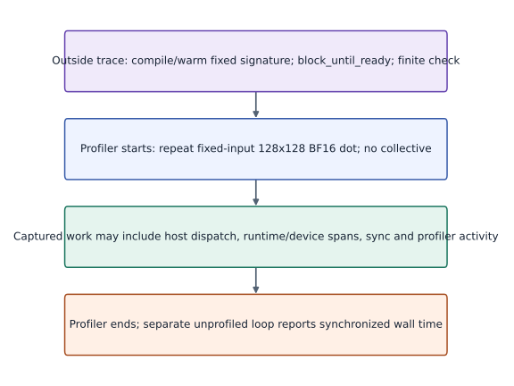

# bfloat16, int8 precision, and XProf profiling on TPU

Phase 21: TPU Systems: Generations, Memory, Precision & XProf · about 25 minutes · CPU

This worked reference is validated on CPU. Accelerator compatibility requires a separate source review and target execution receipt. A separate precision and profiling runner is implemented in the target instructions. Bounded hardware receipts cover v5e1 launch, resume and precision checks; four single-device Pallas cases; and a four-device v5e collective fixture. Each receipt applies only to its recorded source, environment, cases and hardware. Other lessons and TPU configurations require separate qualification.

**Before this lesson:** [TPU generations and HBM memory budgeting](https://www.tahabouhsine.com/jaxpathways/lesson-tpu-03.html).

## What you will be able to do

- Measure error for BF16 operands with requested FP32 and BF16 dot result dtypes, verify the actual returned dtypes, and avoid inferring internal partial-sum precision from output values.
- Implement per-column INT8 weight quantization and an FP32 dequantization reference; account for scales and test a zero-valued channel.
- Capture a warmed `jax.profiler.trace` (`*.xplane.pb`) on a Cloud TPU VM (or local CPU rehearsal) after synchronizing warmup.
- Download the trace directory with `gcloud compute tpus tpu-vm scp --recurse` and inspect it in TensorBoard / XProf.

## The problem

Measure how BF16 operand rounding and the requested dot result dtype affect a fixed CPU matmul, and compare a per-column INT8 weight-quantization reference. Verify the returned dtypes and distinguish observable outputs from backend arithmetic details. Retain a trace of the actual worked workload in a user-selected directory so its events can be inspected.

## The idea

This lesson measures numerical error for BF16 operands with requested FP32 and BF16 dot result dtypes, plus an FP32 dequantization reference for INT8 weights. The JAX API documents `preferred_element_type` as controlling the returned dtype; for the generic dot path it also serves as a compiler hint for accumulation. A returned dtype and output error do not reveal the precision of every internal partial sum. The FP32 result is a finite-precision reference, not exact arithmetic. The INT8 path stores quantized weights plus scale metadata, then casts and rescales them to FP32 before the dot; it does not demonstrate a native INT8 kernel, packed runtime storage, or reduced device-memory traffic. Keep the generated XProf directory after the example returns.

## What does `preferred_element_type` establish for BF16 dot products?

Lower precision asks two separate questions: how much space does an array occupy, and how much does the computed answer change? This lesson keeps the input matrix and weights fixed so you can compare three paths: BF16 operands returning FP32, BF16 operands returning BF16, and stored INT8 weight codes dequantized to FP32 before the dot.

Start with the returned answer. The recorded CPU run has maximum absolute errors $0.03718$, $0.05545$ and $0.12516$, respectively, against the same FP32 reference. The corresponding mean errors are $0.00756$, $0.00912$ and $0.02322$. The maximum asks about the worst output element; the mean summarizes all elements. A small mean can hide a larger error at a particular output, so inspect both before deciding whether a task can tolerate a precision change.

Now follow one INT8 weight column. Its scale is the largest absolute weight in that column divided by $127$. Dividing weights by that scale and rounding produces signed integer codes; multiplying the codes by the scale reconstructs approximate weights. A zero column needs a safe scale and all-zero codes so the calculation never divides by zero. Each output column gets its own scale because columns can have different ranges.

For the $(256,64)$ weight matrix, BF16 storage takes $32768$ bytes. INT8 codes take $16384$ bytes plus $256$ bytes for 64 FP32 scales. That is a smaller stored representation. However, this reference then materializes FP32 weights, which take $65536$ bytes, before multiplying them. Saving checkpoint bytes therefore does not by itself establish a lower-memory or faster dot product. For the $(64,256)$ input, FP32 and BF16 take $65536$ and $32768$ bytes; the $(64,64)$ result takes $16384$ or $8192$ bytes. Temporary lifetimes and other live arrays still matter for peak device memory.

Finally separate a returned dtype from an internal reduction. `preferred_element_type` requests a result element type and, on the generic lower-level dot path, supplies a compiler hint about accumulation. The retained CPU HLO widens BF16 operands to FP32, performs an FP32 dot and converts the requested BF16 result afterward. That is evidence about this compiled graph. It does not identify the physical partial-sum rounding order or establish TPU lowering. The probe command below lets you inspect those artifacts instead of inferring internal arithmetic from the output label.

**Run the source-bound CPU dtype and compiler-IR probe**

```bash
JAX_PLATFORMS=cpu python phases/21-tpu-systems/02-bfloat16-int8-precision-and-xprof-profiling/labs/precision_contract_probe.py --output-dir ./tpu06-precision-output
```

**Expected:** Retains the original and BF16 operands, FP32 reference, both requested-result arrays, explicit FP32-result-to-BF16 cast, seed-zero and seed-42 fixtures, plus seed 7 as a changed-seed check. The receipt records environment and source/data hashes and points to a result summary with returned dtypes, computed errors, and equality counts. StableHLO and optimized HLO are compiler evidence; they do not establish physical partial-sum precision or TPU lowering.

$$
B_{\text{stored}} = N_w b_w + N_s b_s; \quad B_{\text{runtime operands}} = N_x b_x + N_w b_w; \quad B_{\text{result}} = N_y b_y
$$

### Warmup, profiled calls, synchronization and unprofiled measurement boundaries

**Predict:** Which work is outside the trace, what may appear inside it, and does the shown source contain a collective?



*Conceptual execution boundary schematic; durations and event nesting depend on the retained trace.*

Conceptual flow, not drawn to time scale: synchronized warmup runs before the trace. The profiled region repeats a fixed-input matrix dot and synchronizes each result, so a captured timeline can include host dispatch, runtime/device work, synchronization and profiler activity. No collective appears in this function. A separate unprofiled loop measures wall time including host dispatch and synchronization.

### Pause and reason

What can the lesson infer from `jnp.dot(x_bf16, w_bf16, preferred_element_type=jnp.bfloat16)` and its measured output error?

<details><summary>Compare your reasoning</summary>

The call requests a BF16 returned dtype, and this run verifies that dtype and compares the output against a finite-precision reference. For the generic dot path, `preferred_element_type` is also a compiler hint about accumulation. These results do not establish that every partial sum is rounded to BF16; that requires backend-specific implementation evidence.

</details>

## Capture a bounded CPU rehearsal or TPU trace

A useful trace needs a question. Here it is: what events occur while a warmed, fixed-signature BF16 matrix dot is repeatedly dispatched and synchronized? The function allocates its bounded input once, warms that signature, then profiles a fixed number of calls. Every result is checked for finiteness so a broken workload cannot produce an apparently successful timing receipt.

Read the backend and step count first. Then inspect the actual host and device lanes. A host span around dispatch and `block_until_ready` includes the time spent submitting and waiting; it is not automatically an isolated device kernel. This workload has no collective, so a gap between calls is not evidence of collective communication.

The separate unprofiled run measures wall-clock time for the same loop, including dispatch and synchronization. Comparing it with the profiled interval helps you notice instrumentation overhead. Keep CPU rehearsal and TPU receipts separately labelled, since the event names and execution behavior can differ. The commands below retain the target trace for that inspection.

**Run tpu-06.py and capture a 5-step warmed XProf trace on the Cloud TPU VM**

```bash
gcloud compute tpus tpu-vm ssh "$TPU_NAME" --zone="$ZONE" --command="mkdir -p ~/jax-tpu-lab"
gcloud compute tpus tpu-vm scp public/exercises/tpu-06.py "$TPU_NAME":~/jax-tpu-lab/ --zone="$ZONE"
gcloud compute tpus tpu-vm ssh "$TPU_NAME" --zone="$ZONE" --command="set -euo pipefail; source ~/jax-tpu-lab/.venv/bin/activate; export TPU_TRACE_DIR=~/jax-tpu-lab/tpu-xprof-trace; JAX_PLATFORMS=tpu python ~/jax-tpu-lab/tpu-06.py"
mkdir -p ./tpu-xprof-trace
gcloud compute tpus tpu-vm scp --recurse "$TPU_NAME":~/jax-tpu-lab/tpu-xprof-trace ./ --zone="$ZONE"
```

**Expected:** Runs the lesson workload, captures that workload in the persistent TPU_TRACE_DIR, then copies the retained trace directory back. Inspect actual events in XProf; CPU and TPU traces remain separately identified.

**Launch TensorBoard with the XProf profile plugin on your workstation**

```bash
# Use the reviewed logger environment from projects/reproducible-experiments/requirements-loggers.txt, then start TensorBoard.
tensorboard --logdir ./tpu-xprof-trace --port 6006
```

**Expected:** Starts TensorBoard from the pinned logger environment. XProf must already be present in the reviewed target environment; do not install an unpinned plugin during the lesson.

## Practice reading a real trace before attributing TPU time

Before interpreting the trace you capture here, work through the [retained CPU event example](https://www.tahabouhsine.com/jaxpathways/lesson-performance-03.html). It includes actual event start/end timestamps, a parent span with two children, a double-counting counterexample and a measured change to an injected input wait. Apply the same event-accounting steps to your own trace, then identify its actual backend, event names and lanes. This dot-product fixture has no collective, so do not label any interval as collective communication. A target TPU trace may contain different events; retain that target evidence separately from the CPU worked example.

### Pause and reason

A host annotation contains a dot dispatch and block_until_ready. Is its duration isolated TPU kernel time?

<details><summary>Compare your reasoning</summary>

No. It includes host dispatch and waiting within the declared annotation. Inspect the actual device lanes and synchronization structure before making a device-kernel or critical-path claim.

</details>

## Compare BF16 operands with requested FP32 or BF16 dot result dtypes, plus per-column INT8 reference error

Create main.py with evaluate_precision_policies.

```python
# Step 1 — Compare BF16 operands with requested FP32 or BF16 dot result dtypes, plus per-column INT8 reference error
from pathlib import Path
import os
import tempfile
import tempfile
import time
import jax
import jax.numpy as jnp
import numpy as np


def evaluate_precision_policies(seed=0):
    # Create or split explicit PRNG key(s) (`(k1, k2)`) for reproducible randomness.
    k1, k2 = jax.random.split(jax.random.PRNGKey(seed))
    # Sample deterministic random values into `x` using an explicit PRNG key.
    x = jax.random.normal(k1, (64, 256), dtype=jnp.float32)
    # Sample deterministic random values into `w` using an explicit PRNG key.
    w = jax.random.normal(k2, (256, 64), dtype=jnp.float32) * 0.25
    # Cast or evaluate `ref_fp32` in explicit floating-point precision.
    ref_fp32 = jnp.dot(x, w, preferred_element_type=jnp.float32)
    # Cast or evaluate `out_bf16_requested_fp32` in explicit floating-point precision.
    out_bf16_requested_fp32 = jnp.dot(
        x.astype(jnp.bfloat16), w.astype(jnp.bfloat16), preferred_element_type=jnp.float32
    )
    # Cast or evaluate `out_bf16_requested_bf16` in explicit floating-point precision.
    out_bf16_requested_bf16 = jnp.dot(
        x.astype(jnp.bfloat16), w.astype(jnp.bfloat16), preferred_element_type=jnp.bfloat16
    )
    # Reduce across the target axis to summarize `scale`.
    column_max = jnp.max(jnp.abs(w), axis=0, keepdims=True)
    scale = jnp.where(column_max == 0, 1.0, column_max / 127.0)
    # The scale of 1 for a zero column avoids division by zero; its quantized values remain zero.
    w_int8 = jnp.clip(jnp.round(w / scale), -127, 127).astype(jnp.int8)
    # Cast or evaluate `out_int8_dequant_requested_fp32` in explicit floating-point precision.
    out_int8_dequant_requested_fp32 = jnp.dot(x, w_int8.astype(jnp.float32) * scale, preferred_element_type=jnp.float32)
    result_dtype_cases = [
        ("BF16 operands / requested FP32 result", out_bf16_requested_fp32),
        ("BF16 operands / requested BF16 result", out_bf16_requested_bf16),
        ("INT8 per-column / FP32 dequantized dot result", out_int8_dequant_requested_fp32),
    ]
    results = []
    # Loop over each requested-result-dtype comparison:
    for label, tensor in result_dtype_cases:
        diff = jnp.abs(tensor - ref_fp32)
        # Append the computed value via `results.append({`.
        results.append({
            "result_dtype_setting": label,
            "returned_dtype": str(tensor.dtype),
            "max_abs_err": round(float(jnp.max(diff)), 5),
            "mean_abs_err": round(float(jnp.mean(diff)), 5),
            "input_shape": list(x.shape), "weight_shape": list(w.shape), "result_shape": list(tensor.shape),
            "stored_weight_bytes": int((w.astype(jnp.bfloat16).size * 2) if "BF16" in label else w_int8.size),
            "scale_metadata_bytes": int(0 if "BF16" in label else scale.size * 4),
            "runtime_input_bytes": int(x.size * (2 if "BF16" in label else 4)),
            "runtime_weight_operand_bytes": int(w.astype(jnp.bfloat16).size * 2 if "BF16" in label else w.size * 4),
            "dequantized_fp32_workspace_bytes": int(w.size * 4 if "INT8" in label else 0),
            "result_bytes": int(tensor.size * (2 if tensor.dtype == jnp.bfloat16 else 4)),
            "storage_note": "logical array sizes; not peak HBM or measured traffic",
        })
    return results

```

Measuring both max and mean absolute error across requested result dtypes quantifies why requested FP32 result dtype is standard on TPU MXUs.

## Capture a bounded fixed-input XProf trace and measure unprofiled work

Warm and synchronize the fixed signature, profile a bounded number of identical finite dots, then separately measure the same work without the profiler. Report observed backend and retained files; do not infer collectives.

```python
# Step 2 — Capture a warmed XProf trace and verify *.xplane.pb output
def capture_warmed_trace(steps=5, trace_dir=None):
    if not isinstance(steps, int) or not 1 <= steps <= 16:
        raise ValueError("steps must be an integer in [1, 16]")
    # Reuse the same bounded input each iteration. For this 128x128 matrix of 0.125,
    # every dot entry is 128 * 0.125 * 0.125 = 2.0, so repeated calls cannot grow the values.
    x = jnp.full((128, 128), 0.125, dtype=jnp.bfloat16)
    step_fn = jax.jit(lambda a: jnp.dot(a, a, preferred_element_type=jnp.float32).astype(jnp.bfloat16))

    warm = jax.block_until_ready(step_fn(x))
    if not bool(np.isfinite(np.asarray(warm)).all()):
        raise FloatingPointError("warmup output contains a non-finite value")

    trace_dir = Path(trace_dir or os.environ.get("TPU_TRACE_DIR", "./tpu-xprof-trace")).expanduser().resolve()
    trace_dir.mkdir(parents=True, exist_ok=True)
    with jax.profiler.trace(str(trace_dir)):
        for _ in range(steps):
            profiled_result = jax.block_until_ready(step_fn(x))
            if not bool(np.isfinite(np.asarray(profiled_result)).all()):
                raise FloatingPointError("profiled output contains a non-finite value")

    # Measure the same fixed-signature work outside the profiler. This includes host dispatch
    # and synchronization, and is separate from trace duration or profiler event durations.
    t0 = time.perf_counter()
    for _ in range(steps):
        unprofiled_result = jax.block_until_ready(step_fn(x))
    unprofiled_ms = (time.perf_counter() - t0) * 1000.0
    if not bool(np.isfinite(np.asarray(unprofiled_result)).all()):
        raise FloatingPointError("unprofiled output contains a non-finite value")

    xplane_files = list(trace_dir.rglob("*.xplane.pb"))
    return {
        "backend": jax.default_backend(), "jax_version": jax.__version__, "input_shape": list(x.shape), "steps": steps,
        "warmup_finite": True, "all_finite": True, "profiled_xplane_count": len(xplane_files),
        "trace_dir": str(trace_dir), "unprofiled_total_ms": unprofiled_ms,
        "unprofiled_ms_per_step": unprofiled_ms / steps,
        "measurement_note": "unprofiled wall time includes host dispatch and synchronization; not a device-only duration",
        "workload_note": "fixed-input BF16 dot; no collective communication in this function",
    }


prec_table = evaluate_precision_policies()
trace_info = capture_warmed_trace(steps=5)
# Assert invariant `trace_info["profiled_xplane_count"] >= 1` holds
assert trace_info["profiled_xplane_count"] >= 1
assert prec_table[0]["returned_dtype"] == "float32"
assert prec_table[1]["returned_dtype"] == "bfloat16"
assert all(np.isfinite(row["max_abs_err"]) and np.isfinite(row["mean_abs_err"]) for row in prec_table)
print("Precision comparison:", prec_table)
print("Observed backend:", trace_info["backend"], "profiled steps:", trace_info["steps"], "XPlane files:", trace_info["profiled_xplane_count"], "unprofiled ms/step:", round(trace_info["unprofiled_ms_per_step"], 4))
```

Warming up before entering jax.profiler.trace ensures the captured *.xplane.pb file records steady-state execution rather than first-call compilation.

## Step 3: Verify invariants on the completed state

Run the final shape and numerical assertions to confirm the state built in Steps 1 and 2.

```python
assert trace_info["profiled_xplane_count"] >= 1
assert prec_table[0]["returned_dtype"] == "float32"
assert prec_table[1]["returned_dtype"] == "bfloat16"
assert all(np.isfinite(row["max_abs_err"]) and np.isfinite(row["mean_abs_err"]) for row in prec_table)
```

Checking these invariants confirms the computation is ready for the full worked experiment.

## Run the example

```python
# Step 1 — Compare BF16 operands with requested FP32 or BF16 dot result dtypes, plus per-column INT8 reference error
from pathlib import Path
import os
import tempfile
import time
import jax
import jax.numpy as jnp
import numpy as np


def evaluate_precision_policies(seed=0):
    # Create or split explicit PRNG key(s) (`(k1, k2)`) for reproducible randomness.
    k1, k2 = jax.random.split(jax.random.PRNGKey(seed))
    # Sample deterministic random values into `x` using an explicit PRNG key.
    x = jax.random.normal(k1, (64, 256), dtype=jnp.float32)
    # Sample deterministic random values into `w` using an explicit PRNG key.
    w = jax.random.normal(k2, (256, 64), dtype=jnp.float32) * 0.25
    # Keep the reference matrix product in float32 for comparison.
    ref_fp32 = jnp.dot(x, w, preferred_element_type=jnp.float32)
    # Round both operands to BF16, then request a float32 result dtype from the dot.
    out_bf16_requested_fp32 = jnp.dot(
        x.astype(jnp.bfloat16), w.astype(jnp.bfloat16), preferred_element_type=jnp.float32
    )
    # Request a BF16 dot result, then widen returned values to FP32 for error measurement.
    out_bf16_requested_bf16 = jnp.dot(
        x.astype(jnp.bfloat16), w.astype(jnp.bfloat16), preferred_element_type=jnp.bfloat16
    )
    # Take one maximum per output column so each column gets its own quantization scale.
    column_max = jnp.max(jnp.abs(w), axis=0, keepdims=True)
    scale = jnp.where(column_max == 0, 1.0, column_max / 127.0)
    # The scale of 1 for a zero column avoids division by zero; its quantized values remain zero.
    w_int8 = jnp.clip(jnp.round(w / scale), -127, 127).astype(jnp.int8)
    # Dequantize int8 weights to FP32, then request an FP32 result from the dot.
    out_int8_dequant_requested_fp32 = jnp.dot(x, w_int8.astype(jnp.float32) * scale, preferred_element_type=jnp.float32)
    result_dtype_cases = [
        ("BF16 operands / requested FP32 result", out_bf16_requested_fp32),
        ("BF16 operands / requested BF16 result", out_bf16_requested_bf16),
        ("INT8 per-column / FP32 dequantized dot result", out_int8_dequant_requested_fp32),
    ]
    results = []
    # Loop over each requested-result-dtype comparison:
    for label, tensor in result_dtype_cases:
        diff = jnp.abs(tensor - ref_fp32)
        # Append the computed value via `results.append({`.
        results.append({
            "result_dtype_setting": label,
            "returned_dtype": str(tensor.dtype),
            "max_abs_err": round(float(jnp.max(diff)), 5),
            "mean_abs_err": round(float(jnp.mean(diff)), 5),
            "input_shape": list(x.shape), "weight_shape": list(w.shape), "result_shape": list(tensor.shape),
            "stored_weight_bytes": int((w.astype(jnp.bfloat16).size * 2) if "BF16" in label else w_int8.size),
            "scale_metadata_bytes": int(0 if "BF16" in label else scale.size * 4),
            "runtime_input_bytes": int(x.size * (2 if "BF16" in label else 4)),
            "runtime_weight_operand_bytes": int(w.astype(jnp.bfloat16).size * 2 if "BF16" in label else w.size * 4),
            "dequantized_fp32_workspace_bytes": int(w.size * 4 if "INT8" in label else 0),
            "result_bytes": int(tensor.size * (2 if tensor.dtype == jnp.bfloat16 else 4)),
            "storage_note": "logical array sizes; not peak HBM or measured traffic",
        })
    return results


# Step 2 — Capture a warmed XProf trace and verify *.xplane.pb output
def capture_warmed_trace(steps=5, trace_dir=None):
    if not isinstance(steps, int) or not 1 <= steps <= 16:
        raise ValueError("steps must be an integer in [1, 16]")
    # Reuse the same bounded input each iteration. For this 128x128 matrix of 0.125,
    # every dot entry is 128 * 0.125 * 0.125 = 2.0, so repeated calls cannot grow the values.
    x = jnp.full((128, 128), 0.125, dtype=jnp.bfloat16)
    step_fn = jax.jit(lambda a: jnp.dot(a, a, preferred_element_type=jnp.float32).astype(jnp.bfloat16))

    warm = jax.block_until_ready(step_fn(x))
    if not bool(np.isfinite(np.asarray(warm)).all()):
        raise FloatingPointError("warmup output contains a non-finite value")

    trace_dir = Path(trace_dir or os.environ.get("TPU_TRACE_DIR", "./tpu-xprof-trace")).expanduser().resolve()
    trace_dir.mkdir(parents=True, exist_ok=True)
    with jax.profiler.trace(str(trace_dir)):
        for _ in range(steps):
            profiled_result = jax.block_until_ready(step_fn(x))
            if not bool(np.isfinite(np.asarray(profiled_result)).all()):
                raise FloatingPointError("profiled output contains a non-finite value")

    # Measure the same fixed-signature work outside the profiler. This includes host dispatch
    # and synchronization, and is separate from trace duration or profiler event durations.
    t0 = time.perf_counter()
    for _ in range(steps):
        unprofiled_result = jax.block_until_ready(step_fn(x))
    unprofiled_ms = (time.perf_counter() - t0) * 1000.0
    if not bool(np.isfinite(np.asarray(unprofiled_result)).all()):
        raise FloatingPointError("unprofiled output contains a non-finite value")

    xplane_files = list(trace_dir.rglob("*.xplane.pb"))
    return {
        "backend": jax.default_backend(), "jax_version": jax.__version__, "input_shape": list(x.shape), "steps": steps,
        "warmup_finite": True, "all_finite": True, "profiled_xplane_count": len(xplane_files),
        "trace_dir": str(trace_dir), "unprofiled_total_ms": unprofiled_ms,
        "unprofiled_ms_per_step": unprofiled_ms / steps,
        "measurement_note": "unprofiled wall time includes host dispatch and synchronization; not a device-only duration",
        "workload_note": "fixed-input BF16 dot; no collective communication in this function",
    }


prec_table = evaluate_precision_policies()
trace_info = capture_warmed_trace(steps=5)
# Assert invariant `trace_info["profiled_xplane_count"] >= 1` holds
assert trace_info["profiled_xplane_count"] >= 1
assert prec_table[0]["returned_dtype"] == "float32"
assert prec_table[1]["returned_dtype"] == "bfloat16"
assert all(np.isfinite(row["max_abs_err"]) and np.isfinite(row["mean_abs_err"]) for row in prec_table)
print("Precision comparison:", prec_table)
print("Retained trace directory:", trace_info["trace_dir"])
print("Observed backend:", trace_info["backend"], "profiled steps:", trace_info["steps"], "XPlane files:", trace_info["profiled_xplane_count"], "unprofiled ms/step:", round(trace_info["unprofiled_ms_per_step"], 4))
```

Expected: Prints precision errors and policy-specific bytes, then records the observed backend and JAX version, warmup/profile finite-check status, bounded profiled step count, retained XPlane file count, and separate unprofiled wall time per step. The timing includes host dispatch and synchronization. No collective is present in the profiled function.

## Measured output error for BF16 inputs and an FP32 INT8 dequantization reference

**Predict:** How do BF16 operands with requested FP32 or BF16 result dtypes, and the per-column INT8 dequantization reference, compare in error against a finite-precision FP32 JAX result?


**Recorded CPU computation**

### Read the figure

Read the three operand paths along the horizontal axis. Each pair of bars compares one returned result with the same finite-precision FP32 CPU reference. The maximum-error bar asks how far the worst output element moved; the mean-error bar asks about the average absolute change across the output matrix.

In this run, requesting an FP32 result from BF16 operands gives mean error $0.00756$, while requesting BF16 gives $0.00912$. The INT8 dequantization path gives $0.02322$. This ordering describes these seeded inputs and this backend. To choose a policy for a model, repeat the comparison on representative activations and evaluate the model's actual task metric as well as tensor error.

### Connect it to the computation

Compare the error bars with the storage calculation. INT8 codes use fewer stored bytes, yet this reference expands them to FP32 for the dot and has the largest output error of the three paths. You can therefore support a checkpoint-storage claim from the byte counts, but need separate runtime and quality evidence for a deployment decision. The profiler artifact answers timing questions; these bars answer numerical ones.

```python
# Perform matrix contraction / projection to compute `visual_data`.
visual_data = {
    'kind': 'bar',
    'labels': ['BF16 inputs / FP32 result', 'BF16 inputs / BF16 result', 'INT8 weights / FP32 dequantized dot'],
    'xlabel': 'requested result dtype / operand path',
    'ylabel': 'absolute error vs fp32 reference',
    'series': [
        {'label': 'max abs error', 'y': [float(r['max_abs_err']) for r in prec_table]},
        {'label': 'mean abs error', 'y': [float(r['mean_abs_err']) for r in prec_table]},
    ],
}
```

## Recorded reference execution

CPU run: 2026-10-27T16:12:31.866664+00:00. JAX 0.9.2.

```text
Precision comparison: [{'result_dtype_setting': 'BF16 operands / requested FP32 result', 'returned_dtype': 'float32', 'max_abs_err': 0.03718, 'mean_abs_err': 0.00756, 'input_shape': [64, 256], 'weight_shape': [256, 64], 'result_shape': [64, 64], 'stored_weight_bytes': 32768, 'scale_metadata_bytes': 0, 'runtime_input_bytes': 32768, 'runtime_weight_operand_bytes': 32768, 'dequantized_fp32_workspace_bytes': 0, 'result_bytes': 16384, 'storage_note': 'logical array sizes; not peak HBM or measured traffic'}, {'result_dtype_setting': 'BF16 operands / requested BF16 result', 'returned_dtype': 'bfloat16', 'max_abs_err': 0.05545, 'mean_abs_err': 0.00912, 'input_shape': [64, 256], 'weight_shape': [256, 64], 'result_shape': [64, 64], 'stored_weight_bytes': 32768, 'scale_metadata_bytes': 0, 'runtime_input_bytes': 32768, 'runtime_weight_operand_bytes': 32768, 'dequantized_fp32_workspace_bytes': 0, 'result_bytes': 8192, 'storage_note': 'logical array sizes; not peak HBM or measured traffic'}, {'result_dtype_setting': 'INT8 per-column / FP32 dequantized dot result', 'returned_dtype': 'float32', 'max_abs_err': 0.12516, 'mean_abs_err': 0.02322, 'input_shape': [64, 256], 'weight_shape': [256, 64], 'result_shape': [64, 64], 'stored_weight_bytes': 16384, 'scale_metadata_bytes': 256, 'runtime_input_bytes': 65536, 'runtime_weight_operand_bytes': 65536, 'dequantized_fp32_workspace_bytes': 65536, 'result_bytes': 16384, 'storage_note': 'logical array sizes; not peak HBM or measured traffic'}]
Observed backend: cpu profiled steps: 5 XPlane files: 8 unprofiled ms/step: 0.351
Precision comparison: [{'result_dtype_setting': 'BF16 operands / requested FP32 result', 'returned_dtype': 'float32', 'max_abs_err': 0.03718, 'mean_abs_err': 0.00756, 'input_shape': [64, 256], 'weight_shape': [256, 64], 'result_shape': [64, 64], 'stored_weight_bytes': 32768, 'scale_metadata_bytes': 0, 'runtime_input_bytes': 32768, 'runtime_weight_operand_bytes': 32768, 'dequantized_fp32_workspace_bytes': 0, 'result_bytes': 16384, 'storage_note': 'logical array sizes; not peak HBM or measured traffic'}, {'result_dtype_setting': 'BF16 operands / requested BF16 result', 'returned_dtype': 'bfloat16', 'max_abs_err': 0.05545, 'mean_abs_err': 0.00912, 'input_shape': [64, 256], 'weight_shape': [256, 64], 'result_shape': [64, 64], 'stored_weight_bytes': 32768, 'scale_metadata_bytes': 0, 'runtime_input_bytes': 32768, 'runtime_weight_operand_bytes': 32768, 'dequantized_fp32_workspace_bytes': 0, 'result_bytes': 8192, 'storage_note': 'logical array sizes; not peak HBM or measured traffic'}, {'result_dtype_setting': 'INT8 per-column / FP32 dequantized dot result', 'returned_dtype': 'float32', 'max_abs_err': 0.12516, 'mean_abs_err': 0.02322, 'input_shape': [64, 256], 'weight_shape': [256, 64], 'result_shape': [64, 64], 'stored_weight_bytes': 16384, 'scale_metadata_bytes': 256, 'runtime_input_bytes': 65536, 'runtime_weight_operand_bytes': 65536, 'dequantized_fp32_workspace_bytes': 65536, 'result_bytes': 16384, 'storage_note': 'logical array sizes; not peak HBM or measured traffic'}]
Retained trace directory: /private/tmp/jaxpathways-content-repairs-review/tpu-xprof-trace
Observed backend: cpu profiled steps: 5 XPlane files: 8 unprofiled ms/step: 0.0937
Requested BF16 / FP32 result max-error ratio for seed 0: 1.49
Observed backend: cpu steps: 5 finite: True XPlane files: 1
Rejected steps above the fixed maximum before tracing
{'bf16_weight_bytes': 8192, 'int8_code_bytes': 4096, 'scale_bytes': 128, 'zero_column_scale': 1.0, 'zero_codes': 0}
Observed backend and JAX version: cpu 0.9.2
Three returned dtypes: ['float32', 'bfloat16', 'float32']
Three mean absolute errors: [0.0075, 0.00902, 0.02182]
Trace steps/files: 3 8 unprofiled ms/step: 0.11773609245816867
Mean error (per-channel vs per-tensor): 0.01389 0.0979
xplane.pb bytes: 275765
PASS: tpu-06

```

## Compare requested FP32 vs BF16 result dtype error ratio

**Predict before running:** For the seed-zero CPU fixture, what is the ratio of the maximum error for the requested BF16 result to the requested FP32 result?

```python
# Experiment — Compare requested FP32 vs BF16 result dtype error ratio
requested_fp32_err = prec_table[0]["max_abs_err"]
requested_bf16_err = prec_table[1]["max_abs_err"]
ratio = round(requested_bf16_err / requested_fp32_err, 2)
print("Requested BF16 / FP32 result max-error ratio for seed 0:", ratio)
# This reports the measured ratio for the current backend and fixed seed-zero fixture.
assert np.isfinite(ratio)
```

**Expected:** For this seed-zero CPU fixture, the requested BF16 result has about 1.49 times the maximum error of the requested FP32 result. This is an output comparison, not evidence about every internal partial sum.

The ratio is computed from this fixed seed-zero fixture and the current CPU backend. `preferred_element_type` requests the returned dtype and acts as an accumulation hint for this generic dot path; it does not independently certify backend internals.

## Check finite output under a changed bounded trace count

**Predict before running:** Will five profiled dots remain finite when the same input is reused, and are requests above the maximum rejected?

```python
import tempfile
with tempfile.TemporaryDirectory(prefix="tpu-trace-steps-") as tmp:
    five = capture_warmed_trace(steps=5, trace_dir=tmp)
print("Observed backend:", five["backend"], "steps:", five["steps"], "finite:", five["all_finite"], "XPlane files:", five["profiled_xplane_count"])
assert five["all_finite"] and five["steps"] == 5 and five["profiled_xplane_count"] >= 1
try:
    capture_warmed_trace(steps=17, trace_dir=tmp)
except ValueError:
    print("Rejected steps above the fixed maximum before tracing")
else:
    raise AssertionError("trace step count must be bounded")
```

**Expected:** Five repeated fixed-input dots remain finite and produce an XPlane file; 17 steps are rejected before tracing.

The output is not fed back as input, so magnitudes do not grow between repetitions. The explicit upper bound keeps this teaching trace workload finite and bounded.

## Check shape-dependent byte accounting and a zero output column

**Predict before running:** How do stored bytes and scale bytes change for a 128×32 weight matrix, and what happens when one full output column is zero?

```python
# Shape ledger: BF16 weights are 128*32*2 B; INT8 codes are 128*32 B and 32 FP32 scales.
shape = (128, 32)
bf16_weight_bytes = shape[0] * shape[1] * 2
int8_code_bytes = shape[0] * shape[1]
scale_bytes = shape[1] * 4
zero_column = jnp.zeros((shape[0], 1), dtype=jnp.float32)
zero_scale = jnp.where(jnp.max(jnp.abs(zero_column), axis=0, keepdims=True) == 0, 1.0, jnp.max(jnp.abs(zero_column), axis=0, keepdims=True) / 127.0)
zero_codes = jnp.clip(jnp.round(zero_column / zero_scale), -127, 127).astype(jnp.int8)
print({"bf16_weight_bytes": bf16_weight_bytes, "int8_code_bytes": int8_code_bytes, "scale_bytes": scale_bytes, "zero_column_scale": float(zero_scale[0,0]), "zero_codes": int(jnp.count_nonzero(zero_codes))})
assert (bf16_weight_bytes, int8_code_bytes, scale_bytes) == (8192, 4096, 128)
assert float(zero_scale[0,0]) == 1.0 and int(jnp.count_nonzero(zero_codes)) == 0
```

**Expected:** For 128×32 weights, BF16 storage is 8,192 B; INT8 codes plus FP32 scales are 4,096 B + 128 B. A zero column uses scale 1 and remains all zero.

Storage bytes depend on actual shape and dtype. The zero-column case confirms safe metadata without changing its all-zero codes.

## Make it yours

Run `evaluate_precision_policies(seed=42)` and `capture_warmed_trace(steps=3)`. Report the observed backend, each of the three returned dtypes, and all three mean errors. State that the displayed precision comparison uses the CPU rehearsal when the backend is CPU, and that this trace workload contains no collective. Report JAX version and confirm warmup, profiled and unprofiled outputs are finite, and `profiled_xplane_count >= 1`; predict and check that `steps=5` keeps the output finite because each iteration reuses the same input.

### How to write this exercise — Step-by-step recipe & starter scaffold

**Inputs:**
- The seeded precision-policy evaluator and warmed trace capture helper.

**Outputs:**
- For seed 42, measured max and mean errors, requested-result labels, actual returned dtypes, and the trace receipt.

**Invariants to check:**
- Report the actual backend and returned dtypes; do not treat a requested result dtype or measured error as proof of internal partial-sum precision.
- Keep the error comparison tied to the seed-42 fixture and confirm the trace receipt contains an XPlane file.

**Hints:**
- Compare rows by the literal requested-result-dtype labels, then inspect each output array dtype.
- A CPU trace is a valid local exercise result; reserve TPU implementation and performance claims for matching target evidence.

**Starter code scaffold (fill in the TODOs):**

```python
import jax

def compare_precision_run(evaluate_precision_policies, capture_warmed_trace):
    # TODO: Run the seeded comparison and trace, then validate the requested results and backend.
    raise NotImplementedError
```

<details><summary>Reference solution</summary>

```python
p42 = evaluate_precision_policies(seed=42)
t3 = capture_warmed_trace(steps=3)
print("Observed backend and JAX version:", t3["backend"], t3["jax_version"])
print("Three returned dtypes:", [r["returned_dtype"] for r in p42])
print("Three mean absolute errors:", [r["mean_abs_err"] for r in p42])
print("Trace steps/files:", t3["steps"], t3["profiled_xplane_count"], "unprofiled ms/step:", t3["unprofiled_ms_per_step"])
assert t3["warmup_finite"] and t3["all_finite"] and t3["profiled_xplane_count"] >= 1
assert [r["returned_dtype"] for r in p42] == ["float32", "bfloat16", "float32"]
# Changed-step-count check: five repeats remain finite because input is not fed back as output.
t5 = capture_warmed_trace(steps=5)
assert t5["all_finite"] and t5["steps"] == 5
```

</details>

## Compare per-channel vs per-tensor INT8 quantization error

**Foundations**

Quantize `w` with a single global scalar `scale_global = jnp.max(jnp.abs(w)) / 127.0` and compare its max error against per-channel quantization when one column of `w` is scaled by `10.0`.

<details><summary>Hint</summary>

Multiply `w[:, :1]` by `10.0` and compare per-column `axis=0` scale vs global scalar scale.

</details>

### How to write: Compare per-channel vs per-tensor INT8 quantization error — Step-by-step recipe & starter scaffold

**Inputs:**
- A weight matrix with one column scaled by ten and per-channel and global INT8 quantizers.

**Outputs:**
- Maximum reconstruction errors for both quantization scales.

**Invariants to check:**
- The global scale covers the largest magnitude; per-channel scales are computed per output column (axis 0 for this weight layout).

**Hints:**
- Construct the skewed matrix deterministically by multiplying one column by ten.
- Compare dequantized weights with the same original matrix using global and per-column scales.

**Starter code scaffold (fill in the TODOs):**

```python
import jax.numpy as jnp
import numpy as np

def compare_int8_scale_granularity(weights):
    # TODO: skew one column and compare max error from global and per-channel scales.
    raise NotImplementedError
```

<details><summary>Reference solution and reasoning</summary>

```python
# Compare per-channel vs per-tensor INT8 quantization error (Foundations)
# Create or split explicit PRNG key(s) (`w_skew`) for reproducible randomness.
w_skew = jax.random.normal(jax.random.PRNGKey(9), (128, 32), dtype=jnp.float32) * 0.2
w_skew = w_skew.at[:, 0].multiply(10.0)
# Create or split explicit PRNG key(s) (`x_in`) for reproducible randomness.
x_in = jax.random.normal(jax.random.PRNGKey(10), (32, 128), dtype=jnp.float32)
# Cast or evaluate `ref` in explicit floating-point precision.
ref = jnp.dot(x_in, w_skew, preferred_element_type=jnp.float32)
# Reduce along axis=0 to compute `s_col`.
s_col = jnp.max(jnp.abs(w_skew), axis=0, keepdims=True) / 127.0
s_glb = jnp.max(jnp.abs(w_skew)) / 127.0
q_col = jnp.clip(jnp.round(w_skew / s_col), -127, 127).astype(jnp.int8)
q_glb = jnp.clip(jnp.round(w_skew / s_glb), -127, 127).astype(jnp.int8)
err_col = float(jnp.mean(jnp.abs(jnp.dot(x_in, q_col.astype(jnp.float32) * s_col) - ref)))
err_glb = float(jnp.mean(jnp.abs(jnp.dot(x_in, q_glb.astype(jnp.float32) * s_glb) - ref)))
print("Mean error (per-channel vs per-tensor):", round(err_col, 5), round(err_glb, 5))
# Assert invariant `err_col < err_glb` holds
assert err_col < err_glb
```

One outlier channel stretches a per-tensor scale factor and crushes small channels into a few integer buckets; per-channel scaling isolates each column.

</details>

## Verify non-empty XProf *.xplane.pb byte size

**Transfer / diagnosis**

Capture a trace in a temporary directory and verify that the generated `*.xplane.pb` file has `stat().st_size > 0`.

<details><summary>Hint</summary>

Check `xplane_files[0].stat().st_size > 0`.

</details>

### How to write: Verify non-empty XProf *.xplane.pb byte size — Step-by-step recipe & starter scaffold

**Inputs:**
- A temporary trace directory and the public capture_warmed_trace function.

**Outputs:**
- The captured XPlane file path and its byte size.

**Invariants to check:**
- The reported trace must be an actual file with positive size; a directory count alone is insufficient.

**Hints:**
- Capture a short warmed run.
- Inspect each generated xplane.pb file with stat.

**Starter code scaffold (fill in the TODOs):**

```python
import jax.numpy as jnp
import numpy as np

def inspect_xplane_file(capture_warmed_trace, root):
    # TODO: capture a trace and return the nonempty XPlane file evidence.
    raise NotImplementedError
```

<details><summary>Reference solution and reasoning</summary>

```python
# Verify non-empty XProf *.xplane.pb byte size (Transfer / diagnosis)
# Keep this run’s database and artifacts in a scratch directory removed on exit.
with tempfile.TemporaryDirectory(prefix="tpu-xplane-size-") as d:
    a = jnp.ones((128, 128), dtype=jnp.bfloat16)
    # Wrap with `jax.jit` (`fn`) so XLA traces and compiles the function.
    fn = jax.jit(lambda z: z @ z)
    # Wait for device work to finish before timing it or comparing its result on the host.
    jax.block_until_ready(fn(a))
    # Enter managed runtime/context scope for this block:
    with jax.profiler.trace(d):
        # Wait for device work to finish before timing it or comparing its result on the host.
        jax.block_until_ready(fn(a))
    pb = list(Path(d).rglob("*.xplane.pb"))[0]
    size_bytes = pb.stat().st_size
print("xplane.pb bytes:", size_bytes)
# Assert invariant `size_bytes > 0` holds
assert size_bytes > 0
```

Verifying a non-empty `*.xplane.pb` file confirms the profiler flushed device and host events before closing.

</details>

## Check your understanding

Why does the code warm and synchronize before entering the trace, then measure a separate unprofiled loop?

1. Warmup removes all host activity, so the trace contains only accelerator instructions
2. The fixed-signature warmup moves initial compilation out of the captured window; the trace still records whatever host, device, synchronization and profiler events occur, while the unprofiled loop supplies a separate wall-time measurement
3. A matrix dot automatically inserts a cross-device collective, which the profiler needs to show

<details><summary>Answer and explanation</summary>

**1. Warmup removes all host activity, so the trace contains only accelerator instructions**

Warmup excludes the first invocation from the trace but does not remove host dispatch, synchronization, other compilation events, or profiler overhead from captured work.

**2. The fixed-signature warmup moves initial compilation out of the captured window; the trace still records whatever host, device, synchronization and profiler events occur, while the unprofiled loop supplies a separate wall-time measurement (correct)**

The synchronized warmup prepares the tested signature before tracing. The captured function is one fixed-input dot and includes no collective, so it cannot support a communication claim. Trace event durations may nest or overlap and include runtime/profiler activity. The separate unprofiled measurement includes host dispatch and synchronization; it is not a device-only latency.

**3. A matrix dot automatically inserts a cross-device collective, which the profiler needs to show**

A dot call on one array does not imply a distributed collective. Communication appears only if the actual workload and trace contain such operations.

</details>

## Diagnose the result

If XProf shows large gaps between device steps on your TPU VM, check for un-jitted Python work, host-side NumPy conversions, or synchronous `print(array)` calls inside the training step.

## Carry forward

- Use BF16 operands when appropriate, request the desired result dtype with `preferred_element_type`, and verify the actual returned dtype. Treat internal accumulation behavior as backend-specific unless a supported explicit dot algorithm or target evidence establishes it. Use per-column scales when quantizing weights to `int8`.
- Capture the same bounded workload after synchronized warmup. Interpret the events that the trace contains; this fixed-input dot has no collective. Label CPU rehearsal and TPU target traces by their observed backend, and report unprofiled wall time separately from profiler event timing.

## Keep your evidence

Keep the returned-dtype/error table, seeded cast comparisons, source-bound CPU compiler IR and captured *.xplane.pb trace receipt. State the observed backend and the limits of each artifact.

Save your predictions, modified code, terminal outputs, and reasoning in your engineering portfolio.

## Primary references

- [Profile JAX programs with XProf and TensorBoard](https://docs.jax.dev/en/latest/profiling.html)
- [Cloud TPU performance guide](https://cloud.google.com/tpu/docs/performance-guide)
- [jax.numpy.dot: preferred_element_type and returned dtype](https://docs.jax.dev/en/latest/_autosummary/jax.numpy.dot.html)
- [jax.lax.dot: output dtype and compiler accumulation hint](https://docs.jax.dev/en/latest/_autosummary/jax.lax.dot.html)
- [jax.lax.DotAlgorithm: explicit operand and accumulation types](https://docs.jax.dev/en/latest/jax.lax.html#jax.lax.DotAlgorithm)

