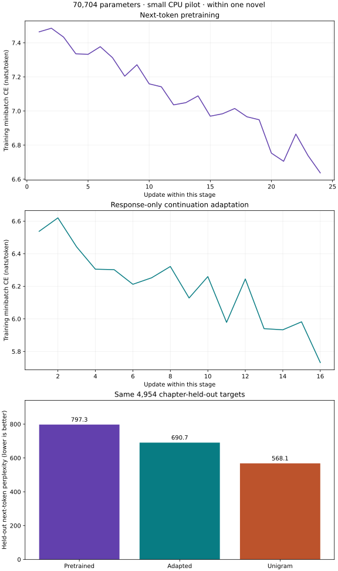

# A tiny causal Transformer with pretraining and instruction-style lineage

Train a small next-token decoder on a pinned public-domain text, continue it with a narrow narrative-completion exercise, then compare held-out perplexity with a count-based unigram model and sample from the exported weights. This is a CPU teaching pilot. It does not implement or promote the separate `causal-model-300m` plan, and it makes no 300M, production, general instruction-following, preference-training, or RLHF claim.

## Data and split contract

The included source is Lewis Carroll's *Alice's Adventures in Wonderland*, Project Gutenberg eBook 11, Millennium Fulcrum Edition 3.0. The source file and license are in `data/source/` and `data/LICENSE.md`; `data/manifest.json` records its SHA-256 and the deterministic extraction hashes. `data/build_data.py` rebuilds the passage and continuation files without network access. Its chapter map matches `embedding-lineage`: chapters I–IV train, V validation, and VI–VIII test. Each chapter is one source group and must remain wholly within one split. The word tokenizer is fit only on train-chapter passages and train-only adaptation records.

The source has one author, language, setting, and genre. Held-out chapters test a within-book continuation of the same distribution; they are not independent-author or broad language-model evaluation. The 32 instruction-style records are built from adjacent eligible paragraphs in train chapters. The prompt asks for a short continuation and the target is the following source paragraph. These are ordinary next-token examples, not human-written preference judgments or evidence of general instruction following. Validation and test chapters never enter adaptation.

## Run as a learner

Use Python `>=3.11,<3.15` with the repository's CPU research dependencies (`jax`, `flax`, `optax`, and `numpy`) installed. From the extracted course workspace root, copy the starter and run the independent contract checks with the same output directory for both stages:

```sh
cp projects/causal-lineage/starter/model.py projects/causal-lineage/my_model.py
python3 projects/causal-lineage/tests/check.py --implementation projects/causal-lineage/my_model.py --stage 1 --output runs/causal-lineage/learner-run
python3 projects/causal-lineage/tests/check.py --implementation projects/causal-lineage/my_model.py --stage 2 --output runs/causal-lineage/learner-run
```

The starter raises `NotImplementedError`. Implement `causal_attention_mask`, `shift_tokens`, `masked_causal_cross_entropy`, and `sample_next_token`. Stage 1 checks causal and non-PAD key visibility, one-token target alignment, an independent NumPy cross-entropy calculation, empty-mask rejection, deterministic top-k sampling, and that changing a future token cannot change earlier logits. It then trains next-token cross-entropy on train-chapter windows and writes the base checkpoint and validation receipt. Stage 2 requires and verifies that exact base checkpoint, initializes a new Adam optimizer for the adaptation objective, trains only response targets from the 32 continuation records, then writes held-out evaluation and export receipts.

To execute the complete reference run:

```sh
python3 projects/causal-lineage/tests/check.py --implementation solution --stage all
```

The complete checker uses a temporary output directory. To inspect and keep artifacts, run the two stages directly:

```sh
python3 projects/causal-lineage/run.py --implementation solution --stage 1 --output runs/causal-lineage/reference
python3 projects/causal-lineage/run.py --implementation solution --stage 2 --output runs/causal-lineage/reference
```

Stage 2 writes `evaluation.json`, stage manifests and parameters, plus `export/`. Evaluation reports validation and test next-token NLL/perplexity for the pretraining checkpoint and adapted checkpoint, and for a unigram baseline estimated from train passages with fixed additive smoothing. All three receive the exact same held-out target tokens. A one-author chapter split and a unigram comparator make a transparent educational check, not a benchmark. Preserve weak or worsening results as measured.

## Objective and implementation

Pretraining minimizes

\[
L_{\mathrm{next}}=-\frac{\sum_{b,t}m_{b,t}\log p_\theta(x_{b,t+1}\mid x_{b,\le t})}{\sum_{b,t}m_{b,t}},
\]

where the target mask excludes padding and each sequence ends at its source passage boundary. The decoder has one pre-layer-normalized causal self-attention block, a GELU MLP, learned positions, and a vocabulary projection. The independent mask test checks both the upper-triangular future exclusion and the padded-key boundary; a perturbation test verifies causal invariance on the actual Flax module.

Adaptation uses the same shifted next-token objective but masks loss to response tokens and EOS; instruction/context tokens remain visible as prompt context. It resets Adam state deliberately at the stage boundary and records that choice. The checkpoint contains model parameters, not optimizer moments, so this project does not claim exact mid-run resume.

## Lineage and inference evidence

Every checkpoint binds parameter bytes to its immediate predecessor, source/code identity, data/source hashes, tokenizer, architecture/configuration, objective, and update history. The checker changes the recorded predecessor and verifies that stage 2 rejects it. The test also confirms every instruction row is assigned to a train chapter and that validation/test chapters do not cross the frozen chapter split.

The exported package contains the adapted parameters, tokenizer, configuration, artifact checksums, and source identities. Two separate Python processes reload the export, compare prompt logits with the in-process model, record their hashes, and reproduce a seeded top-k sample. The sample is real inference from the trained weights; its text is not quality evidence. The report records only the CPU backend actually used. No accelerator has been exercised by this project.

## Recorded CPU pilot

The checked reference run on 2026-10-20 used Python 3.14.3, JAX 0.9.2, Flax 0.12.6, Optax 0.2.8, and the CPU backend. It trained 70,704 parameters on 106 train passages for 24 next-token updates, followed by 16 response-masked adaptation updates over 32 train-only continuation pairs. Validation contains 32 passages; test contains 96 passages. The test comparison uses the same 4,954 next-token targets for every row:

| Checkpoint or baseline | Test NLL | Test perplexity |
| --- | ---: | ---: |
| Pretrained decoder | 6.6813 | 797.32 |
| Instruction-style adapted decoder | 6.5378 | 690.75 |
| Train-only unigram with additive smoothing | 6.3424 | 568.13 |

The unigram baseline is better on this test split. Adaptation lowers the model's measured test perplexity relative to its own base checkpoint, but does not beat the baseline; neither result establishes generalization or instruction following. Two fresh processes reproduced the same seeded sample and prompt logits within a maximum absolute difference of `1.43e-6`. The recorded sample was `she she as she she to the she i she the she she she she as`, a visibly weak continuation. These are receipts from this small CPU run, not benchmark or production evidence.

Keep this project separate from the [planned approximately-300M causal model](../causal-model-300m/README.md). This pilot is not its implementation, training run, scale evidence, or release qualification.

## Read the recorded figures



The first panel follows the 24 pretraining updates; the second follows 16 adaptation updates. Each point is a sampled training minibatch, so a downward trend does not measure held-out quality. Both use nats per selected target token, but adaptation selects only response tokens while pretraining selects every non-padding next token. Their vertical values therefore refer to different target populations. The third panel evaluates all three models on the same 4,954 test targets from held-out chapters. Lower perplexity is better. Adaptation improves over the pretrained model in this run, but the unigram baseline remains better. The repetitive generated sample is another failure signal. These are within-book observations with a small word vocabulary, not broad language-model capability.

The [retained CPU result](outputs/pilot-results.json) includes package versions, source/checkpoint identities, all update histories, evaluation denominators and fresh-process reload checks. Rebuild this plot with `python3 projects/causal-lineage/render_results.py` after producing and retaining a new run; the renderer reads measured values rather than inventing a trajectory.

## Review handoff: explain a changed condition

Held-out perplexity improves while generated instructions remain poor. What has the tiny causal pilot established, and what experiment should follow?

**Keep for review:** Token-weighted held-out NLL against the same tokenizer/baseline, generation examples under a frozen decoding config and separate continuation-versus-SFT experiments. The existing small pilot does not establish production quality or a 300M release.

Write your prediction before opening the reference implementation. Distinguish what the existing checker verifies from your proposed extension; record any extension command, actual output and limitation separately. A reviewer should be able to locate the first failed contract from your saved evidence.
