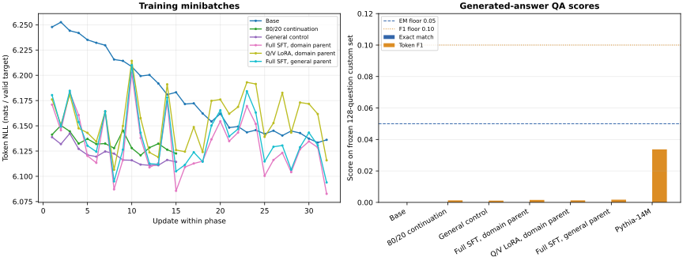
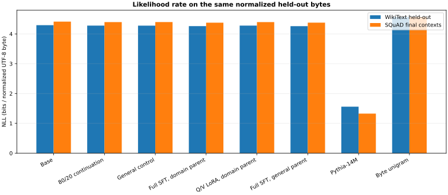

# Capstone: train and release a 300M causal language model

**Status: planned specification.** Inherits the [shared lifecycle gates](../../docs/model-lifecycle-capstones.md) and [tooling guide](../../docs/model-lifecycle-tooling.md). No large-model training or publication has been executed. This is a separate generative project from the MLM/embedding model.

## Bounded CPU pilot: runnable evidence, full capstone still planned

This project now has a reproducible two-layer CPU pilot that exercises the causal lifecycle with real, versioned WikiText-2 and SQuAD 1.1 records. It is a mechanics and small task pilot, not the planned 300M model, not a broad assistant, and not a production or quality qualification. The 300M target, TPU run, human review, broader benchmark gates, and release qualification remain open.

The pilot uses a 512-token byte-level BPE vocabulary with byte fallback, 512-token context, width 32, two four-head RoPE layers, a width-64 GELU MLP, tied embeddings, and FP32 training. Its frozen schedule has a 32-update base branch; a 15-update 80/20 continuation mixture and a 15-update matched general-only control; and three 32-update response-only SFT branches: full fine-tuning from each parent and rank-4 Q/V LoRA from the domain continuation. Every continuation branch consumes 38,400 aligned targets. Each SFT branch uses the same 1,688 response targets. The recipe resets AdamW state at each named phase and binds the exact prompt template, data order, tokenizer bytes, model source, and checkpoint recovery state.

The preparer pins all five source files by revision, byte count, and SHA-256. It groups duplicate or linked articles before splitting, filters final questions against the complete frozen prompt plus all 32 generation tokens, and fits the BPE tokenizer on eligible base-training text only. It produces separate recipe-development and final QA inventories. Each 512-target training block stores already aligned input and target arrays, starts independent records with BOS, resets positions, and uses positive segment IDs (zero is reserved for padding). The trainer must use those targets directly; applying a second generic shift changes the task.

### Reproduce the bounded run

To reproduce the prepared packet and CPU branches, install the pinned core environment and run:

```sh
python3 -m venv .venv-c02
. .venv-c02/bin/activate
python -m pip install -r projects/causal-model-300m/requirements-c02.txt
python projects/causal-model-300m/data/prepare.py --download --output runs/c02-prepared
python projects/causal-model-300m/data/prepare.py --verify --output runs/c02-prepared
JAX_PLATFORMS=cpu python projects/causal-model-300m/run_pilot.py --data runs/c02-prepared --output runs/c02-pilot
JAX_PLATFORMS=cpu python projects/causal-model-300m/evaluate_pilot.py --data runs/c02-prepared --run runs/c02-pilot --output runs/c02-evaluation
python -m pip install -r projects/causal-model-300m/requirements-c02-baseline.txt
python projects/causal-model-300m/fetch_pythia_baseline.py --output runs/pythia-14m
JAX_PLATFORMS=cpu python projects/causal-model-300m/evaluate_pythia_baseline.py --data runs/c02-prepared --model runs/pythia-14m --output runs/c02-evaluation/pythia-baseline.json
JAX_PLATFORMS=cpu python projects/causal-model-300m/evaluate_pythia_qa.py --data runs/c02-prepared --model runs/pythia-14m --output runs/c02-evaluation/pythia-qa.json
JAX_PLATFORMS=cpu python projects/causal-model-300m/evaluate_qa_diagnostics.py --data runs/c02-prepared --run runs/c02-pilot --evaluation runs/c02-evaluation --output runs/c02-evaluation/qa-diagnostics.json
python -m pip install -r projects/causal-model-300m/requirements-c02-figures.txt
python projects/causal-model-300m/render_c02_figures.py --run runs/c02-pilot --evaluation runs/c02-evaluation --pythia-qa runs/c02-evaluation/pythia-qa.json --pythia-baseline runs/c02-evaluation/pythia-baseline.json --diagnostics runs/c02-evaluation/qa-diagnostics.json --output runs/c02-evaluation/figures
JAX_PLATFORMS=cpu python projects/causal-model-300m/export_consumer.py --data runs/c02-prepared --run runs/c02-pilot --evaluation runs/c02-evaluation --branch sft_full_from_domain --output runs/c02-consumer
python -m pip install -r projects/causal-model-300m/requirements-c02-lm-eval.txt
JAX_PLATFORMS=cpu python projects/causal-model-300m/run_lm_eval.py --package runs/c02-consumer --tasks hellaswag,arc_easy --fewshot 0 --limit 8 --output runs/c02-evaluation/lm-eval.json
cp projects/causal-model-300m/starter/model.py runs/c02-model.py
python projects/causal-model-300m/tests/check.py --implementation runs/c02-model.py --stage model  # expected to fail at the first unfinished TODO
# After completing the learner contract, rerun the model stage and then all stages:
python projects/causal-model-300m/tests/check.py --implementation runs/c02-model.py --stage model
python projects/causal-model-300m/tests/check.py --implementation runs/c02-model.py --stage all --data runs/c02-prepared --run runs/c02-pilot --evaluation runs/c02-evaluation --package runs/c02-consumer
```

### What the observed run supports

The prepared corpus and run artifacts stay under `runs/`, outside the project tree. The verifier checks copied raw-source bytes, the frozen recipe, tokenizer, prepared arrays, schedules, and project-owned source lock before training. The accepted run retained all six branch checkpoints and full-state replay receipts. Its measured training losses fell from 6.247781 to 6.136129 over 32 base updates, 6.141266 to 6.122637 over 15 domain-mixture updates, 6.138800 to 6.114291 over 15 matched general-control updates, 6.170957 to 6.082705 over 32 full domain-SFT updates, 6.176107 to 6.115841 over 32 rank-4 Q/V LoRA updates, and 6.180400 to 6.093932 over 32 full-SFT updates from the general parent. The first two base losses were 6.247781 and 6.252569; each loss is a different dropout minibatch, so that small rise is neither a failure nor evidence of convergence.

The learner scaffold is `starter/model.py`; [starter/README.md](starter/README.md) gives the inputs, outputs and invariants for decoder, shifted/aligned losses, continuation/SFT target ownership, LoRA, recovery, and consumer tasks. The checker compares a submitted module against an independent NumPy forward and greedy-generation oracle, tests cross-document/future-token isolation and full/cache parity, routes candidate behavior through training, evaluation, export and a cold consumer, validates frozen data, reconstructs every QA score from its raw record and replays every branch's final update in a fresh process. `--stage model` is the fast inner loop; `--stage all` additionally requires the prepared packet, six-branch run, reloaded evaluation and offline consumer package. The untouched scaffold intentionally raises `NotImplementedError` until those functions are completed.

The held-out evaluator reloads each checkpoint, reports tokenizer-specific NLL and normalized-byte rates separately, and scores all six branches on the same 128 filtered final QA questions with SQuAD v1.1 exact match and token F1. The empty-answer control is scored under the same v1.1 convention, where token F1 is zero when there is no token overlap, including two normalized empty strings. The frozen final set has no empty gold answers. No branch is selected by its final score. In the measured run, exact match was 0 for every branch and token F1 ranged from 0 to 0.0017, below the precommitted 0.05 EM and 0.10 F1 floors. Relative to its own continued parent, full SFT lowered general held-out NLL by about 0.0244 nats per token for the domain parent and 0.0242 for the general parent. The direct comparison between the two full-SFT branches is a separate +0.00096 nats per token for the domain-parent branch. These likelihood changes do not counter the failed task floor. The detailed metrics and all 768 branch-question generations are retained outside the source tree with checkpoint and scorer hashes.

### Read the measured figures

Before looking at the answer scores, predict whether a falling training loss
is enough to show that the model can answer a new question. Keep that prediction
in your experiment notes.



In the **left panel**, horizontal position is the update number within each
phase, and vertical position is negative log likelihood in nats per valid target
token. Each point comes from a different dropout minibatch. The base branch falls
from about 6.25 to 6.14; the small upward step at update two is compatible with
that overall decrease. The vertical axis starts near 6.08, so it magnifies small
changes. The continuation branches run for 15 updates and the SFT branches for
32; an equal horizontal position is not equal cumulative training exposure.
SFT also scores response tokens, whereas pretraining scores all valid aligned
targets. Use these lines to inspect each phase, then use matched held-out
measurements to compare branches.

In the **right panel**, each pair of bars is evaluated on the same 128 final
questions with the frozen 32-token generation limit. Blue is exact match and
orange is token F1; taller is better. The dashed blue line is the 0.05 exact-match
floor and the dotted orange line is the 0.10 F1 floor. Every pilot exact-match bar
is zero, and the highest pilot F1 is below 0.002. Pythia-14M has higher F1, around
0.034, but also has zero exact match and misses the same floors. The important
result is the gap between training-loss improvement and usable task behavior.
It gives us a reason to reject this recipe's quality claim.



Here horizontal position names the system, and vertical position is total
negative log likelihood divided by the same normalized UTF-8 byte count within
each text split, expressed in bits. Lower is better. Blue bars use WikiText
held-out articles; orange bars use final SQuAD context paragraphs. Pilot bars
cluster around 4.3 bits per byte and only slightly improve on the train-only
unigram control near 4.57. The contextual Pythia comparison is much lower,
around 1.56 and 1.33. Dividing by bytes removes the different token-count
scales; it does not equalize training compute, pretraining overlap, vocabulary
or context segmentation. This figure is a descriptive likelihood comparison,
not evidence that any system is a useful assistant.

[Open the training/QA figure at full size](reference/evidence/c02-pilot/figures/c02-training-and-qa.svg)
or [inspect the measured metrics](reference/evidence/c02-pilot/metrics.json).
For a transfer check, propose a paired held-out comparison that could distinguish
an improvement from a different minibatch or denominator. Explain why the lowest
training point alone would not pass either declared QA floor.

The Pythia-14M baseline uses its immutable checkpoint and tokenizer files after verifying their frozen hashes. `evaluate_pythia_baseline.py` measures likelihood; `evaluate_pythia_qa.py` separately runs greedy generation on the same 128 final questions with a 32-token limit and retains every prompt, token ID, answer, finish reason and score. Its measured result was 0 EM and 0.0337 token F1. Pythia token NLL is specific to its tokenizer; compare normalized UTF-8 byte rate across tokenizers. This baseline is not instruction tuned, and its Pile pretraining may overlap the evaluation data, as described in [the rights and provenance notice](data/RIGHTS.md).

On this frozen text, Pythia-14M measured 4.932 nats/token and 1.559 bits per normalized byte on WikiText-2 held-out articles, and 4.440 nats/token and 1.327 bits per normalized byte on SQuAD context paragraphs. The custom pilot branches measured 6.084–6.131 nats/token on WikiText-2 and 6.093–6.144 on the SQuAD contexts; their normalized-byte rates are in `metrics.json`. A separate diagnostic reports response-only NLL and `exp(NLL)` on the same 127 eligible questions for every branch, using the first published answer and including EOS. Its receipt binds the shared eligible-ID hash, response-target denominator, each checkpoint and identity, candidate source, recipe, and tokenizer. Perplexity applies only to this frozen 512-token vocabulary and cannot be compared across tokenizers. The single excluded ID is `572648d1708984140094c160`, whose complete prompt, answer and EOS exceed context; no answer or context is cropped. A train-only smoothed byte-unigram control measured 4.567 bits per normalized byte on WikiText-2 and 4.568 on final SQuAD contexts. `render_c02_figures.py` produces training, QA and shared-byte-rate plots with source JSON digests in `figure-index.json`. These are descriptive results for this short recipe and fixed text, not a broad ranking: the models use different tokenizers, Pythia has Pile pretraining exposure, and its checkpoint was not instruction tuned. The pilot still failed its precommitted QA floors.

### Reload and serve a local package

After evaluation, export one measured branch to a local custom package and run it offline:

```sh
JAX_PLATFORMS=cpu python projects/causal-model-300m/export_consumer.py \
  --data runs/c02-prepared --run runs/c02-pilot \
  --evaluation runs/c02-evaluation --branch sft_full_from_domain \
  --output runs/c02-consumer
```

The package includes the tokenizer, architecture, merged model arrays, a self-contained loader and loopback service, pinned runtime requirements, source and checkpoint identities, and dataset rights notice. It can be copied away from the training checkout; its cold-load check verifies every packaged file digest, the decoder identity, vocabulary, and parameter tree before exposing `generate(prompt, max_new_tokens=32)`. From the exported folder, install `requirements.txt` and run `python serve_local.py --package . --port 8127` to start the optional local wrapper. It binds only to `127.0.0.1`, starts a 30-second request budget at admission, enforces that budget while parsing the prompt and between generation steps, accepts bodies up to 8 KiB and outputs up to 32 tokens, and uses a two-second socket inactivity timeout. At most two requests run at once; overload is rejected with HTTP 503. Cancellation is cooperative: an in-progress native JAX operation must return before the next cancellation check, so it can delay completion beyond the request budget. To roll back, stop the process and restart it with the previous exported package directory; its manifest digest in `/health` identifies the loaded package, and a package failing integrity checks never starts a listener. This is a bounded local pilot consumer, not an Internet-facing service or Transformers/vLLM-compatible release.

### Native benchmark adapter smoke

The pinned native `lm-evaluation-harness` adapter is in `lm_eval_adapter.py`; unit checks cover candidate logits, boundary-merged tokens, Unicode offsets, continuation-only scoring, rolling target coverage, empty context and stop handling. `run_lm_eval.py` requires exactly version 0.4.13 and executes pinned task files on the exported local consumer. Its recorded smoke diagnostic used the first eight records, zero few-shot examples, `Rowan/hellaswag` validation at revision `218ec52e09a7e7462a5400043bb9a69a41d06b76` and `allenai/ai2_arc` test at revision `210d026faf9955653af8916fad021475a3f00453`. It measured HellaSwag accuracy 0.25/normalized accuracy 0.375 and ARC-Easy accuracy 0.125/normalized accuracy 0.25. These eight-example task runs verify adapter execution; they are not stable benchmark estimates or a quality gate. The JSON report retains raw harness samples, selected records, task-file hashes, package identity, installed wheel-file digest and task protocol. Its returned git hash is labeled as working-directory provenance; the recipe-declared task-source commit and installed PyPI distribution identity are recorded separately.

The measured pilot's held-out evaluation gates, Pythia-14M same-source baseline and pinned native LM-Evaluation-Harness adapter remain separate evidence. Full SFT lowered general held-out NLL by 0.0244 nats/token from its domain-mixture parent and by 0.0242 from its matched general-only parent, but did not meet the held-out QA floor: every branch scored 0 EM and token F1 ranged from 0 to 0.0017. The 15-update mixture's general NLL was 0.00117 nats/token worse than the matched general-only continuation, far inside the 0.10 regression allowance. A passing code or replay check cannot substitute for those task scores, and a failed floor remains in the report rather than a reason to select another branch after seeing final scores.

## Full capstone requirements

Outcome: build a small causal model from a versioned corpus, adapt it for a declared use case, compare full fine-tuning with LoRA, evaluate its limitations, and operate a reproducible generation service. Production readiness applies to that use case; a 300M model is not presumed to be a broadly capable assistant.

## Starting point and architecture

Extend the [text harness](../text-harness/README.md), retaining its actual causal checks, full-state recovery, prefill/decode cache, precision and export contracts. Use TEXT-1..3/5, ADAPT, DATA/EVAL, BRIDGE/NUM and SERVE/OPS/SCALE preparation. PREF is needed only for the optional preference stage.

A concrete first architecture hypothesis uses 24 blocks, hidden width 1,024, 16 full attention heads, a two-matrix GELU MLP of width 3,072, vocabulary 49,152, affine pre-LayerNorm/final norm, bias-free linear layers, RoPE and tied input/output embeddings. This has the same approximately 302M unique-parameter budget as the embedding project's encoder candidate, with a causal attention mask and next-token output head rather than an MLM transform. Verify the actual parameter tree. Start with a declared 2,048-token context after tiny/pilot tests; longer context is another training/evaluation claim. Compare GQA or a gated MLP later with recalculated counts and cache layouts.

## Data and input recipe

Begin with an English general/domain text task. A pilot mixture hypothesis is 60% curated general text, 25% relevant domain/reference material and 15% licensed dialogue/instruction-like prose, measured in consumed non-padding tokens. These are recipe categories, not approved datasets or optimal percentages. Keep code/math or multilingual content as explicitly weighted variants when the target requires them.

Pin sources, audit rights/provenance, deduplicate and split by source/document before chunking. Compare tokenizer length/coverage/cost on training data, freeze special IDs and normalization, and check benchmark overlap at every stage. Preserve EOS and document boundaries; packed tokens must not create accidental targets across unrelated documents. Record chosen attention isolation versus cross-document context policies.

## Training phases and handoffs

| Phase | Objective and learner work | Artifact / promotion evidence |
| --- | --- | --- |
| 0: tiny correctness and recipe pilot | Independent next-token loss, causal masks, tokenizer round trip, global token weighting and cache parity; measure real-data throughput/memory | Frozen pilot protocol and actual parameter/runtime report |
| 1: base pretraining | Train from scratch on next-token cross-entropy with a valid-target mask, stable precision and recorded token/schedule clocks | Complete base checkpoint; held-out NLL by source/length, actual generation failures and fresh-process replay |
| 2: domain continuation | Continue next-token learning on a declared domain/general mixture; compare against skipping this phase under a fair resource budget | Continued checkpoint and target-domain gain versus general retention; optimizer reset/continuation decision recorded |
| 3: supervised instruction adaptation | Response-only SFT with a fixed chat template; compare full fine-tuning and real Transformer LoRA | Adapted model/adapter, correct shifted role masks, held-out behavior/retention and merged/unmerged parity |
| 4: optional preference adaptation | Sequence DPO on curated preferences, or learned reward/value/sequence PPO after its dedicated lessons | Separate preference checkpoint with label provenance, response-length/mask checks, external quality and drift; no synthetic-label human-alignment claim |
| 5: release qualification | Evaluate loaded exports, precision/cache variants, generation API and immutable Hub package | Numerical/task/runtime gates and a reproducible consumer/service report |

The base objective is:

\[
L=-\frac{\sum_{b,t}m_{b,t}\log p_\theta(x_{b,t+1}\mid x_{b,\le t})}{\sum_{b,t}m_{b,t}}.
\]

Define \(m\) on target positions; PAD and disallowed packed-boundary targets contribute neither loss nor count. SFT changes this mask to the chosen response targets while preserving prompt context. Check one shifted sequence by hand and inject an off-by-one mask error. Ordinary accumulation must reproduce a token-weighted full-batch update under controlled randomness.

Each phase records parent checkpoint, data/tokenizer/template, precision, objective and schedule identity. Exact resume is tested within phases; a deliberately changed objective is a new experiment. From-scratch, continued-pretraining and imported-base variants must not share misleading training-history claims.

## Evaluation and monitoring

Use [lm-evaluation-harness](https://github.com/EleutherAI/lm-evaluation-harness) through a verified native adapter or a numerically qualified supported conversion. Pin exact task versions, prompts, few-shot examples, scoring conventions and decoding. Start with an attainable subset of completion/common-sense/task-domain tests, then expand only for claimed capabilities. Include a pinned small pretrained baseline and chance/simple baselines where applicable. MTEB is not the primary benchmark for generation.

Report held-out token NLL/perplexity under the **same tokenizer**, domain task scores, fixed generation errors, instruction adherence, stop-token/length behavior, repetitions and unsupported answers. Code-generation benchmarks require an isolated test executor if that capability is included. Final test sets do not tune sampling or templates. A weak score is reported, not hidden behind cherry-picked continuations.

Track valid tokens per source, loss/gradients/updates, learning rate, clipping/nonfinite state, padding, memory and data/compute wait in MLflow or W&B. At adaptation stages add response-token coverage, base retention and preference/length statistics. Fixed generation examples use saved prompts/seeds/decoding; changing temperature can change apparent quality without improving weights.

Required figures: source exposure and token-length distributions, train/validation NLL by token budget, base→continued→SFT task/retention comparisons, actual failed generations, layer/cache precision error, and time-to-first-token/inter-token/end-to-end latency under load. Explain each plot's measurement boundary.

## Serving and Hugging Face release

Save tokenizer, architecture, tied weights, generation configuration, chat template where applicable and the tested loader. Verify full-forward versus incremental cache logits, changed batch/prompt lengths, EOS, capacity overflow and cache isolation between clients. Qualify prefill/decode batching, cancellation, bounded queues and resource limits. Record cache precision separately from weights/activations/accumulation.

Follow the [shared publication workflow](../embedding-model-300m/RELEASE.md), substituting the causal consumer contract. A Transformers-compatible release requires an implemented mapping; a custom JAX decoder is not automatically supported by vLLM or `AutoModelForCausalLM`. Test every advertised path after an immutable cold download. Rollback restores model/tokenizer/template/decoder together.

## Learner review

Retain all stage manifests/checkpoints, one data/objective ablation, a recovery failure/repair, independent mask/loss checks, benchmark inventory including failures, actual W&B/MLflow artifacts, generation/service evidence and release canaries. A reviewer should be able to explain why each phase exists and reproduce the selected model's behavior without the training workspace.

## Implementation gate and real-data lineage

Do not promote until corpus/source rights, document hashes, deduplication, contamination checks, tokenizer revision and stream ordering are frozen. Each pretraining/adaptation checkpoint must name its parent and retain optimizer, RNG and data cursor; held-out perplexity and fixed generation tasks must use separate real data, while toy next-token tables remain mechanics checks.

Before this plan can change from **planned** to **authored**, provide independently checkable dataset/recipe manifests, staged parent-to-child checkpoint records with full resume state, real held-out evaluation outputs, and runnable plan-specific starter/reference/checks. Keep small CPU fixtures labeled as correctness evidence; they do not establish target-scale training, quality or production readiness.

## Recipe decision rehearsal before target-scale training

Instruction examples become more readable after continuation, but held-out base-domain NLL worsens.

**Decide:** Separate domain continued pretraining from response-only SFT. Keep tokenization and token-weighted NLL fixed when comparing language-model likelihood; use separate instruction/retention/safety evaluation for behavior. Choose a mixture through a controlled pilot rather than assuming every continuation is an improvement.

**Review packet:** Parent checkpoint and tokenizer hashes, source/token exposure, pretraining and SFT masks, held-out NLL plus generation examples, retention gates and exported loading/generation parity. The tiny causal-lineage run is not the target-scale model.

This is a design exercise for a planned implementation. Record a hypothesis, a controlled pilot, a stopping criterion and the evidence needed to reject the recipe before requesting target-scale compute. Do not mark the capstone implemented or publish a model card with invented metrics.
