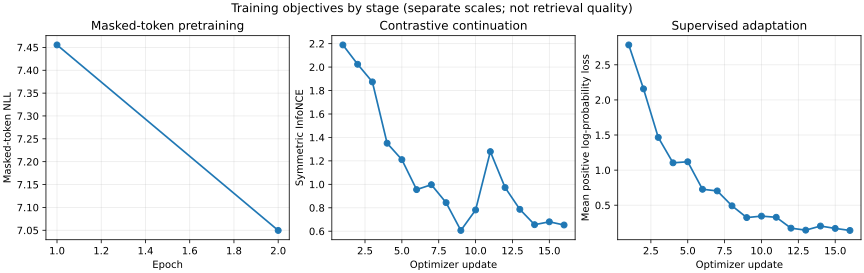

# A tiny bidirectional encoder with checkpoint lineage

Build and inspect a small CPU encoder across four connected objectives: masked-token pretraining, unsupervised contrastive continuation, supervised query-positive adaptation, and held-out passage retrieval. The final export is reloaded in two fresh Python processes. Every stage carries the same source, selected corpus, tokenizer, configuration, architecture, and parent-checkpoint identity forward. This is an educational pilot with 70,765 parameters in the recorded configuration, not a pretrained product, benchmark, or 300M-parameter model.

## Data and limits

The passages come from the included Project Gutenberg text of Lewis Carroll's *Alice's Adventures in Wonderland*, eBook 11, Millennium Fulcrum Edition 3.0. The source header and license are retained. The data manifest pins the source SHA-256, download URL/date, selection procedure and split map. Read `data/LICENSE.md` and check local copyright rules before reuse. The frozen builder samples eligible paragraphs from chapters I–VIII: I–IV train, V validation, and VI–VIII test. The tokenizer is fit only on train passages. Train queries and one-positive judgments are hand-authored for supervised adaptation; validation and test judgments are separate hand-authored pilot judgments, not Gutenberg labels.

This split holds out chapters, not a new author, topic, time period, or writing style. The test has five queries with one judged relevant passage each. Recall@1 changes in increments of 0.2; MRR and nDCG@5 also depend on rank and can change by smaller amounts. These pilot metrics should not be generalized. Chapter labels are not used for adaptation. The model learns chapter-local passages and then five curated training query-positive pairs. No result establishes MTEB performance or production readiness.

## Start as a learner

Use Python 3.11 or newer with the repository's CPU dependencies installed (`jax`, `flax`, `optax`, `numpy`). Work from the repository root. Copy the starter into your workspace and implement the four learner functions before checking each stage:

```sh
cp projects/embedding-lineage/starter/model.py projects/embedding-lineage/my_model.py
python3 projects/embedding-lineage/tests/check.py --implementation projects/embedding-lineage/my_model.py --stage 1
python3 projects/embedding-lineage/tests/check.py --implementation projects/embedding-lineage/my_model.py --stage 2
python3 projects/embedding-lineage/tests/check.py --implementation projects/embedding-lineage/my_model.py --stage 3
python3 projects/embedding-lineage/tests/check.py --implementation projects/embedding-lineage/my_model.py --stage 4
```

Run each command from the course workspace root, in the same Python environment. Stage 1 creates the tokenizer and MLM checkpoint under `runs/embedding-lineage/learner-run`, outside the project source tree. Stages 2 and 3 require the previous checkpoint. Stage 4 evaluates only the test split, creates the export, checks its file hashes, rejects altered configuration and corrupted weights, and compares two independent-process reloads against an in-process probe vector. If you are inspecting the reference implementation, opt into it explicitly:

```sh
python3 projects/embedding-lineage/tests/check.py --implementation solution --stage all --output runs/embedding-lineage/reference
```

The learner checker defaults to `starter`, which should stop at `NotImplementedError` until the required functions are implemented. `--implementation solution` is the explicit answer key. With `--stage all` and no output argument, its reference artifacts live in a temporary directory. Supply `--output runs/embedding-lineage/reference` to keep them. Each saved checkpoint is tied to the exact data/config/tokenizer and to its immediate parent. If a run is interrupted, resume at its last completed stage with the same `--output` directory. Do not mix outputs from different configurations.

## Stage map

1. **Masked-language pretraining.** Implement `encode` and `masked_lm_loss`. Predict the original IDs only at selected mask positions, divide by the number of selected positions, and fail loudly if a batch selects none. Train with randomly selected input masks. Compare the implementation with an independent NumPy cross-entropy oracle. Observe train loss and held-out masked-token NLL.
2. **Contrastive continuation.** Implement symmetric `contrastive_loss`. Two independently masked views of each passage are the positive pair; other items in the minibatch are negatives. Compare both retrieval directions with a NumPy oracle. Contrastive loss may fall while downstream retrieval stays poor.
3. **Supervised adaptation.** Implement `supervised_contrastive_loss` with the standard per-anchor mean of positive log-probabilities. Each curated training query and judged passage form a positive pair. Other pairs in that batch are negatives. The query judgments never come from validation or test. A separate NumPy implementation checks the objective.
4. **Held-out retrieval and export.** Compare normalized dense vectors against a BM25 lexical baseline on the test chapters. Report recall@1, MRR and nDCG@5 plus validation results, parameter count, OOV fraction and truncation count. A tiny judged set is noisy; keep an unhelpful dense result visible. Inspect `evaluation.json`, stage manifests and `export/manifest.json`.

The main runner uses a one-block Linen encoder with bidirectional self-attention. Linen is chosen because its module initialization and `apply({'params': ...})` are simple to inspect for this contained example. The course's NNX lessons use a different mutable graph/state model; this project does not claim NNX checkpoint compatibility. The handoff manifests make the parameter tree, tokenizer and data/config identity explicit so a later migration can be tested rather than assumed.

## Evidence to inspect

Each training checkpoint records the objective history, validation masked NLL, validation retrieval, parameter count, whether optimizer state was reset at the stage boundary, source/data/config/tokenizer hashes and parent checkpoint hash. Stage 4 writes dense and BM25 metrics and a reload receipt. The runner has independent NumPy objective checks, nonfinite training-loss rejection, source-group and qrel split validation, checkpoint checksum/config/tokenizer/lineage checks, fresh-process reload checks, and negative config/corruption tests.

This project uses only CPU execution and a frozen local public-domain source. It performs no network access at runtime, uploads, cloud training, or model publication. The measured result is an actual run of this tiny setup; it is not evidence about TPU execution or scale.

## Recorded CPU pilot

The reference run on 2026-10-20 used Python 3.14.3, JAX 0.9.2, Flax 0.12.6, Optax 0.2.8, and one CPU device. The encoder has 70,765 parameters. Training MLM NLL fell from 7.46 to 7.05; validation MLM NLL was 6.70 after pretraining, then rose slightly to 6.72 after contrastive continuation and 6.72 after query-positive adaptation. Contrastive and supervised-contrastive training losses fell, but the held-out retrieval result is poor: dense retrieval got 0/5 recall@1 and MRR 0.021, while BM25 got 2/5 recall@1 and MRR 0.498 on the same queries. Do not hide this failure behind the decreasing training losses. The exact per-stage metrics, hashes, environment, and reload receipt are in `outputs/pilot-results.json`.

The negative checks rejected a changed configuration, corrupted parameter bytes, and a stale/swapped checkpoint parent, and a changed exported loader against its recorded source identity. Two fresh Python processes reproduced the exported encoder's in-process vector hash. These checks establish a consistent small handoff, not optimizer-state resume: optimizer state is deliberately reset at objective boundaries and the stored stage artifact contains model parameters and provenance, not Adam moments or a mid-epoch data cursor.

Recall@1 changes in increments of 0.2 because there are five test queries; MRR and nDCG@5 depend on the ranks and have smaller possible increments. The checked-in [loss trace CSV](outputs/loss-curves.csv) includes objective, x-axis unit, step, gradient norm, and learning rate. [The three-panel curve](outputs/loss-curves.svg) keeps MLM epochs separate from contrastive optimizer updates and uses separate y-scales; these are training diagnostics, not retrieval metrics. The final verified run completed in 36.12 seconds on the recorded CPU environment. Every update rejected nonfinite loss or gradient leaves, and the stage metrics record actual step counts, learning rates, and gradient norms.

**Transfer exercise:** predict how reducing `max_length` from 48 to 32 changes the reported test truncation count and dense retrieval. Change the config only in a copy, use a new output directory, and rerun all stages; the source/config-bound checkpoint checks should reject attempts to resume from the previous configuration. Record whether the observed retrieval change supports your prediction. For optional experiment tracking, see the separate [reproducible experiments and MLflow workshop](../reproducible-experiments/README.md); this project does not integrate a hosted tracking service.



## Review handoff: explain a changed condition

The tiny real-text run completes and exports, but retrieval quality is weak. What would justify changing the data recipe rather than declaring the project production-ready?

**Keep for review:** Frozen query/document groups, exact-retrieval baselines, per-query rank changes and a controlled data/objective ablation. Preserve this pilot’s weak-quality result; it is not a trained 300M model or an MTEB release.

Write your prediction before opening the reference implementation. Distinguish what the existing checker verifies from your proposed extension; record any extension command, actual output and limitation separately. A reviewer should be able to locate the first failed contract from your saved evidence.
