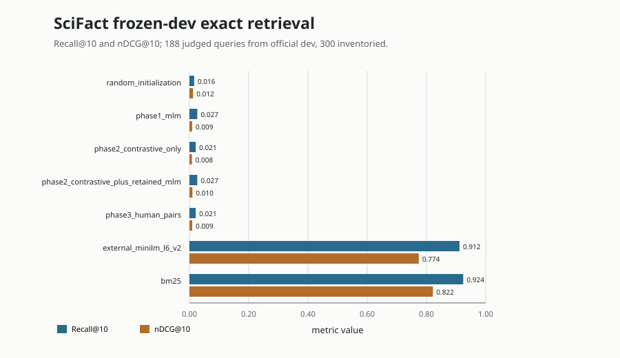
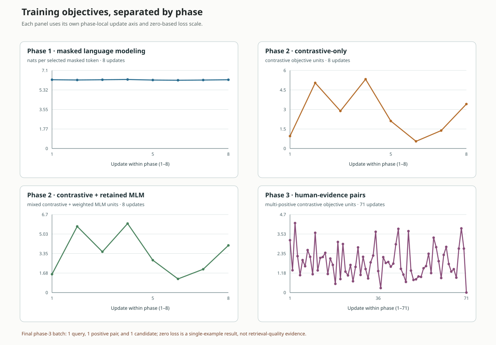

# C01 reference evidence

This folder preserves compact evidence from the executed final8 SciFact CPU
pilot. It is an in-development lifecycle result, not a 300M model release or a
quality qualification. The final8 run remains bound to the checker version
recorded in its original receipt. A later focused checker correction is
documented separately in
[`evidence/checker-attention-amendment.json`](evidence/checker-attention-amendment.json);
the correction does not retroactively change the final8 run. The current
checker still needs its later pinned CI run.
The current runtime loss plot also has a separately recorded, plotting-only
amendment in
[`evidence/objective-plot-amendment.json`](evidence/objective-plot-amendment.json).
It replaces the overlapping legend with phase-specific panels; it did not
rerun training or evaluation. The retained teaching renderer calls the same
`plots.py::loss_figure` function used by learner runs.

The source-bound package contains the original final8 receipt and independent
check record, the full pilot report and update trace, raw figure data and SVGs,
all seven final-protocol metric files, one shared qrels file, and complete
rankings for all 300 queries against all 5,183 candidate documents. The
ranking arrays use `uint16` ordinal indices into the complete document ID
inventory in `rankings/shared-inventory.npz`. The separately implemented
metric audit recomputed every saved per-query and aggregate value from those
rankings and the shared qrels; its seven maximum differences are exactly zero.
[`evidence-index.json`](evidence-index.json) provides the public file hashes,
current numerical-source hashes, retained derivation map, and explicit
omission hashes and reasons. The detailed packet manifest is
[`evidence/final8/retention-manifest.json`](evidence/final8/retention-manifest.json).

## What the measurements show

All retrieval numbers below use the full 5,183-abstract candidate corpus and
the frozen 300-query official SciFact development inventory. Only 188 queries
have human evidence-document judgments; the other 112 are retained in the
inventory and excluded from metric denominators. “Official dev, custom final”
is the protocol because the official test split has no public gold judgments.

| System | Recall@10 | nDCG@10 | MRR |
| --- | ---: | ---: | ---: |
| BM25 | 0.9242 | 0.8218 | 0.7960 |
| Pinned MiniLM-L6-v2 baseline | 0.9117 | 0.7743 | 0.7354 |
| Random initialization | 0.0160 | 0.0120 | 0.0150 |
| Phase 1 masked-token training | 0.0266 | 0.0092 | 0.0089 |
| Phase 2 contrastive-only | 0.0213 | 0.0083 | 0.0101 |
| Phase 2 with retained MLM | 0.0266 | 0.0099 | 0.0102 |
| Phase 3 human-evidence pairs | 0.0213 | 0.0093 | 0.0109 |

The precommitted phase-3 pilot floors were Recall@10 ≥ 0.30 and nDCG@10 ≥
0.10. The measured phase-3 result missed both by a wide margin. This is one
deterministic seed and a small two-layer CPU architecture; it is not evidence
of useful biomedical retrieval. The candidate also trails BM25 and the pinned
MiniLM baseline. MTEB, expert review, broad-domain quality, target-scale
training, target-runtime performance, and production qualification remain
unrun.



The retrieval figure's horizontal axis is metric value from 0 to 1. Its rows
are BM25, MiniLM, random initialization, and the four training checkpoints;
blue bars show Recall@10 and orange bars show nDCG@10. For example, the phase-3
bars end at 0.0213 and 0.0093, far below their corresponding 0.30 and 0.10
floors. `figure-data.json` and the individual `metrics/*.json` files retain
the underlying values, including per-query metrics.



Each panel has its own phase-local x axis—8, 8, 8, and 71 updates—and its own
zero-preserving y axis, so values from different objectives are not compared
on a shared scale. The y-axis unit is stated in each panel: phase 1 uses nats
per selected masked token; phase 2 contrastive-only uses the contrastive
objective; its joint branch combines contrastive and weighted MLM loss; phase
3 uses multi-positive contrastive loss. The small-multiple plot and these
interpretations are bound to the unchanged trace and figure data by
[`teaching/manifest.json`](teaching/manifest.json) and the explicit
[`teaching_extension`](evidence-index.json). Its manifest binds both the
evidence-validating wrapper and the shared runtime plotting source.

The phase-3 endpoint needs special care: update 71 contains one query, one
positive pair, and one candidate document, so its loss of 0 reflects a
single-example last batch and is not evidence of retrieval quality. The
historical combined plot is retained byte-for-byte at
[`evidence/final8/figures/training-objectives.svg`](evidence/final8/figures/training-objectives.svg);
its hash is recorded in the teaching manifest alongside the new figure hash.

## Measured training exposure

The tokenizer was fitted on its frozen eligible text inventory. Its source
hashes and training document IDs are preserved in `tokenizer-info.json`; raw
tokenizer vocabulary text is withheld from this packet pending review.
Prepared sample inventory and consumed training exposure are distinct:

- Phase 1 consumed 32 distinct MLM documents, 2,048 nonpadding input token
  positions, and 281 selected masked-token positions. Two consumed documents
  belong to the disclosed recipe-development document-text subset.
- Each phase-2 branch consumed the same 32 weak-pair indices and 3,659
  nonpadding pair-input tokens. The joint branch additionally consumed 32
  distinct retained-MLM documents, 2,048 nonpadding token positions, and 292
  selected masked-token positions; one of those documents is from the
  disclosed recipe-development document-text subset.
- Phase 3 consumed 281 distinct fit queries, 212 positive documents, 12,916
  nonpadding query-token positions, and 20,096 candidate-document token
  positions.

The full consumed IDs, update keys and counters are in `pilot-report.json` and
`training-trace.json`; selected numeric MLM inputs are retained in
`mlm-input-ids.npy`. Recipe-development document text exposure is disclosed
separately from the strict final query/document-component holdout. The
benchmark was rerun for engineering checks and is not a blinded final test.

## Package, provenance, and portable reruns

The measured package card, provenance note, numeric config and package
metadata are retained in `evidence/final8/local-package/`. The trained
checkpoint state arrays, exported package weights, tokenizer vocabulary, raw
source-text canary, and pinned MiniLM snapshot are intentionally omitted from
the public packet pending separate rights review. Their original hashes and
reasons are in the retention manifest. This directory is therefore a measured
card and evidence record, not a loadable model package. The full local package
was cold-loaded from a copied external review packet with hub access disabled;
it reproduced the saved numeric canary vectors. The canary's numeric token
IDs and vectors are included without the original biomedical text.

To rerun the executable workflow from an extracted course source ZIP, create
an isolated environment, obtain the exact pinned SciFact archive, and run the
checker with outputs outside the extracted source tree. For POSIX shells:

```sh
C01_TMP="${TMPDIR:-/tmp}"
mkdir -p "$C01_TMP"
python3 -m venv "$C01_TMP/jaxpathways-embedding-env"
. "$C01_TMP/jaxpathways-embedding-env/bin/activate"
python -m pip install -r projects/embedding-model-300m/requirements-embedding-lock.txt
python projects/embedding-model-300m/data/prepare.py --download --output "$C01_TMP/jaxpathways-scifact-c01-data"
python projects/embedding-model-300m/tests/check.py --implementation solution --stage all --data "$C01_TMP/jaxpathways-scifact-c01-data" --output "$C01_TMP/jaxpathways-embedding-c01-check"
```

The checker must run with the current source in the extraction. Its baseline
uses the frozen MiniLM revision and may download that exact public snapshot;
the snapshot is not included in the evidence packet or optional source ZIP.
To inspect the captured result without running training, read
`evidence/final8/pilot-report.json`, `training-trace.json`,
`figure-data.json`, the seven metric files, and the metric reconstruction
record. No cloud resources or remote model publication were used.
