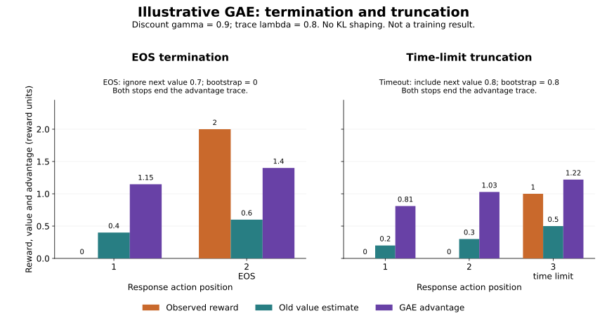

# Audit SFT, DPO and sequence PPO

The supervised objective should count response tokens and exclude prompt tokens. The preference loss should increase when the preferred response becomes less preferred relative to its alternative. The first four stages use short synthetic logits sequences so each result can be checked by hand. Stage 5 connects those ideas to generated token sequences, a fitted reward model and a learned critic on a small synthetic CPU task.

## Before you start

Complete the response-masking and preference-optimization lessons. You should know log-softmax, token masks and the chosen-minus-rejected log-probability margin. Install the CPU course dependencies and edit `projects/posttraining-audit/starter/model.py` from the repository root.

```sh
python3 -m venv .venv
source .venv/bin/activate
python -m pip install -r projects/posttraining-audit/requirements.txt
python3 projects/posttraining-audit/tests/check.py --implementation starter --stage 1
python3 projects/posttraining-audit/tests/check.py --implementation starter --stage 2
python3 projects/posttraining-audit/tests/check.py --implementation starter --stage 3 --evidence-dir runs/posttraining-audit
python3 projects/posttraining-audit/tests/check.py --implementation starter --stage 4
```

On Windows PowerShell, activate `.venv\Scripts\Activate.ps1` and use `python` instead of `python3`.

Stage 1 masks out the first and third token. For the selected token, the target logit is \(3\) and the other logit is \(0\), so the SFT loss is \(\log(1+e^{-3})\), about \(0.0486\). Chosen and rejected policy log probabilities are \(-0.7\) and \(-1.0\). With an equal-probability frozen reference, its log-probability difference is zero. Their margin is \(0.3\); with \(\beta=0.1\) the DPO loss is \(-\log(\sigma(0.03))\), about \(0.678\).

DPO uses the reference-corrected margin \(m=(\log\pi_c-\log\pi_r)-(\log\pi_{ref,c}-\log\pi_{ref,r})\). Stage 2 also checks a nonuniform reference: reference log probabilities \(-0.4\) and \(-1.4\) turn the corrected margin into \(-0.7\), even though the policy alone favors the chosen response.

Stage 2 swaps the two policy preference scores. The margin becomes \(-0.3\) and the DPO loss must rise. An empty response mask must raise a clear error. If the SFT loss changes when only masked prompt logits change, inspect the mask before reduction.

Stage 3 saves response-token count, SFT loss, margin and DPO loss to `runs/posttraining-audit/posttraining-audit-evidence.json`. Without `--evidence-dir`, the file is temporary. Stage 4 runs the full check. Passing output begins `PASS posttraining-audit stage N`.

These are objective mechanics on synthetic values. They do not demonstrate a trained language model, preference-data quality, retained behavior or user-facing response quality. Reference command: `python3 projects/posttraining-audit/tests/check.py --implementation solution --stage 4`.

## Stage 5: sequence PPO on a fixed synthetic fixture

Stage 5 extends the token-level preference exercise into short autoregressive responses. It uses a tiny table policy conditioned on task, previous token and response position, plus a learned table critic. The reference policy is copied before updates. A linear reward model is fitted with pairwise softplus loss on the two fixed synthetic preference pairs, then frozen. This is a small mechanics fixture: its preference labels are not human data, and the policy is not a Transformer.

Optional preparation: [learned values and GAE](../../phases/12-rl/05-learn-values-and-gae/README.md) works through fitted values and a hand-calculated recursion. It is useful background, but it is outside this project’s required lesson route.

Use `projects/posttraining-audit/starter/sequence_ppo.py` for this stage. It includes the checked-in recipe, token/model helpers, frozen component checks, evaluation and serialization scaffold. Implement the six marked functions: `fit_reward_model`, `rollout`, `generalized_advantage_estimate`, `ppo_policy_loss`, `clipped_value_loss`, and `train`. The rollout record uses time-major `[time, batch]` arrays; target and input role masks are separate; the two loss functions return scalar means over valid response targets. The fixed recipe is loaded from `reference/sequence_ppo/recipe.json`. The project pins its CPU dependencies in `projects/posttraining-audit/requirements.txt`.

Its independent command is:

```sh
python3 projects/posttraining-audit/tests/check_sequence_ppo.py --implementation starter --stage 5
```

The integrated reference command runs the preserved stages 1 through 4 and the sequence checks:

```sh
python3 projects/posttraining-audit/tests/check_sequence_ppo.py --implementation solution --stage all
```

The checker accepts an alternate learner module with `--candidate /path/to/sequence_ppo.py`. It grades that file through numeric and rollout protocol checks. Source-text mutation probes run only against the instructor reference module; they do not impose spelling requirements on a learner implementation.

To retain the complete machine-readable rollout trace from the reference implementation, add `--evidence-dir runs/posttraining-audit-sequence-ppo`. It writes `sequence-ppo-evidence.json` with per-token actions, masks, rewards, values, advantages and targets, frozen hashes, per-epoch losses and heldout metrics. The stage 5 starter command writes to the same location only if it completes, which the untouched starter does not.

### Follow one generated response

The policy reads a task ID, the previous token and the response position. Its target-role mask names the generated actions that receive loss. The input-role mask answers a different question: was the previous context token a response token? At the first prediction, the context is BOS/prompt context, but the target is already a response token. Using the input mask for the loss would drop that first target. Follow an action at position \(t\) into the next input at \(t+1\) to check the shift.

Each response has at least two generated tokens. EOS can occur from the second action onward; all later positions are padding. A response that reaches the four-token collection limit is truncated. The frozen fitted reward score for the observed response goes on its final valid action. Each valid action also receives sampled KL shaping:

\[
r_t=r_t^{\mathrm{score}}-\beta\bigl(\log\pi_{\mathrm{old}}(a_t\mid s_t)-\log\pi_{\mathrm{ref}}(a_t\mid s_t)\bigr).
\]

The sampled log-ratio can be negative for an individual action. It is a sample used for shaping, rather than an exact divergence. The evaluation below separately computes categorical KL from the full token distributions at each visited context.

### Work through termination and timeout

Before looking at the figure, predict what happens to the last bootstrap when the response ends with EOS. Now ask the same question when collection stops at a time limit but the modeled process has a continuation.



**Read the figure.** Positions along the horizontal axis are generated response actions. Orange bars show observed reward, teal bars show the old value estimate, and purple bars show the advantage. All heights use reward units. An early action can have a positive advantage even when its immediate reward is zero, because the recursion carries later evidence backward.

These are two different illustrative responses, with no KL shaping. Their heights are not a controlled comparison of learning performance. Values printed on the bars are rounded. The [fixed fixture](figures/gae-eos-timeout-fixture.json) and [independent plotting script](figures/render_gae.py) retain the full calculation; neither calls the PPO solution.

Use \(\gamma=0.9\) and \(\lambda=0.8\). The temporal-difference residual and reverse recursion are:

\[
\delta_t=r_t+\gamma b_t V_{\mathrm{old}}(s_{t+1})-V_{\mathrm{old}}(s_t),\qquad
A_t=\delta_t+\gamma\lambda c_t A_{t+1}.
\]

Here \(b_t=0\) at EOS and \(b_t=1\) at a timeout; both stops set the trace continuation \(c_t=0\). An ordinary valid action has both indicators equal to one. Padding has zero residual, advantage and target and contributes no loss.

For the left response, the old values are \([0.4,0.6]\), rewards are \([0,2]\), and next values are \([0.6,0.7]\). The EOS residual is \(2-0.6=1.4\), so the displayed next value \(0.7\) is ignored. The full residual vector is \([0.14,1.4]\), and the advantages are \([1.148,1.4]\).

For the right response, the old values are \([0.2,0.3,0.5]\), rewards are \([0,0,1]\), and next values are \([0.3,0.5,0.8]\). The timeout residual is \(1+0.9(0.8)-0.5=1.22\). The residuals are \([0.07,0.15,1.22]\), giving advantages \([0.810448,1.0284,1.22]\). Try setting only the timeout bootstrap to zero: the advantages become \([0.4372,0.51,0.5]\). This is why the stop type matters.

The runnable fixture trains the post-timeout critic value against a declared one-token continuation: task 0 appends response A, task 1 appends response C, then ends. This scripted continuation makes the boundary value learnable and testable. It is an assumption of this small environment, not evidence about natural-language continuation.

### Keep snapshots fixed while learning

Each outer update samples a fresh rollout. The behavior log probabilities and old values from that rollout stay fixed through every inner optimizer epoch. Compute the advantages and targets \(V_{\mathrm{old}}+A\) once, stop their gradients, and reuse them. The current policy and critic change; the reference policy and fitted reward model remain frozen for the whole run.

The policy uses the signed clipped PPO minimum and averages over valid response tokens. The critic clips changes around the old values and uses a valid-token mean, with a separate declared continuation-target loss. Record those units when comparing losses. The checker keeps actions, masks, rewards, old/reference probabilities, values, advantages, targets, per-epoch losses and component hashes. It checks independent scalar calculations, numerical gradients, changed conditions and fresh-process reload. Deliberately broken implementations must fail, including refreshed old probabilities, wrong stop handling and padding included in the loss.

The objective follows [PPO](https://arxiv.org/abs/1707.06347), the recursion follows [Generalized Advantage Estimation](https://arxiv.org/abs/1506.02438), and frozen targets use [JAX stop_gradient](https://docs.jax.dev/en/latest/_autosummary/jax.lax.stop_gradient.html).

### Interpret the evaluation

Read every metric with its denominator. Reward is averaged per generated sequence. Sampled KL and exact categorical KL at sampled visited contexts are reported per valid response token. The per-sequence sum adds those visited-context conditional KL values. It is not the exact divergence between complete generated-sequence distributions.

The evaluation uses fixed held-out prompt instances, but both splits share the same two task features. The tiny policy sees task ID rather than prompt token content. Passing this check therefore tests the declared mechanics and repeated tasks; it does not measure unseen-task or prompt-semantic generalization.

Nonfinite or empty evaluations remain failures. The report also records failure when reward does not exceed the frozen reference or conditional KL exceeds its declared limit. Keep a failed result in the evidence instead of changing the recipe after seeing it. Reload the saved tiny state in a fresh Python process to reconstruct the same evaluation.

This stage covers synthetic sequence PPO mechanics. Human preference quality, alignment, saved Transformer lineage, C02 qualification and full capstone evaluation still require their own work.

## Review handoff: explain a changed condition

Improve a chosen-versus-rejected log-probability margin while decreasing the chosen probability. Construct concrete numbers.

**Keep for review:** Before/after chosen, rejected and fixed-reference values. For example, moving from \((-2,-3)\) to \((-3,-5)\) improves the raw margin from \(1\) to \(2\), while the chosen probability falls from \(e^{-2}\) to \(e^{-3}\). Independent quality evaluation is still needed.

Write your prediction before opening the reference implementation. Distinguish what the existing checker verifies from your proposed extension; record any extension command, actual output and limitation separately. A reviewer should be able to locate the first failed contract from your saved evidence.
