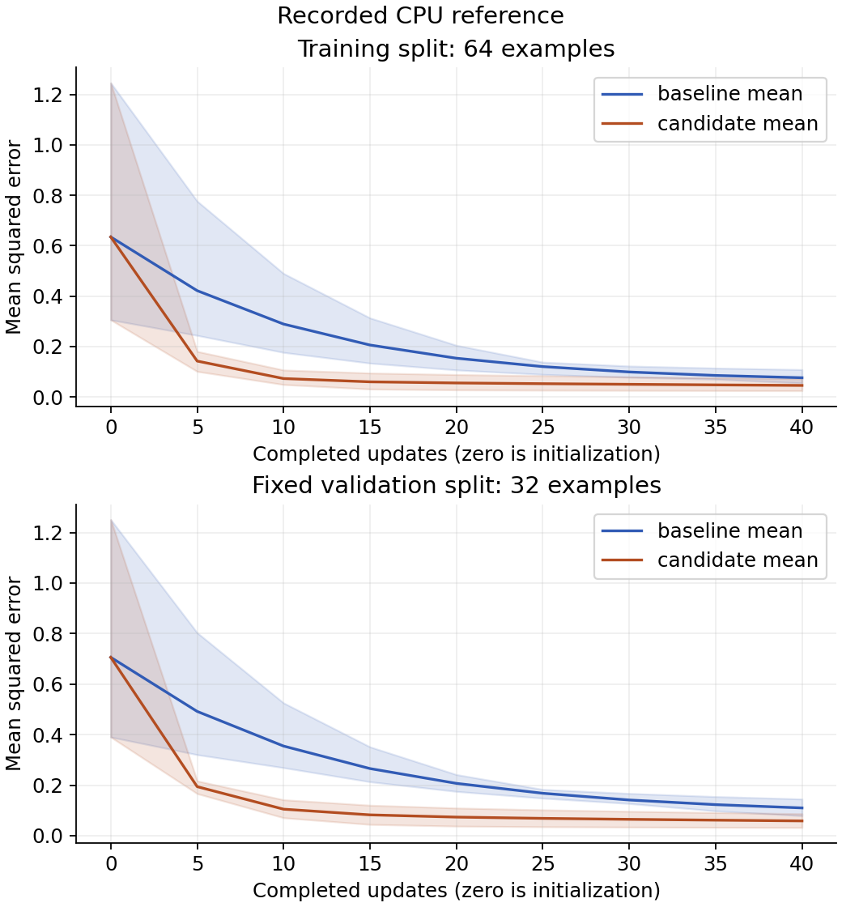
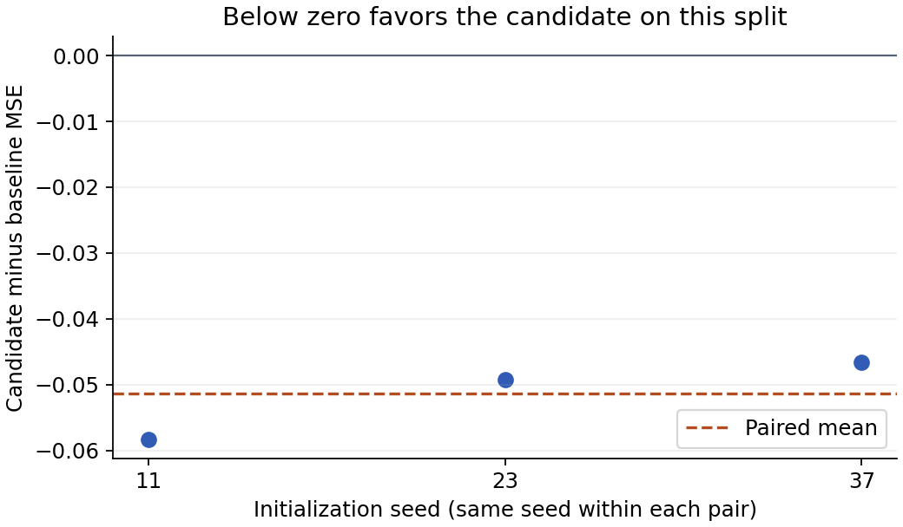

# Research notebook: reproducible JAX/Flax experiments

## Question and declared decision rule

With a fixed synthetic split and model width, learning rate 0.04 will reduce final validation MSE more than 0.01 over 40 full-batch updates.

Inspect every paired seed difference and the descriptive mean and sample SD. Favor the candidate only if all three differences are negative; require a fresh validation plan before extending the conclusion.

## Execution inventory

| Run | Status | Attempts |
| --- | --- | ---: |
| baseline-s11 | completed | 2 |
| baseline-s23 | completed | 1 |
| baseline-s37 | completed | 1 |
| candidate-s11 | completed | 1 |
| candidate-s23 | completed | 1 |
| candidate-s37 | completed | 1 |

## Provenance

Plan SHA-256: `e25dde4100224c96ba5bb5a096b8bf60f59527ce679b96fd044528aca52d567b`.
Data SHA-256: `d3f43eba7ef34bf9593eb02340d5688cb497565584c6d6879333bc6a6e06842f`.

The saved plan, source/, configs/, run environments, metrics and checkpoints identify this comparison.
Full source/config/data checksums detect accidental changes; they are not authenticated attestations.

Machine-readable rows and the complete observation histories are in [comparison.json](comparison.json).
Portable inventory: [comparison.csv](comparison.csv).

## Results

Read each panel separately. Zero is the untrained model; every later observation follows its update. The shaded range spans the smallest and largest seed result at each step, not a confidence interval.

Each point compares the same seed on the same validation examples. Below zero favors the candidate; the dashed line is the paired mean. Seeds vary initialization only, not the fixed dataset.

Paired mean difference: -0.051411131; sample SD: 0.0061274443; pairs: 3.
Constant predictor validation MSE: 0.81955083.

These are descriptive validation results on a synthetic fixture, not evidence of a population-wide advantage.

## Evidence links

- [baseline-s11: metrics](../runs/baseline-s11/attempt-02/metrics.csv), [configuration](../runs/baseline-s11/attempt-02/config.json), [environment](../runs/baseline-s11/attempt-02/environment.json), [checkpoint](../runs/baseline-s11/attempt-02/checkpoint.npz).
- [baseline-s23: metrics](../runs/baseline-s23/attempt-01/metrics.csv), [configuration](../runs/baseline-s23/attempt-01/config.json), [environment](../runs/baseline-s23/attempt-01/environment.json), [checkpoint](../runs/baseline-s23/attempt-01/checkpoint.npz).
- [baseline-s37: metrics](../runs/baseline-s37/attempt-01/metrics.csv), [configuration](../runs/baseline-s37/attempt-01/config.json), [environment](../runs/baseline-s37/attempt-01/environment.json), [checkpoint](../runs/baseline-s37/attempt-01/checkpoint.npz).
- [candidate-s11: metrics](../runs/candidate-s11/attempt-01/metrics.csv), [configuration](../runs/candidate-s11/attempt-01/config.json), [environment](../runs/candidate-s11/attempt-01/environment.json), [checkpoint](../runs/candidate-s11/attempt-01/checkpoint.npz).
- [candidate-s23: metrics](../runs/candidate-s23/attempt-01/metrics.csv), [configuration](../runs/candidate-s23/attempt-01/config.json), [environment](../runs/candidate-s23/attempt-01/environment.json), [checkpoint](../runs/candidate-s23/attempt-01/checkpoint.npz).
- [candidate-s37: metrics](../runs/candidate-s37/attempt-01/metrics.csv), [configuration](../runs/candidate-s37/attempt-01/config.json), [environment](../runs/candidate-s37/attempt-01/environment.json), [checkpoint](../runs/candidate-s37/attempt-01/checkpoint.npz).

## Your interpretation

Write your decision against the declared rule. Explain one seed pair and one visible curve feature. Separate what you observed from the proposed cause. Record the next changed-condition experiment before running it.

No numerical resume was tested here. Retried jobs start from initialization; use the linked recovery lessons for continuation.
Logging is outside the compiled step. Update timings include the update and post-update training loss, while training wall time additionally includes validation and logging. Neither measures distributed scaling.
