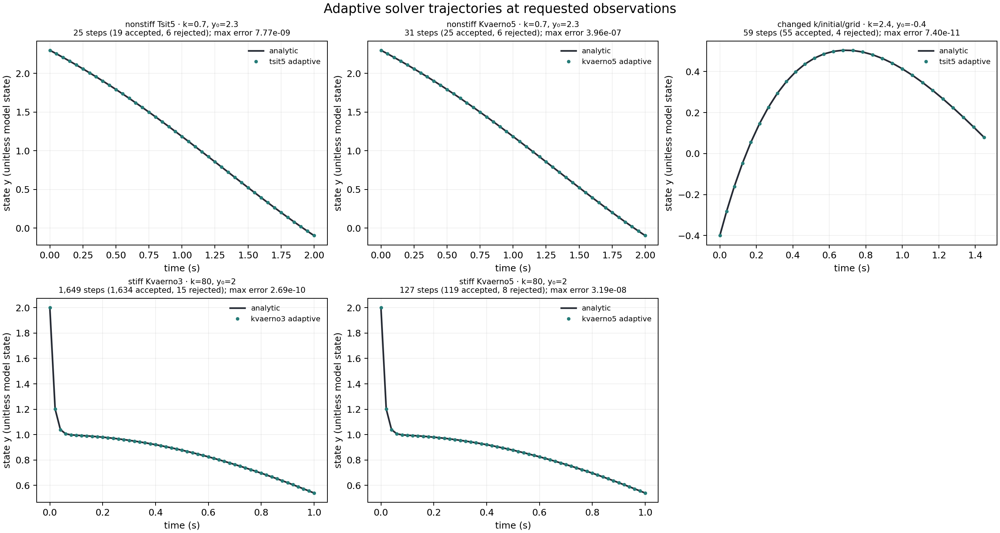
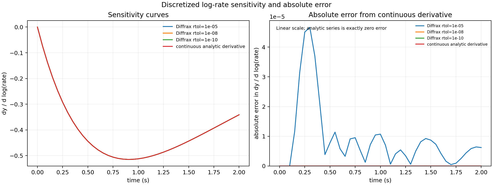
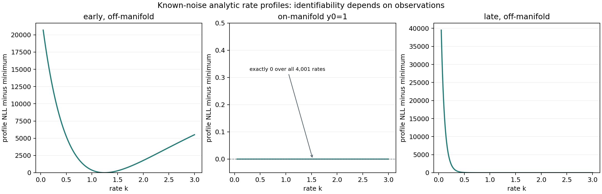

# Audit a differentiable scientific inverse problem

Build a reusable cooling simulator, infer an unknown positive rate, and defend the result with numerical and physical evidence. Complete `science-01` through `science-04` first. This project uses synthetic exponential cooling so independent answers are available; it is not a validation of an actual instrument or a general ODE solver.

## Start and run

Use the course CPU environment in `requirements-cpu.txt`. Run commands from the checkout or extracted bundle's top folder. The scaffold enables float64 before creating arrays.

```sh
# Copy the starter template into your editable workspace file
cp projects/scientific-inverse/starter/model.py projects/scientific-inverse/my_model.py
python3 projects/scientific-inverse/tests/check.py --implementation projects/scientific-inverse/my_model.py --stage 1
```

In Windows PowerShell, use `Copy-Item` instead of `cp`. Keep `my_model.py` as your implementation; the reference stays in `solution/model.py`.

## Stage 1: model and state contract

Implement `simulate(rate, initials, steps=40, dt=0.05)`. Use classical RK4 and explicit scan state. Return a batch-major array `(B, steps+1)` that includes the starting value in column zero. Reject empty or non-vector initials, a nonscalar rate, nonpositive step count and nonpositive step size. Keep the rate differentiable, so do not convert it to a Python float inside the simulation.

Before running, derive the discrete multiplier and predict whether a larger rate should raise or lower the endpoint. Tests compare the entire trajectory with an independent RK4 polynomial and the continuous exponential at two rate/grid settings, including a singleton batch and permuted trajectory order.

Save a shape diagram and a refinement table. Reproduce an overly large Euler step separately; explain why a finite, differentiable result can still violate physical behavior.

## Stage 2: loss and sensitivity

Implement `loss(log_rate, initials, observations, dt=0.05)`. Convert the log parameter to a positive rate with `exp`, simulate the same observation times, and return mean squared error over all batch/time entries. Require exactly `(B, steps+1)` observations with at least two times; do not rely on broadcasting.

```sh
# Run run command in terminal using the course Python environment
python3 projects/scientific-inverse/tests/check.py --implementation projects/scientific-inverse/my_model.py --stage 2
```

Derive the log-rate chain rule before checking it. The checker uses an independent host polynomial and finite differences at two nonoptimal parameters. Save those comparisons, a justified tolerance, and a deliberate detached-gradient failure with its repair. Explain the difference between a derivative of the discretization and a sensitivity of the continuous model.

## Stage 3: inference and measurement

Implement `fit` using the explicit log-rate gradient update documented in the starter. Return the fitted rate and the complete loss history including the initial pre-update value. Implement `evaluate` without fitting or mutating inputs. Report MSE, RMSE, maximum absolute error, trajectory count and observation count.

```sh
# Run run command in terminal using the course Python environment
python3 projects/scientific-inverse/tests/check.py --implementation projects/scientific-inverse/my_model.py --stage all
```

The checks change the generating rate, initial guess and initial conditions; compare full replay; evaluate frozen new initial conditions; refine the simulation grid; and compare one noisy-data fit with an independent dense analytic grid search. A parameter fit that passes only the lesson's original constants is insufficient.

Save a report with data-generation rules and seeds, units, train/held-out split, environment/device/dtype, full learning histories, residual plots, numerical tolerances, an identifiability diagnosis and observed failure/repair. Explain what would change with real measurements: noise model, uncertain initial conditions, model misspecification, measurement times and parameter uncertainty. A single noisy fit is not a confidence interval.

## Inspect the reference after your attempt

```sh
# Run run command in terminal using the course Python environment
python3 projects/scientific-inverse/tests/check.py --implementation solution --stage all
```

Public reference checks establish behavior on bounded CPU fixtures. They do not establish independent scientific review, a certified competency, or accelerator performance. Continue with the [science synthesis assessment](../../assessments/science.md) for a changed problem and reviewer rubric.

## Review handoff: explain a changed condition

Repeat parameter fitting on two finer time grids at the same observation times. Could a different fitted parameter be compensating for discretization error?

**Keep for review:** A table of step size, forward error, inferred parameter and sensitivity error against an independent reference. Separate solver convergence from identifiability and observation noise.

Write your prediction before opening the reference implementation. Distinguish what the existing checker verifies from your proposed extension; record any extension command, actual output and limitation separately. A reviewer should be able to locate the first failed contract from your saved evidence.

## Optional extension: adaptive Diffrax solves

The extension compares a real adaptive ODE solver with the closed form for

\[
y'(t)=-k\bigl(y(t)-\cos t\bigr)-\sin t,
\qquad y(t)=\cos t+(y_0-1)e^{-kt}.
\]

The optional environment stays outside the course CPU environment. From the
repository root, create `.venv-science`, install the complete pinned stack,
copy the starter, and run the independent checker. POSIX shell:

```sh
python3 -m venv .venv-science
source .venv-science/bin/activate
python -m pip install -r projects/scientific-inverse/requirements-science.txt
cp projects/scientific-inverse/starter/diffrax_workflow.py projects/scientific-inverse/my_diffrax_workflow.py
science_evidence="$(mktemp -d)"
python projects/scientific-inverse/tests/check_diffrax.py --implementation projects/scientific-inverse/my_diffrax_workflow.py --evidence-dir "$science_evidence"
```

PowerShell:

```powershell
py -3.14 -m venv .venv-science
.\.venv-science\Scripts\Activate.ps1
python -m pip install -r projects/scientific-inverse/requirements-science.txt
Copy-Item projects/scientific-inverse/starter/diffrax_workflow.py projects/scientific-inverse/my_diffrax_workflow.py
$scienceEvidence = Join-Path $env:TEMP "scientific-inverse-diffrax-check"
python projects/scientific-inverse/tests/check_diffrax.py --implementation projects/scientific-inverse/my_diffrax_workflow.py --evidence-dir $scienceEvidence
```

Implement `solve_forced_decay`, `log_rate_sensitivity`, and `fit_rate` in the
copied file. The initial value means \(y(0)\), so observation times must start
at zero and increase strictly. The checker supplies changed rates, initial
states, and grids; compares saved trajectories with a host NumPy formula;
checks reverse-mode sensitivities against the continuous derivative and centered finite
differences; and tests rate fitting against its own analytic Gaussian profile.
It also checks stiff Kvaerno solves, solver status and step counts, invalid
inputs, input immutability, and structural versus practical identifiability.
The untouched starter must fail because these three APIs raise
`NotImplementedError`.

The checker writes raw arrays, figure data, plots, a report, and a source-bound
receipt outside the project by default. The reference workflow also chooses a
fresh temporary directory unless `--output` is supplied:

```sh
python projects/scientific-inverse/solution/diffrax_workflow.py
```

`trajectories.svg` and `.png` show all five executed solver cases, with requested
time on the horizontal axis and state on the vertical axis. Every panel labels
the solver, rate, initial state, accepted/rejected step counts, and maximum
error against the analytic solution. In the stiff case at rate 80, Kvaerno3
uses 1,649 steps (1,634 accepted and 15 rejected), while Kvaerno5 uses 127
(119 accepted and 8 rejected); both trajectories closely follow the analytic
curve at the plotted output times. The nonstiff Tsit5/Kvaerno5 panels make the
same comparison at rate 0.7. These are adaptive solver-step counts at the same
requested tolerances, not wall-clock speed measurements.

`sensitivity.svg` and `.png` use two panels. The left overlays
\(dy/d\log k\) for three solver tolerances and the continuous derivative; the
lines nearly coincide because all three tolerances give close agreement at
this scale. The right panel plots absolute error from the continuous derivative
on a linear axis, so the exact analytic zero-error series remains at zero
rather than being moved with a plotting substitute. Tightening tolerance
reduces the maximum error in these runs.
The maximum errors are \(4.66\times10^{-5}\), \(2.11\times10^{-8}\), and
\(2.15\times10^{-10}\) for relative tolerances \(10^{-5}\), \(10^{-8}\), and
\(10^{-10}\).

`likelihood-profiles.svg` and `.png` plot known-noise negative log likelihood
minus its minimum against positive \(k\) for early off-manifold, on-manifold,
and late observations. The early panel reuses the exact fit times and
observations. The on-manifold profile is exactly zero over all 4,001 rates;
the small negative axis range lifts that true zero curve off the frame edge,
and the annotation identifies the flat profile. The archived
`figure-data.npz` contains the plotted arrays and sensitivity error arrays;
`raw-evidence.npz` also includes fit residuals, held-out trajectories, and the
Euler instability trace. PNGs are saved alongside the SVGs for convenient
inspection.

The frozen CPU reference run uses Diffrax 0.7.2, JAX/JAXlib 0.9.2, NumPy 2.4.4,
Python 3.14.3, and float64. Tsit5's nonstiff case had maximum absolute error
\(7.77\times10^{-9}\) in 25 steps (19 accepted, 6 rejected). At rate 80,
Kvaerno3 used 1,649 steps and had error \(2.69\times10^{-10}\); Kvaerno5 used
127 steps and had error \(3.19\times10^{-8}\). All reported adaptive solves
succeeded. Sensitivity errors against the continuous derivative fell from
\(4.66\times10^{-5}\) at rtol \(10^{-5}\), to \(2.11\times10^{-8}\) at
\(10^{-8}\), to \(2.15\times10^{-10}\) at \(10^{-10}\). The noisy reference
fit returned rate 1.24537 for generating rate 1.25; the independent analytic
profile grid minimum for those exact fit observations was 1.2454875. At the
fitted rate, profile NLL was 26.660372 versus 26.660444 at the 4,001-point
grid minimum, a signed difference of \(-7.20\times10^{-5}\); the fitted value
lies between grid points. The early off-manifold panel uses the exact training
times and observations used by `fit_rate`. Their combined little-endian
float64 SHA256 (times followed by observations) is
`2be5bb76ee7f5af6161ce185a15609e7518b9d38c127f53a442dc14d1a12edce`, also
recorded and recomputed from the retained raw arrays.







The profiles use early observations at \(t\in[0,1.2]\), on-manifold
\(y_0=1\), and late observations at \(t\in[6,9]\). Across the five plotted
candidate rates, on-manifold prediction spread and profile range are both zero,
which establishes structural non-identifiability for this model. Late-time
profile has a broad low-NLL region because its prediction spread across the
same candidate rates is 0.482, compared with 1.231 for early observations;
that shows reduced practical sensitivity. Profile width here is a fixed-noise
synthetic diagnostic, not a confidence interval. The deliberately coarse explicit Euler stiff solve
reached maximum absolute error \(3.63\times10^8\); the max_steps=1 adaptive
control returned failure after one rejected step. These synthetic profiles
are diagnostics, not confidence intervals or validation against field data.
The archived JSON report explains the plotted axes, values, and limits. Its
`receipt.json` binds each retained asset to the implementation, checker, and
requirements hashes without hashing itself.

The reference uses Tsit5 for a nonstiff case and Kvaerno3/Kvaerno5 with an
adaptive PID controller for a stiff case. It enables float64 before creating
JAX arrays. Diffrax's default `RecursiveCheckpointAdjoint` differentiates the
numerical solve in reverse mode; this is a discretize-then-optimize
sensitivity. Forward-mode JVPs require the explicit `ForwardMode` adjoint.
Tighter tolerances generally improve agreement with the continuous derivative,
but adaptive step choices and finite tolerances still affect the result.
