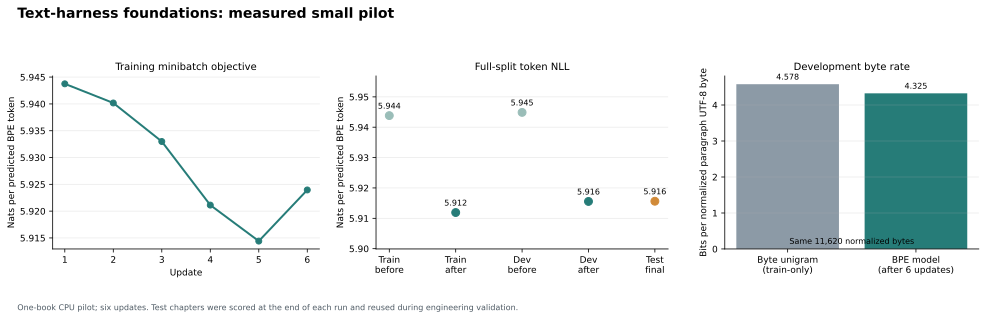

# Decoder foundations: from bytes to a cached causal model

This optional workflow sits beside the original four-stage text harness. It adds a configurable multi-layer decoder and a measured small-data pipeline while leaving the original one-block, width-24 model, checker, cache policies, precision receipts, and export APIs available.

## Data and rights

The corpus is the already-local Project Gutenberg UTF-8 text *Alice's Adventures in Wonderland*, eBook 11, Millennium Fulcrum Edition 3.0. The retained source includes its original header and license text. The manifest records the acquisition URL and date, source hash, rights statement, and chapter map. The source SHA-256 is `01b38ea4c710a84bc18d0bd41271a5a1a92b94e97b2812f4dece97d4a694725e`. Project Gutenberg lists this work as public domain in the United States; local copyright law can differ. See [the rights note](data/LICENSE.md), [the retained source](data/source/alice-pg11.txt), [the Project Gutenberg record](https://www.gutenberg.org/ebooks/11), and [its license](https://www.gutenberg.org/policy/license.html).

Before filtering, deduplication, tokenization, packing, or byte counting, each paragraph has whitespace runs collapsed to one ASCII space and leading/trailing whitespace trimmed. Chapters I–IV are the training group, V is validation, and VI–VIII are the final test group. The data report includes selected record IDs, normalized paragraph byte counts, token exposure, chunks, and truncation counts. BOS/EOS are inserted per chunk, every selected text token is exposed, and no selected token is dropped. Held-out chapters share the author's style, characters, and setting with training.

## Install and run

From the repository root, create and activate the project-local environment, then install the pinned requirements. The output directory is under `runs/`, outside the source and its hash-bound artifacts.

POSIX shell:

~~~sh
python3 -m venv .venv-foundations
source .venv-foundations/bin/activate
python -m pip install -r projects/text-harness/foundations/requirements-foundations.txt
python projects/text-harness/foundations/tests/check_foundations.py \
  --implementation projects/text-harness/foundations/model.py \
  --output runs/text-foundations
~~~

PowerShell:

~~~powershell
py -3 -m venv .venv-foundations
.\.venv-foundations\Scripts\Activate.ps1
python -m pip install -r projects/text-harness/foundations/requirements-foundations.txt
python projects/text-harness/foundations/tests/check_foundations.py `
  --implementation projects/text-harness/foundations/model.py `
  --output runs/text-foundations
~~~

The checker runs actual CPU training, independent numerical checks, cache comparisons, a fresh-process resume, and an inference-package reload. It writes the tokenizer, checkpoints, package, raw report, and source-bound receipt to the selected output directory. Running it again reuses the same fixed chapter split; the test group is scored once at the end of each run.

To implement the learner scaffold, copy it to a working file and fill in its TODOs. Create the output parent first if needed. The incomplete scaffold is expected to fail at its first unimplemented contract.

POSIX shell:

~~~sh
mkdir -p runs
cp projects/text-harness/foundations/starter.py runs/decoder.py
# Edit runs/decoder.py, then run the checker:
python projects/text-harness/foundations/tests/check_foundations.py \
  --implementation runs/decoder.py \
  --output runs/text-foundations-learner
~~~

PowerShell:

~~~powershell
New-Item -ItemType Directory -Force runs | Out-Null
Copy-Item projects/text-harness/foundations/starter.py runs/decoder.py
# Edit runs/decoder.py, then run the checker:
python projects/text-harness/foundations/tests/check_foundations.py `
  --implementation runs/decoder.py `
  --output runs/text-foundations-learner
~~~

The workflow uses Hugging Face `tokenizers` BPE with a ByteLevel pre-tokenizer and decoder, byte fallback, no normalization, and reserved IDs `[PAD]=0`, `[BOS]=1`, `[EOS]=2`, `[UNK]=3`. It fits merges on chapters I–IV only and records the processor hash and training record IDs. A separate 260-entry UTF-8 byte tokenizer supplies the byte-level baseline. Both paths round-trip unseen multibyte text. See the [Tokenizers quicktour](https://huggingface.co/docs/tokenizers/en/quicktour).

## Model and training contracts

`config.py` exposes immutable `ModelConfig` and `TrainConfig`. `model.initialize(key, config)` builds a pre-layer-normalized decoder with configurable vocabulary, context, width, layer count, head count, MLP width, dropout, and tied or untied output weights. `model.parameter_count(config)` is a formula; initialization checks that it matches the actual parameter tree for the requested model. The pilot model has two layers, width 16, four heads, MLP width 32, and 10,880 parameters. A separate width-1024, 21-layer, vocabulary-32000 configuration evaluates to 299,301,888 by formula only. No parameters for that target model are allocated and no 300M training run is claimed.

`model.logits(params, tokens, config, valid_mask, segment_ids, dropout_key)` expects `[batch,time]` token IDs. Attention combines causal, valid-token, and same-document masks. Empty attention rows remain finite; padding targets and cross-document next-token boundaries are excluded from the FP32 token-normalized loss. Dropout is active only when training supplies a fresh key.

`model.prefill` returns last-position logits and per-layer K/V cache state with absolute next position, capacity, and config identity. `model.decode_step` appends one position and rejects incompatible configs and capacity overflow. Greedy `model.generate` blocks PAD/BOS output and stops at EOS. The checker compares cached and full outputs across multiple prompts and nonzero offsets, and deliberately corrupts the second layer's K cache.

`train.initialize_training` creates model parameters, both Adam moment trees, schedule step, PRNG state, epoch/cursor, document permutation, and packed-example order. `train.step` uses FP32 gradients, keyed dropout, warmup/linear scheduling, and Adam. Checkpoints store numeric state and hashes for source, data, processor, configs, and code; loading validates hashes, tree structure, dtypes, shapes, and finite values. The checker compares next-batch IDs, dropout key, loss, parameters, moments, optimizer step, and iterator state after a fresh-process resume. It also checks epoch coverage across a partial batch and rejects a checkpoint when batch configuration changes.

The inference package contains parameters and the tokenizer, not optimizer state. A fresh Python process reloads both and compares prefill/decode logits to the original process. No cloud runtime or Hub upload is used.

## Pilot evidence

The figure has three separate views: six minibatch training losses in nats per predicted BPE token; full-split token NLL in the same BPE-token units; and development bits per normalized paragraph byte for the trained BPE model and train-only byte-unigram baseline. The left curve starts at 5.943746, reaches 5.914412 at step 5, then rises to 5.923953 at step 6. Each point uses a new minibatch and dropout key, so that one-step rise is ordinary batch variation; it neither signals a failed update nor shows that training has converged. Its vertical axis is zoomed to about 0.03 nats/token. The middle panel compares NLL over the full same train and validation splits before and after training; validation NLL falls by about 0.029 nats/token. Those full-split measurements are steadier than the individual minibatch losses. The right panel compares the byte unigram baseline and BPE model on the same 11,620 normalized validation bytes: 4.57832 versus 4.32519 bits/byte. That improvement describes this fixed validation text and does not establish fluent or general language-model quality. Token NLL/perplexity is vocabulary-specific and is not compared across processors.

The pilot trains for six FP32 CPU updates on 133 training paragraphs, evaluates on 61 validation paragraphs, and scores 229 held-out test paragraphs. It uses 23,314/5,889/20,479 exposed train/validation/test tokens, with no truncation. Validation token NLL moves from 5.94488 to 5.91555 nats/token; final test token NLL is 5.91562 nats/token. This is a small single-book pipeline check, not a model-quality or generalization qualification.

Test chapters were scored once at the end of each pilot run. Engineering validation reran the same fixed holdout while correcting the workflow, so these chapters have been inspected repeatedly; the result is not a blind benchmark and should not be treated as one. A losing short run would still be a valid recorded outcome. Physical TPU qualification and larger capstones remain open.

The retained pilot files, including the [raw report](reference/run/pilot-results.json), tokenizer, checkpoint, inference package, resume canaries, and original source-bound receipt, live in `reference/run`. Download the project ZIP to inspect the complete collection. The original receipt is preserved byte-for-byte; [the evidence index](reference/evidence-index.json) maps its original run paths to portable repository paths and records hashes. The report hash is also in the [figure data](reference/pilot-figure-data.json). Recreate the SVG and PNG from the retained report with `python projects/text-harness/foundations/reference/make_pilot_figure.py`; if Matplotlib is not already installed, use `python -m pip install matplotlib==3.10.8`. The script records its input report hash.
